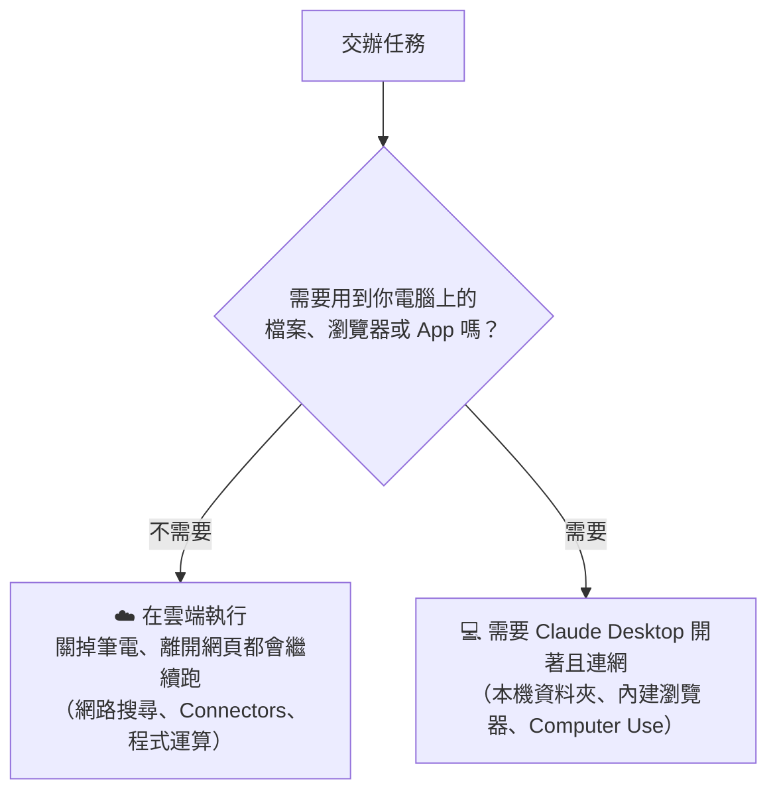

# 代理任務（Agent Tasks）：交辦一件事，Claude 自己做完

> 🔵 **方案需求**：**Pro / Max / Ultra**（逐步開放中）；**Team / Enterprise** 需管理員開啟。Free 方案目前不支援。
> 📖 官方參考：[Claude Cowork and chat are one Claude](https://support.claude.com/en/articles/16761823-claude-cowork-and-chat-are-one-claude) · [Schedule recurring tasks](https://support.claude.com/en/articles/13854387-schedule-recurring-tasks-in-claude-cowork)

**代理任務**是指：你只要說出目標，Claude 就會**自己拆解步驟、使用工具、讀寫檔案、上網查資料**，把一件多步驟的工作完整做完，而不只是回答一個問題。

> 🆕 **2026 改版重點**：以前要在輸入框切換到另一個模式才能交辦任務，現在**已經全部合併到一般對話裡**。你在任何對話中說出需求，Claude 會自己判斷是直接回答，還是開始執行多步驟任務。**不用切換、不用找按鈕。**

---

## 💡 一、一般問答 vs 代理任務

| 比較項目 | 一般問答 💬 | 代理任務 🤖 |
| :--- | :--- | :--- |
| **你說什麼** | 「什麼是 VLOOKUP？」 | 「把這 3 份 CSV 合併對帳，做成有公式的 Excel 和一份簡報」 |
| **Claude 做什麼** | 直接回答 | 規劃步驟 ➔ 寫程式計算 ➔ 產出檔案 ➔ 回報結果 |
| **入口** | 一般對話 | **同一個對話**（Claude 自動判斷） |
| **執行位置** | — | 預設在**雲端**執行，關掉筆電也會繼續跑 |
| **本機檔案** | 需手動上傳 | 在 Claude Desktop 授權資料夾後，可直接讀寫 |
| **上網操作** | 網路搜尋 | 可用 [內建瀏覽器](../Built_in_Browser/README.md) 開網頁、點按鈕、填表單 |
| **操作電腦 App** | — | 可用 [Computer Use](../Computer_Use/README.md) 操作螢幕上的應用程式 |
| **排程** | — | 說一句「每天早上 8 點幫我做」就能建立 [排程任務](../Scheduled/README.md) |
| **額度消耗** | 較低 | 較高，複雜任務才用 |

---

## 🧭 二、雲端 vs 你的電腦：什麼時候要開著 Claude Desktop？



| 功能 | 網頁版 | Claude Desktop | 手機 App |
| :--- | :---: | :---: | :---: |
| 交辦任務、查看進度、給回饋 | ✅ | ✅ | ✅ |
| 雲端執行（關機也會跑） | ✅ | ✅ | ✅ |
| 排程任務 | ✅ | ✅ | ✅ |
| Projects 專案知識庫 | ✅ | ✅ | ✅ |
| 本機資料夾讀寫 | ⚠️ 需 Desktop 開著 | ✅ | ⚠️ 需 Desktop 開著 |
| [內建瀏覽器](../Built_in_Browser/README.md) | ⚠️ 需 Desktop 開著 | ✅ | ⚠️ 需 Desktop 開著 |
| [Computer Use](../Computer_Use/README.md)（Beta） | ⚠️ 需 Desktop 開著 | ✅ | ⚠️ 需 Desktop 開著 |

> 💡 在手機或網頁交辦的任務，如果要碰你電腦裡的檔案或 App，那台電腦的 Claude Desktop 必須**開著且連網**。

---

## 🚀 三、核心能力

### 1. 📁 本機資料夾讀寫
- 在 **Claude Desktop** 授權一個資料夾，Claude 就能直接讀取、分類、重新命名檔案，並把成果寫回資料夾。
- 已授權的資料夾會列在 **Trusted folders** 中；**Storage folder** 設定則決定 Claude 把產出存在哪裡。
👉 實戰：[範例 1：本機資料夾批次整理與報銷總表](./Examples/01_Local_Folder_Organize/)

### 2. 🛡️ 核准模式
| 模式 | 說明 | 適合 |
| :--- | :--- | :--- |
| **Manually approve** | 每個動作前都會暫停，等你按 Allow／Deny | 第一次操作、敏感檔案 |
| **Automatically approve** | 連續執行，但背後會即時做安全檢查，有風險就停下來問你 | 日常工作 |
| **Skip all approvals** | 完全不暫停 | 只在 100% 信任的環境使用 |

👉 實戰：[範例 1](./Examples/01_Local_Folder_Organize/)

### 3. 📝 反白局部修改
Claude 產出長篇草稿後，**反白要改的段落 ➔ Edit with Claude**，只改那一段。
👉 實戰：[範例 2：客訴回信草稿局部修改](./Examples/02_Customer_Feedback/)

### 4. 🤖 背景寫程式計算
處理多份 CSV / Excel 時，Claude 會自己寫 Python 程式做合併、計算與畫圖，避免數字算錯。
👉 實戰：[範例 3：跨來源財務對帳與自動繪圖](./Examples/03_Financial_Report/)

### 5. 🌐 上網查資料＋排程
需要查外部網站時，Claude 可以搜尋或用[內建瀏覽器](../Built_in_Browser/README.md)開網頁閱讀；再說一句「每天早上 8 點幫我做一次」就變成[排程任務](../Scheduled/README.md)，在雲端定時執行。
👉 實戰：[範例 4：產業情報監測與定時晨報](./Examples/04_Daily_News_Brief/)

### 6. 🎯 資料夾指令 vs 專案指令
- **本機資料夾**：放一份 `folder-instructions.md`，Claude 在這個資料夾工作時都會遵守。
- **雲端 Project**：在 Project 的 Instructions 設定規範，專案內每個對話都適用。
- Claude 還能自己維護進度日誌（`PROJECT_LOG.md`），完成就打勾。
👉 實戰：[範例 5：資料夾指令與專案日誌](./Examples/05_Folder_Instructions_Project/)

---

## 🎓 四、5 大職場實戰範例（由淺入深）


| 難度 | 範例 | 情境 | 核心能力 | 練習檔 |
| :---: | :--- | :--- | :--- | :--- |
| **Level 1** | [**範例 1：本機資料夾整理與報銷總表**](./Examples/01_Local_Folder_Organize/) | 下載資料夾堆滿發票與簡報，自動分類歸檔並把單據金額整理成總表 | 📁 本機資料夾讀寫<br/>🛡️ 核准模式 | 📦 [`sample_files.zip`](./Examples/01_Local_Folder_Organize/sample_files.zip) |
| **Level 2** | [**範例 2：客訴分流與局部修改回信**](./Examples/02_Customer_Feedback/) | 大量負評依 SOP 分級，產生道歉信，再反白局部修改 | 📋 依 SOP 判斷<br/>📝 反白局部修改 | 📦 [`sample_files.zip`](./Examples/02_Customer_Feedback/sample_files.zip) |
| **Level 3** | [**範例 3：跨來源財務對帳與自動繪圖**](./Examples/03_Financial_Report/) | 多部門 CSV 對不起來，背景寫程式算達成率並畫圖 | 🤖 背景程式運算<br/>📈 自動繪圖 | 📦 [`sample_files.zip`](./Examples/03_Financial_Report/sample_files.zip) |
| **Level 4** | [**範例 4：產業情報監測與定時晨報**](./Examples/04_Daily_News_Brief/) | 自動上網查競品新聞，設成每天早上的排程 | 🌐 上網查資料<br/>🕒 排程任務 | 📦 [`sample_files.zip`](./Examples/04_Daily_News_Brief/sample_files.zip) |
| **Level 5** | [**範例 5：資料夾指令與專案日誌**](./Examples/05_Folder_Instructions_Project/) | 新產品發表專案，Claude 依規範工作並自動更新進度日誌 | 🎯 資料夾／專案指令<br/>📝 日誌自動維護 | 📦 [`sample_files.zip`](./Examples/05_Folder_Instructions_Project/sample_files.zip) |

---

## 🛠️ 五、快速上手

1. **開新對話**：網頁版、Claude Desktop 或手機 App 都可以。
2. **（需要本機檔案時）授權資料夾**：在 Claude Desktop 選擇要讓 Claude 使用的資料夾。
3. **（選用）選擇 Project**：在 Project 中開對話，Claude 會套用專案檔案與指令。
4. **選擇核准模式**：敏感工作用 **Manually approve**。
5. **說出目標**：講清楚目標、資料來源、輸出格式（建議用 RTCCF）。
6. **觀察與回饋**：Claude 會顯示執行進度；你可以隨時補充指示或喊停。
7. **（選用）變成排程**：任務做完後說「請每週一早上 9 點自動幫我做一次」。

**快速體驗 Prompt**（可直接複製）：

```markdown
## Task
請幫我研究「台灣 2026 年電動機車市占率前三名品牌」，

## Constraint
- 至少參考 3 個不同來源，並附上連結
- 比較各品牌的市占率、主力車款與價格帶

## Format
產出一份 Docs 文件（含比較表），以及一頁 Slides 摘要
```

---

## 💡 六、教學與使用建議

> [!TIP]
> 1. **節省額度**：代理任務消耗的額度比一般問答多很多。單純問答、腦力激盪不用特別要求「自動執行」；需要讀寫多份檔案、批次處理、排程時再交辦。
> 2. **關機提醒**：只用網路搜尋、Connectors、雲端檔案的任務，關機也會跑完；要讀寫本機資料夾、使用內建瀏覽器或 Computer Use 的任務，電腦和 Claude Desktop 都要開著。
> 3. **重要任務用 Manual 核准**：寄信、覆寫財務報表、操作外部網站時，建議逐步確認。
> 4. **方法優先順序**：Claude 會優先使用 **Connectors**（最快最穩），其次是 **瀏覽器**，最後才是 **Computer Use** 直接操作螢幕。

---

← [返回 Claude_AI 主講義](../README.md) | 🏠 [返回專案總首頁](../../README.md)
