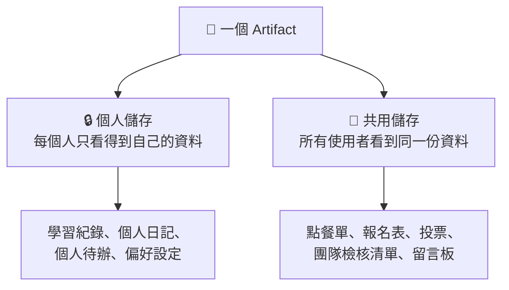

# 資料儲存（Storage）：讓成品擁有「記憶力」

> 2026/9/16 改版後，Artifact 有了**官方的雲端儲存空間**：資料存在 Claude 雲端，換電腦、換手機都還在，而且可以設定成「只有自己看得到」或「大家共用同一份」。
>
> 📖 官方來源：[What are artifacts and how do I use them?](https://support.claude.com/en/articles/17153992-what-are-artifacts-and-how-do-i-use-them)

---

## 💡 為什麼小工具需要「記憶力」？

沒有儲存功能的小工具（待辦清單、記帳表、報名表），只要**重新整理、關掉網頁**，剛剛輸入的資料就全部消失。有了儲存功能，今天填的資料明天打開還在，而且**同事填的資料你也看得到**。

---

## 🎯 方案需求

| 做法 | 方案 | 資料存在哪 | 跨裝置 | 多人共用 |
| :--- | :---: | :--- | :---: | :---: |
| 🆕 **Artifact 儲存（個人）** | 🔵 Pro 以上 | Claude 雲端 | ✓ | ✗ 每人各自一份 |
| 🆕 **Artifact 儲存（共用）** | 🔵 Pro 以上 | Claude 雲端 | ✓ | ✓ 大家同一份 |
| 瀏覽器 `localStorage`（替代方案） | 🟢 Free 可用 | 使用者自己的瀏覽器 | ✗ | ✗ |

> 🟢 **Free 帳號怎麼辦？** 官方儲存功能需要 Pro 以上方案。Free 帳號可以改用瀏覽器 `localStorage`，資料只存在**那一台電腦的那一個瀏覽器**，請參考本文最後的「Free 替代方案」。

---

## 🔐 個人儲存 vs 共用儲存



| | 🔒 個人儲存 | 👥 共用儲存 |
| :--- | :--- | :--- |
| 誰看得到 | 只有輸入的那個人 | 所有使用這個 Artifact 的人 |
| 適合 | 私人資料 | 需要大家一起填的資料 |
| 第一次使用 | 直接使用 | **會跳出確認視窗**，提醒資料會被其他人看到 |

> ⚠️ **由誰決定？** 用哪一種儲存方式是**做這個 Artifact 的人**決定的。使用別人分享的工具時，輸入敏感資料前請先確認它用的是哪一種。

**容量上限**：每個 Artifact 最多 **100 MB** 或 **25,000 筆資料**（以先達到者為準）。

---

## 🧪 實作 1：個人學習打卡紀錄（個人儲存）`🔵 Pro`

```markdown
## Role
你是一位注重使用者體驗的前端工程師。

## Task
做一個「每日學習打卡」Artifact，使用「個人儲存」，每個人只看得到自己的紀錄。

## Context
使用者每天記錄：日期、學習主題、學習分鐘數、心得一句話。

## Constraint
- 顯示本月累積分鐘數、連續打卡天數
- 用月曆標示有打卡的日子
- 可以編輯、刪除自己的紀錄

## Format
互動網頁 Artifact，資料使用個人儲存
```

**驗證方式**：關掉頁面、改用手機打開 Artifact，資料應該都還在。

---

## 🧪 實作 2：研討會籌備檢核清單（共用儲存）`🔵 Pro`

```markdown
## Role
你是一位活動專案管理師。

## Task
做一個「研討會籌備檢核清單」Artifact，使用「共用儲存」，讓籌備小組所有人看到同一份進度。

## Context
預設項目：場地確認、講者邀請、簡報審查、設備租借、茶水點心、報到名單、會後問卷

## Constraint
- 每個項目可指派負責人、設定截止日、勾選完成
- 勾選時自動記錄是誰、什麼時候勾的
- 頂部顯示完成百分比進度條
- 逾期未完成的項目用紅色標示

## Format
互動網頁 Artifact，資料使用共用儲存
```

**驗證方式**：用 **Email 邀請**一位同事（權限設為 **Can edit** 或依需要設定），請對方勾選一個項目，你重新整理後應該可以看到對方的勾選紀錄。

---

## 🏢 職場常見應用

| 應用 | 儲存方式 |
| :--- | :--- |
| 部門下午茶團購點餐單 | 👥 共用 |
| 活動報名表、投票 | 👥 共用 |
| 部門零用金記帳本 | 👥 共用（建議只邀請相關人員） |
| 個人學習紀錄、閱讀筆記 | 🔒 個人 |
| 個人化設定（字體大小、深色模式） | 🔒 個人 |

---

## ⚠️ 注意事項

- **舊版 Artifact（2026/9/16 以前）**：儲存上限只有 20 MB、只能存文字，而且**必須先 Publish 才能用**。**一旦取消發布，所有儲存的資料都會永久刪除**，也無法重新發布。
- **連結訪客**：沒登入的訪客無法使用需要帳號的功能，若工具要記錄「是誰填的」，請改用 Email 邀請或組織內分享。
- **備份習慣**：重要資料建議在工具中加上「匯出 CSV」按鈕，定期備份。

---

## 🟢 Free 替代方案：瀏覽器 localStorage

Free 帳號無法使用官方儲存，但可以請 Claude 把資料存在使用者的瀏覽器中：

```markdown
## Task
做一個「活動籌備檢核清單」HTML Artifact。

## Constraint
1. 使用瀏覽器 localStorage 保存所有項目與勾選狀態，重新整理後資料仍保留
2. 支援新增、勾選完成（加刪除線）、刪除個別項目
3. 頂部顯示完成進度條（%）
4. 提供「匯出 CSV」與「清空全部」按鈕（清空前要二次確認）

## Format
單一 HTML Artifact
```

| 限制 | 說明 |
| :--- | :--- |
| 只存在一台裝置 | 電腦上輸入的資料，用手機打開看不到 |
| 不能多人共用 | 每個人的瀏覽器各自一份 |
| 清除瀏覽器資料就會消失 | 使用無痕模式或清除快取時資料會被清空 |

> 💡 如果需要多人共用或跨裝置，就是升級 Pro、改用官方共用儲存的時機。

---

← [返回 Artifacts 主手冊](../README.md)
