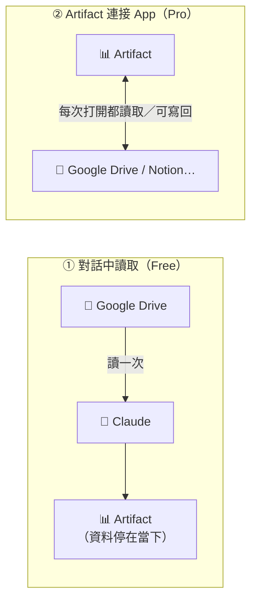

# 外部服務串接（Connectors）：讓成品讀寫真實資料

> 透過 Connectors，Claude 可以直接讀取你的 Google Drive、Gmail、Notion 等服務。2026/9/16 改版後，**Artifact 本身也能連接 App**，做出會持續讀取最新資料的工具和儀表板。
>
> 📖 官方來源：[What are artifacts and how do I use them?](https://support.claude.com/en/articles/17153992-what-are-artifacts-and-how-do-i-use-them) · 延伸閱讀：[Connectors 單元](../../Connectors/README.md)

---

## 🎯 先分清楚兩種用法

| 用法 | 說明 | 方案 |
| :--- | :--- | :---: |
| **① 對話中用 Connector，再產生 Artifact** | 請 Claude 在對話中讀取 Drive 的檔案，然後做成圖表或文件。成品裡的資料是**做的當下**的內容 | 🟢 Free 可用（Connectors 有用量限制） |
| **② Artifact 本身連接 App** | 成品打開時會**自己去讀最新資料**，也可以寫回去 | 🔵 Pro 以上 |



---

## 🧪 實作 1：Drive 試算表 ➔ 業績圖表（對話中讀取）`🟢 Free`

先在 **Settings ➔ Connectors** 連接 Google Drive，然後輸入：

```text
請讀取我 Google Drive 中的「2026年Q3業績明細」試算表，
做成一個可以依「部門」下拉篩選的互動圖表 Artifact，
上方顯示總營收、成長率兩張 KPI 卡片。
```

---

## 🧪 實作 2：會自動更新的 Notion 任務看板（Artifact 連接 App）`🔵 Pro`

```markdown
## Role
你是一位專案管理工具設計師。

## Task
做一個 Artifact，連接我的 Notion「Sprint Tasks」資料庫，顯示成看板（待辦／進行中／完成）。

## Constraint
- 每次打開都讀取最新資料
- 拖拉卡片到其他欄位時，更新 Notion 中的狀態
- 標示逾期任務與無負責人的任務
- 上方顯示本週完成率

## Format
互動看板 Artifact，連接 Notion
```

---

## 🧪 實作 3：Gmail ➔ 專案跟催表 `🟢 Free（對話中讀取）`

```text
搜尋我 Gmail 中主旨含「機房升級」的最近 5 封信，
整理出決議事項和待辦，做成一份有負責人、期限、核取方塊的追蹤表 Artifact。
```

---

## 🔒 分享時的權限與安全

- **每個人用自己的連線**：你分享的 Artifact 被同事打開時，讀取的是**同事自己連接的帳號**，不會讀到你的 Drive 或 Notion。
- **連結訪客不能用**：沒登入的訪客打開時，連接 App 的部分**無法運作**。
- **連接外部網站的限制**：會連接其他網站的 Artifact **不能使用「Anyone with the link」**，也無法用 Email 邀請；這類工具請用組織內分享。
- **寫入要確認**：寫入檔案、寄信等動作會先跳出確認，由你核准後才會執行。
- **組織可關閉**：Team / Enterprise 的管理員可以關閉 Artifact 連接 App 的功能。

---

← [返回 Artifacts 主手冊](../README.md)
