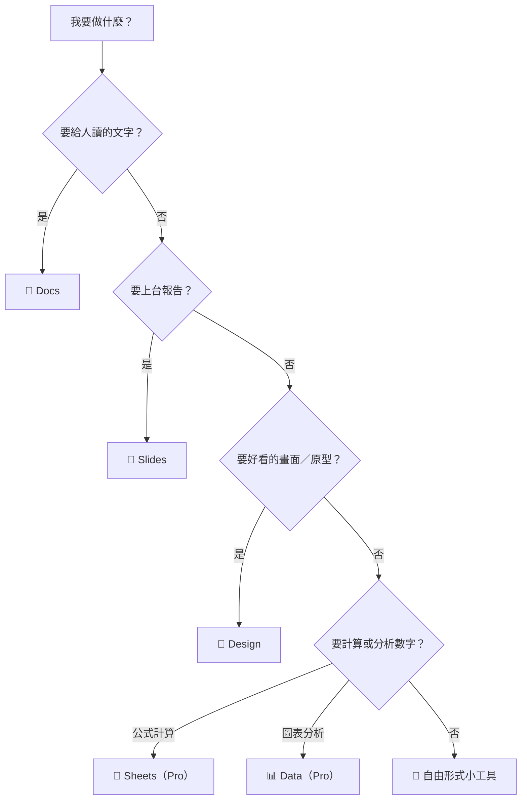

# Artifacts 中心與七大範本全攻略

> 2026/9/16 改版後，Artifacts 從「對話旁邊的預覽視窗」變成獨立的成品中心：所有作品集中在左側欄的 **Artifacts** 分頁，並提供 Docs、Slides、Design、Data、Sheets、Whiteboards、Motion 七種範本。
>
> 📖 官方來源：[What are artifacts and how do I use them?](https://support.claude.com/en/articles/17153992-what-are-artifacts-and-how-do-i-use-them) · [Claude Pricing](https://claude.com/pricing)

---

## 🗂️ Artifacts 分頁：所有作品的家

- **位置**：左側欄 **Artifacts**，或直接開啟 `claude.ai/artifacts`
- **自動收納**：不論是從對話中產生，還是從範本開始，做好的作品都會自動存到這裡
- **找得到**：可以搜尋標題、依類型篩選，也能看到別人分享給你的作品
- **跨裝置**：網頁版、Desktop 可建立、編輯、分享；**iOS / Android App 可檢視與編輯**（分享設定要到網頁版或 Desktop 調整）；Claude Code 也可以發布 Artifact

### 三種開始方式

| 方式 | 怎麼做 |
| :--- | :--- |
| 直接說 | 在任何對話中說「幫我做一份簡報／文件／小工具」 |
| 輸入框選 Output | 訊息框點 **Output** ➔ 選範本 ➔ 輸入需求 |
| 從 Artifacts 分頁 | 左側欄 **Artifacts** ➔ 選範本 |

---

## 🧱 七大範本＋自由形式總覽

| 範本 | 做什麼 | 匯出 | 方案 |
| :--- | :--- | :--- | :---: |
| 📄 **Docs** | 和 Claude、團隊即時共同撰寫的文件 | Word、PDF、Markdown、Google Docs | 🟢 Free |
| 📑 **Slides** | 從筆記或對話內容產生簡報，內建播放 | PowerPoint、PDF、Google Slides | 🟢 Free |
| 🎨 **Design** | 視覺稿、原型、一頁式文宣、Landing page，可套用設計系統 | .zip、PDF、PowerPoint、HTML | 🟢 Free |
| 📊 **Data** | 從連接的資料源做儀表板、數據故事；每張圖都標示查詢方式與更新時間 | — | 🔵 Pro |
| 🧮 **Sheets**（Beta） | 有跨工作表公式的試算表，你和 Claude 編輯同一份表格 | — | 🔵 Pro |
| 🧠 **Whiteboards**（Beta） | 和 Claude、團隊一起腦力激盪的白板 | — | 🔵 Pro |
| 🎬 **Motion**（Beta） | 動畫說明、動態圖表、操作導覽 | MP4 | 🟣 Team / Enterprise |
| 🧩 **自由形式** | 程式碼、流程圖、單頁網站、圖片、小工具 | 檢視程式碼、複製、下載 | 🟢 Free |

> ⚠️ **Team / Enterprise 預設值**：Docs、Slides、Design 預設開啟。Sheets、Whiteboards、Motion 在 Team 預設開啟，在 Enterprise **預設關閉**，需要管理員開啟。

---

## 📄 Docs：協作文件

**特色**
1. **三種修改方式**：叫 Claude 改、自己直接打字、**反白文字 ➔ Edit with Claude** 只改那一段
2. **多人協作**：分享給同事後可以一起編輯或留言
3. **匯出**：Word、PDF、Markdown、Google Docs

**Prompt 範例：產品發表企劃與新聞稿**

```markdown
## Role
你是一位資深科技公關總監。

## Task
請用 Docs 範本建立「新一代企業 AI 協作平台發表企劃與新聞稿」。

## Context
- 產品：NexusWork AI 2026
- 亮點：跨部門知識庫、會議語音即時決策紀錄、機密資料自動去識別化
- 目標媒體：科技媒體、財經媒體

## Format
包含：發表會時程表、新聞稿主標／副標、執行摘要表格、媒體 FAQ、公關聯絡窗口
```

**練習**：反白「新聞稿」段落 ➔ Edit with Claude ➔「改成 300 字以內的英文版」。

---

## 📑 Slides：簡報

**特色**
1. **自動拆頁排版**：給大綱或長篇報告，Claude 自動拆成每頁一個重點並選擇合適版型
2. **線上播放**：按 **Present** 全螢幕播放，不用下載
3. **匯出**：PowerPoint（可在 Office 中繼續修改）、PDF、可編輯的 Google Slides

**Prompt 範例：季度成果匯報（QBR）**

```markdown
## Role
你是一位管理顧問與商務簡報設計師。

## Task
請用 Slides 範本做一份 6 頁的「2026 Q3 智慧製造轉型專案成果匯報」。

## Content
1. 封面（專案名稱、報告人、日期）
2. 執行摘要：3 大 KPI 用大字呈現
3. 痛點 vs 解決方案（左右對照）
4. 導入效益：良率提升 14.8%、巡檢工時減少 40%（用圖表）
5. 挑戰與風險因應表
6. Q4 里程碑時程（Timeline）

## Style
深藍＋金色配色、每頁少字、附講者備忘稿
```

---

## 🎨 Design：視覺設計與原型

**特色**
1. **自然語言做設計**：描述需求就能產生 UI 原型、儀表板版面、一頁式文宣、Landing page
2. **多版本比較**：可要求一次產生多種風格並排比較
3. **設計系統**（部分方案限定）：可以套用公司的品牌色、字型、元件規範，讓每次產出風格一致
4. **匯出**：.zip、PDF、PowerPoint、單一 HTML，或傳送到其他工具繼續編輯

**Prompt 範例：手機 App 首頁原型**

```text
請用 Design 範本設計一個「智慧手錶健康監測 App」的手機首頁原型：
顯示今日步數、心率、睡眠分數三張卡片，下方是一週趨勢圖，
支援深色模式，並給我淺色和深色兩個版本比較。
```

---

## 📊 Data：資料儀表板　`🔵 Pro`

適合從**連接的資料源**或**上傳的 CSV** 做儀表板與數據故事。每張圖表會標示資料查詢方式與更新時間，方便確認數字來源。

```text
請用 Data 範本，讀取我上傳的銷售 CSV，做一個業績儀表板：
4 張 KPI 卡片、月趨勢折線圖、區域比較長條圖，可依區域與產品篩選，
最下方用 3 句話寫出本月重點觀察。
```

---

## 🧮 Sheets：試算表　`🔵 Pro（Beta）`

和 Claude 編輯**同一份表格**，公式可以跨工作表運作。適合預算表、報價單、排班表。

```text
請用 Sheets 範本做「年度部門預算表」：
工作表「明細」列出 12 個月 × 6 個費用科目；工作表「總表」用公式引用明細，
算出每季小計、全年總計與預算使用率，超過 90% 的科目標示紅色。
```

---

## 🧠 Whiteboards：白板　`🔵 Pro（Beta）`

```text
請開一個 Whiteboard，主題是「明年度客戶滿意度提升計畫」，
分成「產品、服務、溝通、流程」四區，每區先放 3 張便利貼點子，
之後團隊補充完再幫我們歸納成優先順序。
```

---

## 🎬 Motion：動畫影片　`🟣 Team / Enterprise（Beta）`

```text
請用 Motion 範本，把「新人報到流程」做成 60 秒動畫說明影片：
分成 5 個步驟，每步驟配一句旁白文字與圖示，最後匯出 MP4。
```

---

## ⚙️ 必要設定

**Settings ➔ Capabilities** ➔ 開啟 **「Create and edit files」**（舊名稱：Code execution and file creation）。
Team / Enterprise 由管理員在 **Organization settings ➔ Capabilities** 開啟。

---

## 💡 怎麼選？



---

← [返回 Artifacts 主手冊](../README.md)
