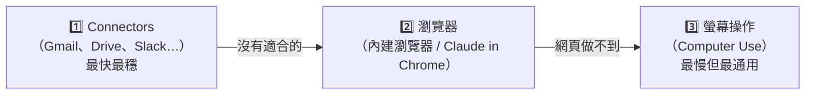

# 🖱️ Computer Use（Beta）：Claude 直接操作你的電腦

> 🔵 **方案需求**：**Pro / Max / Ultra**（Beta）。⚠️ **Team / Enterprise 目前無法使用**；Free 方案不支援。
> 💻 **環境**：**Claude Desktop**（macOS、Windows；Linux 尚未支援）。電腦必須**開機、未休眠**，且 Claude Desktop 要開著。
> 📖 官方參考：[Let Claude use your computer](https://support.claude.com/en/articles/14128542-let-claude-use-your-computer-in-cowork)

---

## 💡 這是什麼？

**Computer Use** 讓 Claude 可以像人一樣**看你的螢幕、移動滑鼠、點擊、打字、開啟應用程式**。當某個工作**沒有 Connector、也不是網頁**（例如 Excel 桌面版、公司內部系統、特殊軟體），Claude 就能直接操作畫面來完成。

### Claude 怎麼選擇做法？

Claude 會**先用最精準的方法**，真的不行才操作螢幕：



---

## ⚙️ 開啟步驟

1. 把 **Claude Desktop** 更新到最新版。
2. 前往 **Settings ➔ Capabilities**，找到 **Computer use**（如果沒看到，請到 **Settings ➔ System** 的 **This computer** 區塊找）。
3. 打開 **Enable computer use**。
4. 開一個新對話，交辦一件需要用到電腦應用程式的任務。

> 如果作業系統跳出權限要求，請依畫面指示到系統設定開啟。

---

## 🔐 權限與控制

| 機制 | 說明 |
| :--- | :--- |
| **每個 App 都要你同意** | Claude 第一次要使用某個應用程式時，會先請你核准 |
| **預設禁止的 App** | 投資、加密貨幣等平台預設不能使用 |
| **封鎖清單** | 你可以把不想讓 Claude 碰的 App 加入封鎖清單，相關要求會自動拒絕 |
| **背景視窗模式**（macOS 15 以上） | 預設在背景視窗操作，每次要接管整個螢幕前會先問你 |
| **完全控制模式** | 可在 Computer use 設定中改成讓 Claude 直接接管螢幕 |

---

## 🎯 使用情境

| 情境 | 範例 |
| :--- | :--- |
| 🗂️ **桌面軟體操作** | 在 Excel / Numbers 桌面版套用格式、建立樞紐分析表 |
| 🏢 **內部系統** | 登入沒有 API 的公司內部系統，匯出報表 |
| 📁 **跨 App 整理** | 從 Finder 找檔案 ➔ 在預覽程式開 PDF ➔ 把重點貼進 Word |
| 🧪 **App 測試** | 在手機模擬器測試 App，回報操作上的問題 |
| 📊 **整合分析** | 結合本機檔案與已連接的工具，做出格式完整的競品分析 |

---

## 🧪 實作範例（Prompt 可直接複製）

> 🔰 **第一次使用建議**：先從「只讀不寫」的簡單任務開始，並使用 **Manually approve** 核准模式，看清楚 Claude 每一步在做什麼。

### 範例 1｜整理桌面截圖　`入門`

```markdown
## Task
請打開 Finder（Windows 為檔案總管），查看我的「桌面」上有哪些截圖檔。

## Constraint
- 只列出清單，先不要移動或刪除任何檔案
- 依日期分組，並說明每張截圖大概是什麼內容

## Format
條列清單，最後建議一個資料夾分類方式讓我確認
```

---

### 範例 2｜Excel 桌面版：建立樞紐分析表　`進階`

```markdown
## Task
請打開我「文件」資料夾中的「2026銷售明細.xlsx」，
用 Excel 桌面版建立一個新工作表「樞紐分析」。

## Constraint
- 列：業務區域；欄：月份；值：銷售金額加總
- 加上一張群組直條圖
- 存檔前先停下來讓我確認畫面

## Format
完成後告訴我做了哪些步驟，以及最高與最低的區域
```

---

### 範例 3｜PDF 重點 ➔ Word 摘要　`進階`

```markdown
## Task
請打開「下載」資料夾中最新的 3 份 PDF 報告，
閱讀後在 Word 開一份新文件，寫出每份報告的 5 點重點摘要。

## Constraint
- 每份報告用一個標題分隔
- 存檔名稱：「報告重點摘要_今天日期.docx」，存在「文件」資料夾
- 不要修改或刪除原始 PDF

## Format
完成後回報檔案位置
```

---

### 範例 4｜內部系統報表下載（依公司環境調整）　`專家`

```markdown
## Task
請打開公司的 [系統名稱] 應用程式（我已經登入），
進入「報表 ➔ 月報」，下載 10 月的出勤報表（Excel 格式），存到「文件/出勤報表」資料夾。

## Constraint
- 每進入一個新畫面就截圖給我確認
- 只做下載，不要修改任何系統設定或資料
- 遇到需要輸入密碼或驗證碼的畫面，請停下來讓我自己處理
```

---

## 🛡️ 安全須知（上課務必說明）

- ⚠️ **Claude 會截圖來看畫面**：螢幕上看得到的東西（包含個資、機密）都可能被看到。開始前請**關閉不相關的視窗**。
- ⚠️ **沒有隔離沙盒**：Claude 在一個 App 的操作可能影響其他 App（例如點連結會在 Chrome 開啟）。
- ⚠️ 官方說明：自動安全檢查所審查的截圖，Anthropic 可能會保留副本。
- 🚫 **避免用於**：網路銀行、醫療、政府服務等敏感 App，以及理財、法律文件、醫療資訊。
- Claude 被訓練成會避開高風險動作（轉帳、刪改檔案、處理敏感資料），也會留意提示注入，**但這些防護並不完美**。
- ✅ **好習慣**：從簡單任務開始、Prompt 寫具體、全程注意 Claude 的操作。

---

## ⚠️ 限制

- 電腦必須**開機、未休眠**，Claude Desktop 要開著。
- 複雜的多步驟任務可能需要重試。
- 操作螢幕比 Connectors 和瀏覽器**慢很多**，能用 Connector 就用 Connector。
- 目前 **Team / Enterprise** 方案無法使用。

---

## ❓ 常見問題

**Q1：Computer Use 和內建瀏覽器差在哪？**
[內建瀏覽器](../Built_in_Browser/README.md)只能操作**網頁**；Computer Use 可以操作**整台電腦的任何應用程式**。網頁任務請優先用瀏覽器，比較快也比較安全。

**Q2：我在手機上交辦任務，Claude 能操作我家裡的電腦嗎？**
可以，但那台電腦要開機、未休眠，且 Claude Desktop 開著並連網。

**Q3：Settings 裡找不到 Computer use？**
請確認：① Claude Desktop 已更新 ② 方案是 Pro / Max / Ultra（Team / Enterprise 目前不支援）③ 到 **Settings ➔ System ➔ This computer** 找找看。

---

← [返回 Claude_AI 主講義](../README.md) · [代理任務](../Agent_Tasks/README.md) · [內建瀏覽器](../Built_in_Browser/README.md)
