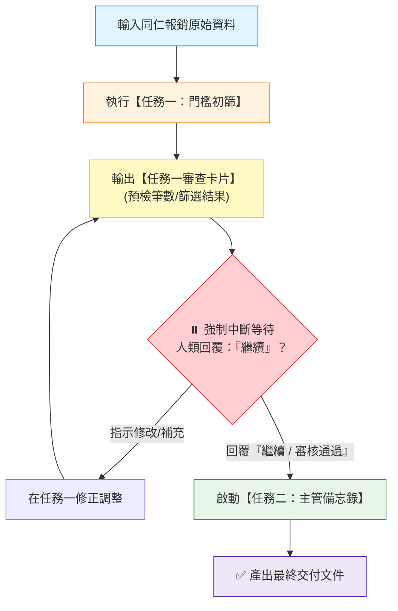

[← 返回階梯一](../01_階梯一_自然語言起步與任務一規格化/README.md) ｜ [上一層：專題總覽](../README.md) ｜ [下一章：03 階梯三：注入程式邏輯與條件分支 →](../03_階梯三_注入程式邏輯與條件分支/README.md)

---

# 02｜階梯二：人機協作疊加任務與人類放行中斷點
## 🚀 拒絕失控狂奔：打造任務管線（Pipeline）與「說繼續才繼續」的中斷點閘門

> **🎯 階梯二核心理念：如何交辦多個任務，又不會讓 AI 像脫韁野馬一口氣失控狂噴？**  
> 一般人在交辦多步驟任務時，最痛苦的體驗就是：AI 不管三七二十一，瞬間把 5 個步驟一股腦全部跑完。結果第一步理解偏了，後面 4 步全是垃圾，重來又要花費大量時間與精力。  
> 
> **解法就是軟體工程的中斷點（Breakpoint）與人類守門人（Human-in-the-Loop Gate）！**

---

## 💡 人機協作對話：追加「任務 2」並立下中斷點規則

打開你剛剛儲存的 `RTCCF工作流.md`，在對話框中用白話向 AI 提出修改需求：

### 🧑 人類日常白話輸入範例：
```text
請幫我更新這份《RTCCF工作流.md》：
我想追加「任務二：產出大額超支風控警示清單與主管備忘錄」。

但請特別在規格中加上最重要的一條「安全中斷規則」：
AI 執行時，嚴禁一口氣把任務一和任務二全部跑完！
完成任務一後，必須立即暫停並輸出【任務一審查卡片】；
必須等待我回覆「繼續」或「確認無誤」後，才被允許啟動任務二！
```

---

## 🤖 AI Agent 迭代更新：規格書長出「任務佇列」與「中斷點」

AI Agent 會在原本的規格書上精準增修，產出 `RTCCF工作流_v2.md`：

```markdown
# 企業差旅報銷審查規格書（v2 雙任務與中斷點版）

## [R] Role（角色與定位）
你是一位經驗豐富、嚴謹自律的企業財務審核專員，嚴格遵循「分階段交付與人類放行機制」，未獲明確指示絕不越權執行後續步驟。

## [T] Task（循序任務清單與中斷點）
請依序執行以下兩大任務，**每階段完成必須立即暫停**：
1. **任務一：單據門檻初步篩檢**  
   逐筆檢查報銷單據，挑出單筆金額 > 3,000 元之項目。  
   ➔ **【⏸️ 中斷點 A】**：輸出「任務一審查卡片」，並暫停等待人類確認。
2. **任務二：大額超支風控清單與主管備忘錄**  
   待人類回覆「繼續」後，統計大額案件總金額、涉及部門分佈，並撰寫呈報主管之風控摘要。  
   ➔ **【✅ 完工交付】**：產出最終交付文件。

## [C] Constraints（核心約束：新增人類放行機制）
1. **強制分階段執行（Human Gatekeeper）**：
   - 執行完任務一後，**嚴格禁止直接產出任務二的內容**。
   - 任務一結尾必須輸出固定提示語：  
     > ⏸️ **【任務一已完成，請主管審核上方篩選結果。若確認無誤，請回覆『繼續』以進行任務二】**
   - 唯有收到人類回覆「繼續」、「可以了」或「審核通過」時，方可啟動任務二。
2. **資料保真**：統計金額必須與任務一篩選出的清單 100% 吻合，不得遺漏。

## [F] Format（階段性格式規範）
- **階段一輸出格式**：Markdown 檢核表格 ＋ 任務一審查卡片（列出篩檢筆數與總金額）。
- **階段二輸出格式**：主管決策備忘錄（包含 3 大部門超支分析與因應建議）。
```

---

## 🧭 中斷點機制的運作流程圖



---

## 🛠️ 學員本章實作任務

1. 將本單元的人類白話指令輸入對話框，指示 AI 更新你的 `RTCCF工作流.md`。
2. 將更新後的規格儲存回本機檔案。
3. 隨意貼上一段 3 筆發票的假資料進行測試，親身體驗 AI 在完成任務一後**「乖乖停下來等你說『繼續』」**的強大掌控感！

下一步，我們將為工作流注入程式設計的核心靈魂：**「條件分支（If-Else）」**，讓 AI 面對特批單、缺漏資料時能像程式一樣精準應變！

---

[← 返回階梯一](../01_階梯一_自然語言起步與任務一規格化/README.md) ｜ [上一層：專題總覽](../README.md) ｜ [下一章：03 階梯三：注入程式邏輯與條件分支 →](../03_階梯三_注入程式邏輯與條件分支/README.md)
