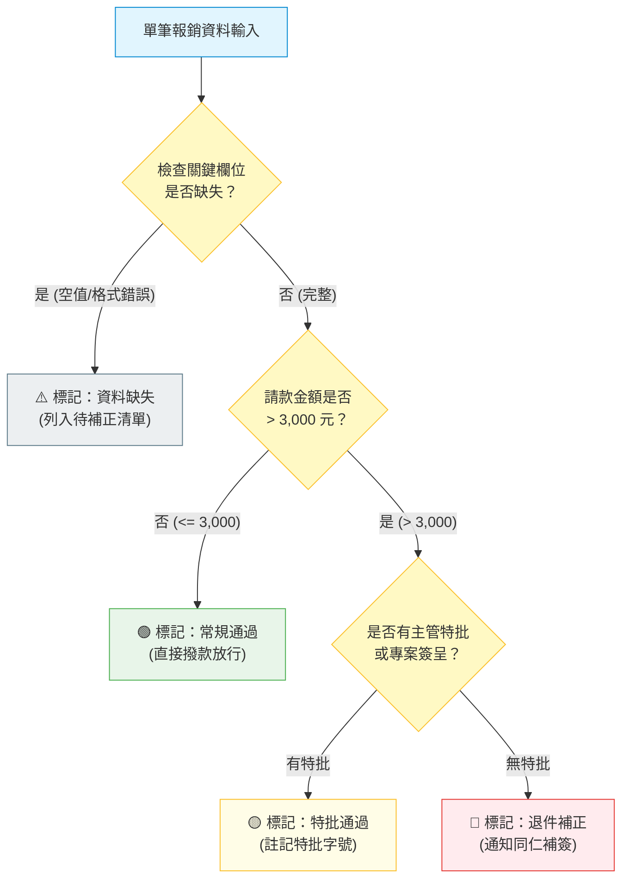

[← 返回階梯二](../02_階梯二_人機協作疊加任務與人類放行中斷點/README.md) ｜ [上一層：專題總覽](../README.md) ｜ [下一章：04 階梯四：自檢迴圈與防呆安全煞車 →](../04_階梯四_自檢迴圈與防呆安全煞車/README.md)

---

# 03｜階梯三：注入程式邏輯與條件分支
## 🚀 杜絕模糊瞎猜：用自然語言寫出無死角的「If-Else 決策樹」

> 🟢 **採用平台**：各類主流 AI Agent（Claude / ChatGPT / Gemini / Antigravity）  
> 🛠️ **建議執行模式**：**多情境條件決策模式**（依據單據狀態分流入四象限，杜絕模糊猜測）

---

## 📦 本階梯實戰素材與提示詞下載專區

| 檔案類型 | 檔案名稱 | 核心作用與說明 | 檢視與下載連結 |
| :--- | :--- | :--- | :---: |
| 📦 **一鍵打包** | `階梯三_條件分支實戰素材包.zip` | 包含本單元所有提示詞、CSV/MD測試資料與分流成果總表 | [📥 **下載 ZIP 壓縮包**](./階梯三_條件分支實戰素材包.zip) |
| 💬 **注入提示詞** | `3-1_白話注入If-Else條件分支指令.md` | 指示 AI 寫入四象限 If-Else 決策樹之白話指令 | [📄 查看提示詞](./3-1_白話注入If-Else條件分支指令.md) |
| 📄 **規格書 v3** | `3-2_AI產出之RTCCF工作流規格_v3.md` | 具備完整決策樹、防呆分支與標籤判定之升級版 RTCCF | [📄 查看規格書](./3-2_AI產出之RTCCF工作流規格_v3.md) |
| 📊 **實務偽素材** | `素材_混合型報銷單據_含特批與缺漏20筆.csv` | 20 筆真實測試資料（含常規、特批、無特批超支、發票缺漏） | [📄 查看素材 (CSV)](./素材_混合型報銷單據_含特批與缺漏20筆.csv) ｜ [MD](./素材_混合型報銷單據_含特批與缺漏20筆.md) |
| 🏆 **示範成果** | `已完成_四象限決策審核總表.md` | 精準分流入 4 大標籤之完整審查明細表與處置指引 | [🏆 查看示範成果](./已完成_四象限決策審核總表.md) |

---

> **🎯 階梯三核心理念：當面對特殊例外、缺漏或邊界情況時，如何不讓 AI 自由發揮或產生幻覺？**  
> 真實企業運作中，規則從來不是單一線性的。  
> 例如報銷：金額小於 3,000 是常規核銷；超過 3,000 但附有主管特批單是特例核准；超過 3,000 且沒附特批單則必須退件。  
> 
> **如果不給 AI 清晰的判斷分支，AI 就會開始「自行腦補」，給出不合規的危險決策！**

---

## 💡 人機協作對話：將業務規則注入為「自然語言條件分支」

在對話中指示 AI Agent 修改 `RTCCF工作流.md`，把審核規則升級為多情境分支矩陣：

### 🧑 人類日常白話輸入範例：
```text
請幫我更新這份《RTCCF工作流.md》的 [Constraints] 限制條件：
請加入嚴謹的審核邏輯分支（If-Else 判斷樹）：
1. 情況 A（常規合格）：IF 金額 <= 3,000 元 且 欄位完整 ➔ 判定為【🟢 常規通過】。
2. 情況 B（特批核准）：IF 金額 > 3,000 元，但備註欄有寫「經理特批」或「專案簽呈」 ➔ 判定為【🟡 特批通過】，並列出簽呈案號。
3. 情況 C（退件補正）：IF 金額 > 3,000 元 且「無任何特批備註」 ➔ 判定為【🔴 退件補正】，並註記需補簽呈。
4. 情況 D（異常缺漏）：IF 發票號碼或金額欄位為空 ➔ 判定為【⚠️ 資料缺失】，直接列入異常清單。
```

---

## 🤖 AI Agent 迭代更新：規格書長出「決策邏輯樹」

AI Agent 會在規格書中將日常口語編譯為標準的邏輯陳述句，產出 `RTCCF工作流_v3.md`：

```markdown
# 企業差旅報銷審查規格書（v3 條件分支版）

## [R] Role（角色與定位）
你是一位經驗豐富、依章審計的財務合規專員，嚴格依據下列「條件分支邏輯（Decision Tree）」執行判斷，絕不自行放寬標準。

## [T] Task（循序任務清單與中斷點）
1. **任務一：單據分類審核與邏輯分流**  
   依據 [Constraints] 中的決策樹，為每一筆單據打上審查標籤（常規通過／特批通過／退件補正／資料缺失）。  
   ➔ **【⏸️ 中斷點 A】**：輸出「審查分類統計卡片」，等待人類回覆「繼續」。
2. **任務二：大額與異常案件專題備忘錄**  
   統計各分類金額佔比，針對【🔴 退件補正】與【⚠️ 資料缺失】產出各部門補件催辦清單。  
   ➔ **【✅ 完工交付】**。

## [C] Constraints（核心約束：注入 If-Else 條件分支）
1. **四象限審查決策樹（Decision Tree）**：
   - `IF` (請款金額 <= 3,000 元 且 必填欄位完整)  
     ➔ 標記【🟢 常規通過】，無需後續追蹤。
   - `ELSE IF` (請款金額 > 3,000 元 且 備註註明「特批/簽呈」)  
     ➔ 標記【🟡 特批通過】，於備註欄高亮註明特批字號。
   - `ELSE IF` (請款金額 > 3,000 元 且 無特批佐證)  
     ➔ 標記【🔴 退件補正】，強制提示「需補陳部門副總簽核文件」。
   - `ELSE` (發票號碼缺漏 OR 金額無法轉化為數字)  
     ➔ 標記【⚠️ 資料缺失】，立即歸入異常資料組，禁止加總入合格金額。
2. **安全中斷放行**：完成任務一分類後必須立即中斷暫停，待人類審查說「繼續」後方可進入任務二。

## [F] Format（格式規範）
- 任務一表格新增欄位：`| 審核狀態 | 處置行動建議 |`
```

---

## 🧭 條件分支邏輯運作圖



---

## 🛠️ 學員本章實作任務

1. 將本單元的白話 If-Else 條件輸入對話框，指示 AI 更新 `RTCCF工作流.md`。
2. 將包含「特批」、「未特批」與「漏寫發票號碼」的混合測試文字餵給 AI。
3. 觀察 AI 是否能 100% 準確分流入 4 大標籤，完全不出現模糊猜測！

下一章，我們將帶你為工作流裝上**「自檢迴圈（Validation Loop）與安全煞車」**，讓 AI 在交件前自己檢查算術加總，且絕不陷入無限死循環！

---

[← 返回階梯二](../02_階梯二_人機協作疊加任務與人類放行中斷點/README.md) ｜ [上一層：專題總覽](../README.md) ｜ [下一章：04 階梯四：自檢迴圈與防呆安全煞車 →](../04_階梯四_自檢迴圈與防呆安全煞車/README.md)
