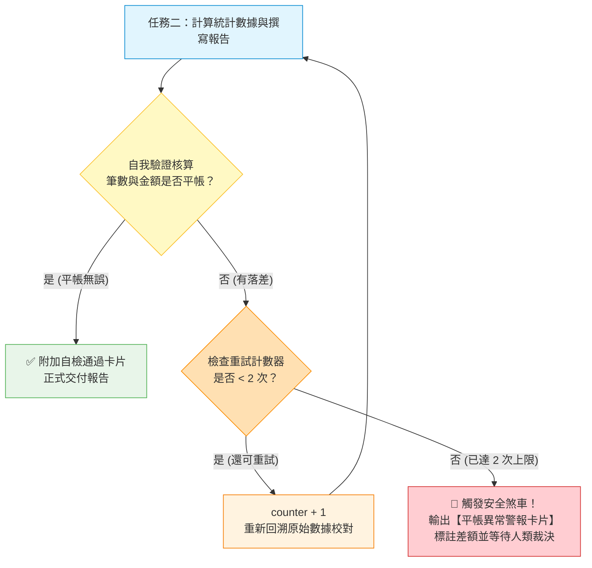

[← 返回階梯三](../03_階梯三_注入程式邏輯與條件分支/README.md) ｜ [上一層：專題總覽](../README.md) ｜ [下一章：05 階梯五：完整工作流規格書落地與實戰調用 →](../05_階梯五_完整工作流規格書落地與實戰調用/README.md)

---

# 04｜階梯四：自檢迴圈與防呆安全煞車
## 🚀 拒絕人工挑錯：讓 AI 具備「自我驗算」能力，並設下最多重試 2 次的安全底線

> **🎯 階梯四核心理念：產出結果後，難道人類還要拿計算機一筆筆重算？**  
> 許多人以為用了 AI 就能省力，結果發現：AI 算術加總偶爾會加錯、分類標籤偶爾會漏勾一兩筆，最後人類還是得花半小時用肉眼手動抓漏。  
> 
> **解法就是程式思維中的「斷言驗證（Validation Assertion）」與「自我修正迴圈（While Loop with Safety Brake）」！**

---

## 💡 人機協作對話：加入「自檢清單」與「有限次修正」

在對話框中指示 AI Agent 更新 `RTCCF工作流.md`，為工作流裝上「交件前的自動品管檢核」：

### 🧑 人類日常白話輸入範例：
```text
請幫我更新這份《RTCCF工作流.md》：
在產出最後報告前，我要強制 AI 執行「自我核算驗證迴圈（Validation Loop）」：
1. 建立自檢標準：
   - 筆數檢查：常規筆數 + 特批筆數 + 退件筆數 + 缺漏筆數，是否 100% 等於輸入總筆數？
   - 平帳檢查：合格總金額 + 特批總金額 + 退件總金額，是否剛好等於同仁申報總金額？
2. 迴圈重試限制（安全煞車）：
   - 如果自檢未通過，AI 必須重新檢視原始單據並自我修正。
   - 但「自我修正重試次數上限為 2 次」！嚴格禁止無窮迴圈。
   - 若重試 2 次後數字依然無法平帳，必須立即中斷暫停，產出【平帳異常警報】，交由人類裁決！
```

---

## 🤖 AI Agent 迭代更新：規格書長出「自我修復與安全防禦力」

AI Agent 會在規格書中加入完整的驗證演算法，產出 `RTCCF工作流_v4.md`：

```markdown
# 企業差旅報銷審查規格書（v4 自檢迴圈與安全煞車版）

## [R] Role（角色與定位）
你是一位兼具稽核與品質工程思維的財務審查 Agent，落實「未經平帳驗證絕不交付成果」之防守原則。

## [T] Task（循序任務清單與自檢斷點）
1. **任務一：單據分類審核與邏輯分流**  
   ➔ **【⏸️ 中斷點 A】**：輸出「審查分類統計卡片」，等待人類回覆「繼續」。
2. **任務二：大額與異常案件專題備忘錄**  
   ➔ 啟動【內部驗證迴圈（Validation Loop）】（詳見 Constraints）。  
   ➔ **【✅ 完工交付】**：附帶「品管自檢確認卡片」。

## [C] Constraints（核心約束：新增驗證迴圈與安全煞車）
1. **品質斷言驗證清單（Verification Rubric）**：
   - [ ] **斷言 1（筆數守恆）**：`常規筆數 + 特批筆數 + 退件筆數 + 缺失筆數 == 輸入總筆數`
   - [ ] **斷言 2（金額平帳）**：`常規金額 + 特批金額 + 退件金額 == 原始請款總金額`
   - [ ] **斷言 3（零編造）**：無任何非原始文字提供的虛擬單據。
2. **While 迴圈與重試計數器（Retry Limit = 2）**：
   - 產出成果前，必須主動執行上述 3 項斷言核算。
   - `IF` 斷言全部通過 ➔ 正式放行輸出報告。
   - `ELSE`（有任何一項不符）➔ 啟動自我修正（重試次數 counter + 1）。
   - **安全煞車**：修正重試上限為 **2 次**。若第 2 次重試後仍無法平帳，**嚴禁硬湊數字！必須立即暫停並拋出【平帳異常紅燈卡片】**，詳列哪一筆金額存在落差，尋求人類會計指示。

## [F] Format（格式規範）
- 報告末端必須固定附上【🛡️ 財務品管自檢確認表】：
  - 輸入總額 vs. 拆分總額比對結果（平帳差額：$0）
  - 自檢重試次數（0 次 / 1 次 / 2 次）
```

---

## 🧭 自檢迴圈與安全煞車運作流程圖



---

## 🛠️ 學員本章實作任務

1. 指示 AI 將自檢迴圈與「重試上限 2 次」的規則更新進 `RTCCF工作流.md`。
2. 刻意給 AI 一組容易算錯或有小數點雜訊的資料，觀察 AI 是否會在報告最後**出示【🛡️ 財務品管自檢確認表】**，宣告自己已經算過一遍且平帳無誤！
3. 體驗將「人眼抓漏」交給「演算法自檢」的極致安心感！

最後一階，我們將這套成熟的規格書**正式落地為數位資產**，並演示如何在真實企業環境中隨調隨用！

---

[← 返回階梯三](../03_階梯三_注入程式邏輯與條件分支/README.md) ｜ [上一層：專題總覽](../README.md) ｜ [下一章：05 階梯五：完整工作流規格書落地與實戰調用 →](../05_階梯五_完整工作流規格書落地與實戰調用/README.md)
