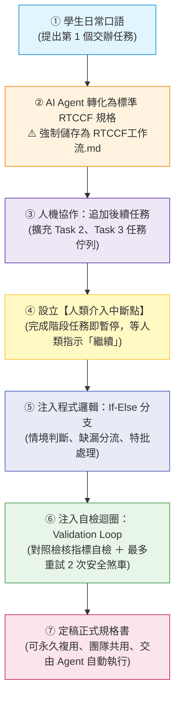

# 人機協作 RTCCF 工作流：打造具備程式邏輯的任務規格書
## 🚀 從日常口語交辦，到 AI Agent 可執行的精密工作流規格

> **🎯 專題核心定位：學員千萬別自己手打 RTCCF！**  
> 很多學員看到一份嚴謹的 RTCCF 或長篇 Prompt 規格書時往往望而卻步，覺得像在寫公文或寫程式一樣痛苦。  
> **請記住：真實的高手絕不是手打整份規格！**  
> 
> 本專題全面導入**「自然語言起手 ➔ 產出任務 1 ➔ 存為 `.md` ➔ 人機協作持續演進」**的敏捷迭代工作流：
> 1. **零門檻口語起手**：學員只需輸入日常口語交辦事項，由 AI Agent 自動轉化為專業 **RTCCF 格式**。
> 2. **核心守則——強制儲存為 `.md` 檔案**：將 AI 生成的規格儲存為 `RTCCF工作流.md`（Markdown 具備結構保真、跨平台零幻覺優勢）。
> 3. **人機協作疊加任務清單**：透過對話追加任務 2、任務 3，並建立**「人類說繼續才繼續」的中斷點放行機制（Human-in-the-Loop）**，徹底制止 AI 一口氣狂奔的失控狀況。
> 4. **注入程式邏輯三大要素**：在規格書中融入**條件分支（If-Else）**、**自檢反思迴圈（Validation Loop）**與**安全煞車（Retry Limit）**，打造無死角的防呆規格書！

---

## 🧭 人機協作標準演進工作流

---

## 📦 實戰資源與素材一鍵下載專區

本專題提供完整的**白話發想提示詞**、**各階段演進之 RTCCF 規格書**、**多類型真實業務偽資料（TXT/MD/CSV/XLSX）**與**已完成交付成果**。學員可點選各別檔案檢視，亦可一鍵打包下載：

> 📥 **全套專題一鍵打包下載**：👉 [**`人機協作RTCCF工作流_全套實戰素材包.zip`**](./人機協作RTCCF工作流_全套實戰素材包.zip)  
> *(內含 5 大階梯全部 25+ 份提示詞、偽素材、Excel 試算表與成果備忘錄)*

---

## 🗺️ 五階漸進實戰學習地圖

本專題由淺入深設計為**五大進階階梯**，以真實職場中最常見的**「企業差旅報銷與合規審查」**貫穿全流程，帶你親手體驗一份規格書如何逐步成長：

| 階梯單元 | 核心學習主題 | 學員口語操作 vs. AI 規格演進 | 核心配套素材與交付成品 | 專屬素材包 |
| :--- | :--- | :--- | :--- | :---: |
| **[🟢 階梯一：自然語言起步與任務一規格化](./01_階梯一_自然語言起步與任務一規格化/README.md)** | **口語轉化 ＆ 存檔守則** | 學員口述：「幫我挑出發票超過 3,000 元的項目」➔ AI 轉寫為標準 RTCCF ➔ **本機存為 `RTCCF工作流.md`** | 💬 [`1-1_白話自然語言發想提示詞.md`](./01_階梯一_自然語言起步與任務一規格化/1-1_白話自然語言發想提示詞.md) 📄 [`1-2_AI產出之RTCCF工作流規格_v1.md`](./01_階梯一_自然語言起步與任務一規格化/1-2_AI產出之RTCCF工作流規格_v1.md) 📑 [`素材_2026Q1各部門差旅報銷申請清單_初審.md`](./01_階梯一_自然語言起步與任務一規格化/素材_2026Q1各部門差旅報銷申請清單_初審.md) 🏆 [`已完成_任務一_單據門檻初篩表格.md`](./01_階梯一_自然語言起步與任務一規格化/已完成_任務一_單據門檻初篩表格.md) | [📥 下載 ZIP](./01_階梯一_自然語言起步與任務一規格化/階梯一_自然語言起步實戰素材包.zip) |
| **[🟡 階梯二：人機協作疊加任務與人類放行中斷點](./02_階梯二_人機協作疊加任務與人類放行中斷點/README.md)** | **任務佇列 ＆ 人工介入 (Human-in-the-Loop)** | 對話追加：「加任務 2 做警告清單，但任務 1 做完要停下，我說『繼續』才能做任務 2」➔ 寫入中斷點 | 💬 [`2-1_白話追加任務二與中斷點指令.md`](./02_階梯二_人機協作疊加任務與人類放行中斷點/2-1_白話追加任務二與中斷點指令.md) 📄 [`2-2_AI產出之RTCCF工作流規格_v2.md`](./02_階梯二_人機協作疊加任務與人類放行中斷點/2-2_AI產出之RTCCF工作流規格_v2.md) 📑 [`素材_企業內部差旅支出管理辦法_節錄.md`](./02_階梯二_人機協作疊加任務與人類放行中斷點/素材_企業內部差旅支出管理辦法_節錄.md) ⏸️ [`已完成_任務一審核卡片_含中斷等待.md`](./02_階梯二_人機協作疊加任務與人類放行中斷點/已完成_任務一審核卡片_含中斷等待.md) 🏆 [`已完成_任務二_大額超支風控警示清單.md`](./02_階梯二_人機協作疊加任務與人類放行中斷點/已完成_任務二_大額超支風控警示清單.md) | [📥 下載 ZIP](./02_階梯二_人機協作疊加任務與人類放行中斷點/階梯二_人機協作中斷點實戰素材包.zip) |
| **[🔵 階梯三：注入程式邏輯與條件分支](./03_階梯三_注入程式邏輯與條件分支/README.md)** | **If-Else 條件判斷** | 對話追加：「金額小於 3,000 合格；超過但有特批單算特批；否則標記退件」➔ 寫入自然語言 If-Else 矩陣 | 💬 [`3-1_白話注入If-Else條件分支指令.md`](./03_階梯三_注入程式邏輯與條件分支/3-1_白話注入If-Else條件分支指令.md) 📄 [`3-2_AI產出之RTCCF工作流規格_v3.md`](./03_階梯三_注入程式邏輯與條件分支/3-2_AI產出之RTCCF工作流規格_v3.md) 📊 [`素材_混合型報銷單據_含特批與缺漏20筆.csv`](./03_階梯三_注入程式邏輯與條件分支/素材_混合型報銷單據_含特批與缺漏20筆.csv) 🏆 [`已完成_四象限決策審核總表.md`](./03_階梯三_注入程式邏輯與條件分支/已完成_四象限決策審核總表.md) | [📥 下載 ZIP](./03_階梯三_注入程式邏輯與條件分支/階梯三_條件分支實戰素材包.zip) |
| **[🟠 階梯四：自檢迴圈與防呆安全煞車](./04_階梯四_自檢迴圈與防呆安全煞車/README.md)** | **While 迴圈自檢 ＆ 重試次數上限** | 對話追加：「產出前核算各項總和是否等於總請款，不合則重算，上限 2 次，防死循環」➔ 寫入 Validation Loop | 💬 [`4-1_白話注入自檢迴圈與重試上限指令.md`](./04_階梯四_自檢迴圈與防呆安全煞車/4-1_白話注入自檢迴圈與重試上限指令.md) 📄 [`4-2_AI產出之RTCCF工作流規格_v4.md`](./04_階梯四_自檢迴圈與防呆安全煞車/4-2_AI產出之RTCCF工作流規格_v4.md) 📗 [`素材_複雜請款明細帳_含小數與稅額30筆.xlsx`](./04_階梯四_自檢迴圈與防呆安全煞車/素材_複雜請款明細帳_含小數與稅額30筆.xlsx) 🛡️ [`已完成_自動平帳審核報告_含品管自檢確認表.md`](./04_階梯四_自檢迴圈與防呆安全煞車/已完成_自動平帳審核報告_含品管自檢確認表.md) 🛑 [`已完成_平帳異常警報卡片範例.md`](./04_階梯四_自檢迴圈與防呆安全煞車/已完成_平帳異常警報卡片範例.md) | [📥 下載 ZIP](./04_階梯四_自檢迴圈與防呆安全煞車/階梯四_自檢迴圈與安全煞車實戰素材包.zip) |
| **[🟣 階梯五：完整工作流規格書落地與實戰調用](./05_階梯五_完整工作流規格書落地與實戰調用/README.md)** | **成熟資產化 ＆ 跨平台調用** | 整合出企業級完整規格書，貼上整批未清洗發票，驗證 AI Agent 循序、分流、自檢、等待放行的完整威力！ | 🏆 [`5-1_企業級完整RTCCF工作流規格書.md`](./05_階梯五_完整工作流規格書落地與實戰調用/5-1_企業級完整RTCCF工作流規格書.md) 💬 [`5-2_一次性調用與資料餵入指令.md`](./05_階梯五_完整工作流規格書落地與實戰調用/5-2_一次性調用與資料餵入指令.md) 📗 [`素材_全公司跨部門差旅報銷真實測試數據50筆.xlsx`](./05_階梯五_完整工作流規格書落地與實戰調用/素材_全公司跨部門差旅報銷真實測試數據50筆.xlsx) 📑 [`已完成_企業差旅合規審查與高階主管風控備忘錄.md`](./05_階梯五_完整工作流規格書落地與實戰調用/已完成_企業差旅合規審查與高階主管風控備忘錄.md) 📝 [`已完成_全流程執行日誌與平帳確認報告.md`](./05_階梯五_完整工作流規格書落地與實戰調用/已完成_全流程執行日誌與平帳確認報告.md) | [📥 下載 ZIP](./05_階梯五_完整工作流規格書落地與實戰調用/階梯五_完整工作流落地全套實戰包.zip) |

---

## 💡 為什麼人機協作工作流需要「程式思維三大要素」？

| 程式思維要素 | 傳統口語 Prompt 的慘痛災情 😭 | 注入工作流規格後的強大威力 ✨ |
| :--- | :--- | :--- |
| **循序管線與中斷點 (Pipeline & Breakpoint)** | 一口氣狂噴數千字，前面第一步算錯，後面步驟全盤皆錯，重來浪費大量 Token 與時間。 | **分階段交付**：AI 完成任務 1 立即出示摘要卡片並暫停，待人類審查說「繼續」才推進任務 2。 |
| **條件分支 (If-Else Selection)** | 遇到特殊情況或缺漏資料時，AI 開始胡亂猜測、自行腦補或編造不存在的事實（幻覺）。 | **多路徑精準分流**：定義好「若符合 A 則...；若符合 B 則...；若都不符則退回詢問」，零模糊空間。 |
| **自檢迴圈與安全煞車 (Validation & Safety Brake)** | 算術加總不對、格式漏缺，全靠人類用肉眼一行行校對挑錯；或者反覆要求修改時 AI 陷入無限道歉死循環。 | **內建評量規準（Rubric）**：產出前自行對照清單檢核，不符則重新修整；並硬性約束最多重試 2 次防死循環。 |

---

## 📋 工作規格送出前自我檢核清單（The 6 Checks）

當你與 AI Agent 協同演進出一份 `RTCCF工作流.md` 後，花 10 秒快速核對以下 6 點：

- [ ] **[R] 角色定位**：是否定義了具備嚴謹審核思維的角色？
- [ ] **[T] 任務序列**：任務是否有明確的先後順序（任務 1 ➔ 任務 2 ➔ 任務 3）？
- [ ] **[C] 中斷放行**：是否要求 AI 每完成一個任務就停下來，等待人類指令「繼續」？
- [ ] **[C] 條件分支**：是否有至少一條清晰的 `IF... ELSE...` 規則處理異常或邊界條件？
- [ ] **[C] 迴圈上限**：自檢迴圈是否明確限制了最大重試次數（如：最多重試 2 次）？
- [ ] **[F] 階段格式**：每個階段的交付格式（審核卡片、表格、清單）是否有具體規範？

---

👉 **準備好體驗人機協作的魅力了嗎？讓我們從第一步開始：**  
[進入 01｜階梯一：自然語言起步與任務一規格化 →](./01_階梯一_自然語言起步與任務一規格化/README.md)
