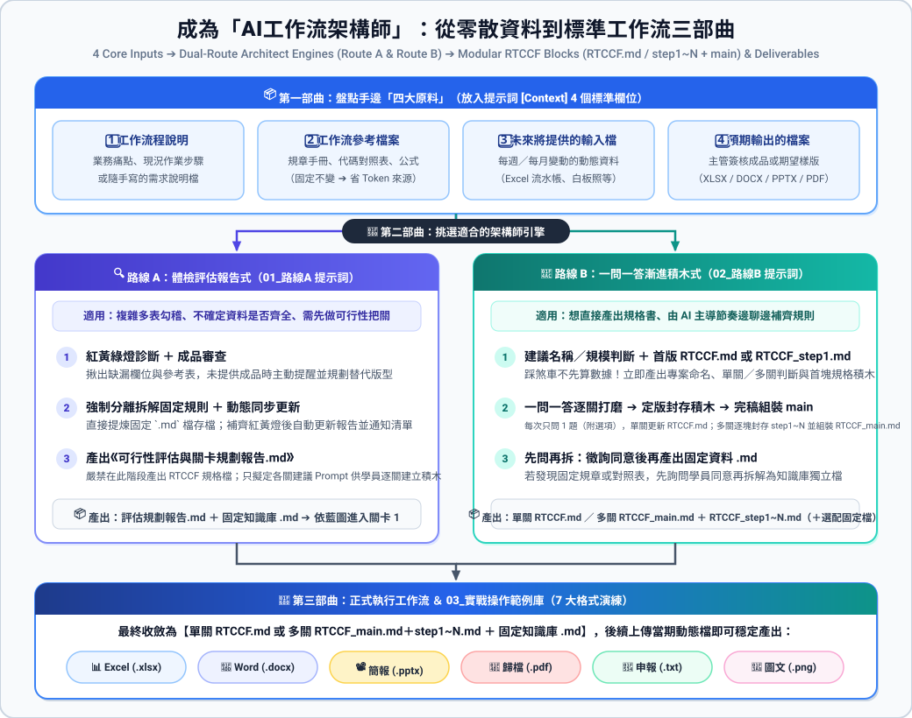

# 🧭 00_AI工作流架構師實戰指南：從零散資料到標準工作流三部曲

> 💡 **本單元核心教學目標（從「會照著做」進化到「能自己設計架構」）**：  
> 在課堂前面的章節，學員看到的案例都是老師預先規劃好關卡、清洗好固定資料表的教具。  
> **但當學員回到自己的職場，面對的往往是一堆格式混亂的 Excel、幾份規章 PDF、幾張白板照片，以及主管口頭交代的一段需求——完全不知道該從哪裡下手！**  
> 
> 本單元專門培養學員具備 **「AI 工作流架構師」的系統規劃思維**，透過以下 3 大核心能力從 0 到 1 打造可重複調用的企業級自動化工作流：
> 1. **素材盤點與風險識別**：學會盤點手邊零散素材、區分「固定知識」、「每次變動的動態輸入」與「預期的輸出」，並提前揪出缺漏風險。
> 2. **漸進式積木優化（Progressive Modular Refinement）**：
>    - **單關任務**：收斂為單一 `RTCCF.md` 規格書。
>    - **多關任務**：逐關封存 `RTCCF_step1~N.md` 子積木，最後組裝成總控 `RTCCF_main.md`。
> 3. **雙路線提示詞落地**：自由選用「路線 A（先全盤體檢再建置）」或「路線 B（一問一答邊聊邊建）」，讓 AI 引導您一步步完成工作流。

---

## 🏗️ 全景藍圖：成為 AI工作流架構師的三部曲

---

## 🛠️ 架構師雙路線核心提示詞（依業務情境二選一啟動）

### 🔍 路線 A：體檢評估引擎（先診斷再開工）
* **適用情境**：業務複雜、多表勾稽、不確定手邊資料是否齊全，需要先做完整可行性健檢與防呆把關。
* **核心機制**：產出 7 大維度《工作流可行性評估與關卡規劃報告.md》與常駐知識庫固定規則 `.md` 檔，揪出缺漏紅黃燈並規劃單關（`RTCCF.md`）／多關積木（`RTCCF_step1~N.md` ＋ 總控 `RTCCF_main.md`）藍圖（支援補齊資料後動態同步更新報告與規則檔）。
* **取得提示詞**：👉 [**`01_路線A_AI工作流架構師評估提示詞.md`**](./01_路線A_AI工作流架構師評估提示詞.md)

### 💬 路線 B：一問一答漸進引擎（邊聊邊建 RTCCF 積木）
* **適用情境**：規則大多已在腦海裡，或希望由 AI 主導節奏一題一題引導，最快直接產出可執行規格書。
* **核心機制**：AI 先建議工作流名稱與說明、判斷任務規模並產出首版規格（單關 `RTCCF.md` ／ 多關首塊積木 `RTCCF_step1.md`）；透過「一問一答（每次 1 題，附 A/B/C 選項）」逐關打磨封存積木、完稿時自動組裝 `RTCCF_main.md`，並先徵詢同意再拆解固定 `.md` 檔。
* **取得提示詞**：👉 [**`02_路線B_互動式漸進生成RTCCF提示詞.md`**](./02_路線B_互動式漸進生成RTCCF提示詞.md)

---

## 🎓 三部曲實戰教學法（講師授課 ＆ 學員自學 SOP）

* [**第一部曲｜四大原料盤點**](./第一部曲_四大原料盤點.md)：教導學員整理「工作流程說明、工作流參考檔案、未來動態輸入檔、預期輸出成品」4 大核心素材。
* [**第二部曲｜雙路線引擎比較**](./第二部曲_雙路線引擎比較.md)：完整對照「路線 A（先體檢再建置）」與「路線 B（一問一答邊聊邊建）」的適用情境與課堂教學節奏。
* [**第三部曲｜7 大分級實戰範例（`03_實戰操作範例庫/`）**](./03_實戰操作範例庫/README.md)：依三大教學梯次提供真實案例演練包（涵蓋 **XLSX、DOCX、PPTX、PDF、TXT、PNG** 成品格式），包含紅燈阻斷補齊演練與一鍵下載 `.zip`。

---

[← 返回學員職場實戰案例庫](../README.md)
