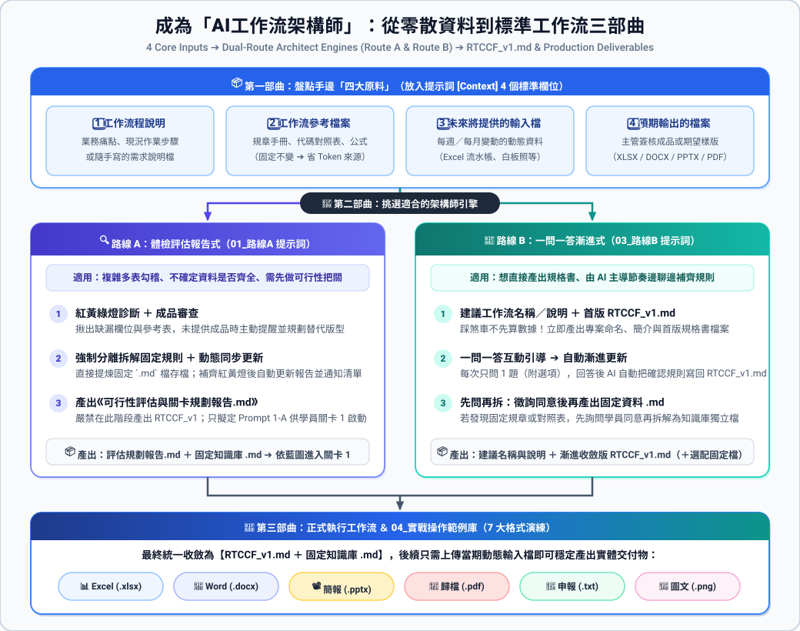

# 🧭 00_AI工作流架構師實戰指南：從零散資料到標準工作流三部曲

> 💡 **本單元核心教學目標（從「會照著做」進化到「能自己設計架構」）**：  
> 在課堂前面的章節，學員看到的案例都是老師預先規劃好關卡、清洗好固定資料表的教具。  
> **但當學員回到自己的職場，面對的往往是一堆格式混亂的 Excel、幾份規章 PDF、幾張白板照片，以及主管口頭交代的一段需求——完全不知道該從哪裡下手！**  
> 
> 本單元專門培養學員具備 **「AI工作流架構師」的系統規劃思維**：學會盤點素材、區分固定知識與動態輸入、識別缺漏風險，並利用雙路線提示詞讓 AI 協助您從 0 到 1 打造出可重複調用的企業級自動化工作流！

---

## 🏗️ 全景藍圖：成為 AI工作流架構師的三部曲

---

## 📂 本專區工具與教材導覽（依教學順序編排）

| 編號與檔案 | 模組定位 | 教學與使用說明 |
| :--- | :--- | :--- |
| 🔍 [**`01_路線A_AI工作流架構師評估提示詞.md`**](./01_路線A_AI工作流架構師評估提示詞.md) | 路線 A：體檢評估引擎 | **先診斷再開工**：產出 7 大維度《評估與關卡規劃報告.md》與固定規則檔，揪出缺漏紅黃燈、規劃單關／多關藍圖（支援補齊後動態同步更新）。 |
| 📑 [**`02_路線A_評估與關卡規劃報告樣版.md`**](./02_路線A_評估與關卡規劃報告樣版.md) | 路線 A 報告標準樣版 | 定義 AI 輸出報告的標準骨架與章節結構，供學員對照與老師授課驗收。 |
| 💬 [**`03_路線B_互動式漸進生成RTCCF提示詞.md`**](./03_路線B_互動式漸進生成RTCCF提示詞.md) | 路線 B：一問一答漸進引擎 | **直接邊聊邊建 RTCCF**：AI 先建議專案名稱與說明並產出首版 `RTCCF_v1.md`，再透過「一問一答（一次 1 題）」自動更新規格，並先問再拆固定 `.md` 檔。 |
| 🧪 [**`04_實戰操作範例庫/`**](./04_實戰操作範例庫/) | 7 大分級實戰範例庫 | 涵蓋 **XLSX、DOCX、PPTX、PDF、TXT、PNG** 所有職場成品格式，附一鍵下載 `.zip` 實作包！ |

---

## 🎓 三部曲實戰教學法（講師授課 ＆ 學員自學 SOP）

### 📦 第一部曲｜架構師基本功：先盤點手邊「四大原料」

教導學員切忌一開始就寫 Prompt 或直接叫 AI 算數字！在啟動對話前，先把手上零散資料歸納進提示詞 `[Context]` 預設的 **4 個標準欄位**（若懶得打字，預設也支援「請依上傳檔案自行判斷」）：

| 原料欄位 | 要放什麼資料？ | 架構師思維重點 |
| :--- | :--- | :--- |
| **1. 工作流程說明** | 業務痛點、現況作業步驟、目標說明檔（`.txt` / `.md`） | 讓 AI 知道「為什麼要做、要解決什麼問題」 |
| **2. 工作流參考檔案** | 規章手冊、代碼對照表、計算公式、門檻定義（`.pdf` / `.docx` / `.xlsx`） | **省 Token 關鍵來源！** 這些不常變動的內容適合抽離成固定知識庫 `.md` |
| **3. 未來將提供的輸入檔** | 每週／每月會重複上傳的動態原始流水帳或現場照片 | 提醒 AI 哪些是「每期會換的輸入」，絕不能將特定月份或單號寫死在規格裡 |
| **4. 預期輸出的檔案** | 過去主管簽核過的成品檔案（Excel/Word/PPT/PDF/截圖），若無亦可說明 | **防止 AI 瞎猜排版！** 有樣版照樣版產出；無樣版則須建立版型規格書或透過問答確認 |

---

### 🔀 第二部曲｜挑選武器：認識「架構師雙路線引擎」

依學員當下的業務複雜度與習慣，課堂可介紹兩條互補的架構設計路線：

| 比較維度 | 🔍 路線 A：體檢評估報告式（[`01_路線A`](./01_路線A_AI工作流架構師評估提示詞.md)） | 💬 路線 B：一問一答漸進式（[`03_路線B`](./03_路線B_互動式漸進生成RTCCF提示詞.md)） |
| :--- | :--- | :--- |
| **最適合的場景** | 業務複雜、多表勾稽、**不確定手邊資料齊不齊全**，需要完整健檢報告與分關設計 | 規則大多在腦海裡或想**最快直接產出 `RTCCF_v1.md`**，喜歡讓 AI 一題一題引導補齊細節 |
| **第 1 輪 AI 做什麼** | 產出《可行性評估與關卡規劃報告.md》＋ 自動提煉固定規則 `.md` 檔（**此階段不產出 `RTCCF_v1.md`**） | 產出「工作流建議名稱與說明」＋ 立即產出首版 **`RTCCF_v1.md`** ＋ 提出第 1 個關鍵問題 |
| **補齊與更新機制** | 遇到紅／黃燈時，學員補充資訊 ➔ **AI 同步覆寫更新報告與固定檔，並回報更新清單（Changelog）** | **一問一答（一次只問 1 題，附 A/B/C 選項）** ➔ 學員每回答一題，**AI 自動漸進更新寫回 `RTCCF_v1.md`** |
| **固定資料拆解方式** | 強制自動提煉分離為獨立的知識庫 `.md` 檔 | 偵測到固定規章／對照表時，**先詢問學員是否同意拆解為固定資料 `.md` 檔**，同意後才拆 |
| **如何啟動執行** | 綠燈後，複製報告第六章建議的 **Prompt 1-A** 開啟關卡 1 產出 `RTCCF_v1.md` | 問答收斂至無任何待確認項目後，開新對話上傳當期輸入檔，照 `RTCCF_v1.md` 直接執行 |

> 🧑‍🏫 **老師上課實戰節奏建議（雙刀流教法）**：
> 1. **先用「路線 B（一問一答）」搭配簡單案例破冰**：讓學員體驗 5~10 分鐘內從零散說明產出工作流建議名稱與 `RTCCF_v1.md`，成就感最高！
> 2. **再用「路線 A（評估報告）」搭配「範例 3（紅燈補齊）」深化架構思維**：讓學員看懂「資料缺漏會產生幻覺，必須紅燈阻斷」、「多關卡必須每關輸出 `.md` 作為人機協作斷點」的企業級防呆觀念！

---

## 🧪 第三部曲｜7 大實戰範例庫（三梯次階梯式課堂演練）

本範例庫全數採用學員過去真實的原始素材與成品，已全部打包為 `.zip` 下載檔。建議課堂依下列 **三大教學梯次** 由淺入深進行演練：

---

### 🟢 第一梯次：課堂必練核心（建立單關閉環與紅燈防呆意識）

#### ⚡ 範例 01：【最淺・單關閉環 ➔ Excel】跨平台行銷投放數據交叉分析
* 📂 **資料夾與一鍵下載包**：[`04_實戰操作範例庫/範例1_.../`](./04_實戰操作範例庫/範例1_最淺單關閉環_跨平台行銷數據分析/) ｜ 📥 [**`範例1_最淺單關閉環_跨平台行銷數據分析.zip`**](./04_實戰操作範例庫/範例1_最淺單關閉環_跨平台行銷數據分析/範例1_最淺單關閉環_跨平台行銷數據分析.zip)
* 🎓 **對應完整專案**：[`2026_09_07 跨平台成效數據交叉分析與異常診斷自動化`](../2026_09_07_AI工具提示詞設計與智慧辦公效率提升班/跨平台成效數據交叉分析/README.md)
* 📌 **知識庫固定檔案**：[`廣告指標與預算規則.md`](./04_實戰操作範例庫/範例1_最淺單關閉環_跨平台行銷數據分析/廣告指標與預算規則.md)
* 🚦 **診斷狀態**：🟡 **黃燈（可作單關練習版；正式週報需補齊轉換價值欄位計算 ROAS ➔ 建議規劃：1 道關卡閉環）**
* 💡 **課堂教學重點**：
  1. **拒絕過度設計**：任務單純時 1 個關卡即可閉環完成，不為拆而拆。
  2. **無成品檔替代方案示範**：當學員沒有過去的成品檔案時，如何透過《週報版型規格》或問答鎖定欄位與樣式，避免 AI 瞎猜！

#### 🔴 範例 03：【真實痛點・紅燈補齊 ➔ 法定 TXT】營業稅電子申報媒體檔
* 📂 **資料夾**：[`04_實戰操作範例庫/範例3_.../`](./04_實戰操作範例庫/範例3_資料缺漏需補齊_營業稅法定申報檔/)
* 📦 **課堂雙階段下載包**：
  - 1️⃣ 🔴 **體驗紅燈診斷包**：📥 [**`範例3_資料缺漏需補齊_營業稅法定申報檔.zip`**](./04_實戰操作範例庫/範例3_資料缺漏需補齊_營業稅法定申報檔/範例3_資料缺漏需補齊_營業稅法定申報檔.zip)
  - 2️⃣ 🟢 **補齊後通關實作包**：📥 [**`範例3_補齊素材後_通關實作包.zip`**](./04_實戰操作範例庫/範例3_資料缺漏需補齊_營業稅法定申報檔/補齊素材後_可供通關測試/範例3_補齊素材後_通關實作包.zip)
* 🎯 **最終交付實體成果**：📥 [**`營業稅81字元法定申報檔_完成成果.TXT`**](./04_實戰操作範例庫/範例3_資料缺漏需補齊_營業稅法定申報檔/補齊素材後_可供通關測試/最終交付實體成品_TXT/營業稅81字元法定申報檔_完成成果.TXT)
* 🚦 **診斷狀態**：🔴 **紅燈阻斷警告 ➔ 🟢 補齊素材後通關（建議規劃：2 道關卡）**
* 💡 **課堂教學重點（強力推薦必講！）**：
  1. **步驟 1（體驗紅燈）**：上傳缺漏統編與代碼的原始檔，讓 AI 亮紅燈阻斷，體驗「絕不在缺漏資料上瞎猜幻覺」。
  2. **步驟 2（補齊轉綠燈）**：換上補齊後的素材重新評估／補充，看 AI 立即亮起 🟢 綠燈並同步產出更新後的報告與規則檔，引導完成法定 81 字元 TXT 產出！

---

### 🟡 第二梯次：進階多表勾稽與多模態混合

#### 📊 範例 02：【進階・多表勾稽 ➔ 實體 Excel】出納付款審核與銀行網銀放行
* 📂 **資料夾與一鍵下載包**：[`04_實戰操作範例庫/範例2_.../`](./04_實戰操作範例庫/範例2_進階多表勾稽_出納付款審核與放行/) ｜ 📥 [**`範例2_進階多表勾稽_出納付款審核與放行.zip`**](./04_實戰操作範例庫/範例2_進階多表勾稽_出納付款審核與放行/範例2_進階多表勾稽_出納付款審核與放行.zip)
* 🎓 **對應完整專案**：[`2026_09_07 出納付款審核與銀行放行總表自動化`](../2026_09_07_AI工具提示詞設計與智慧辦公效率提升班/出納付款審核與銀行放行總表自動化/README.md)
* 🎯 **最終交付實體成果**：📥 [**`01_付款放行歸戶總表_完成成果.xlsx`**](./04_實戰操作範例庫/範例2_進階多表勾稽_出納付款審核與放行/最終交付實體成品_XLSX/01_付款放行歸戶總表_完成成果.xlsx)
* 🚦 **診斷狀態**：🟢 **綠燈（建議規劃：2 道關卡）**
* 💡 **教學重點**：多部門請款多對一歸戶合併、手續費內外扣防呆，示範兩關之間透過 `.md` 進行人工驗收中斷點。

#### 📝 範例 04：【多模態辨識 ➔ 實體 Word】工程監造手寫白板辨識與施工日誌
* 📂 **資料夾與一鍵下載包**：[`04_實戰操作範例庫/範例4_.../`](./04_實戰操作範例庫/範例4_高階多模態複雜混合_工程白板照片辨識/) ｜ 📥 [**`範例4_高階多模態複雜混合_工程白板照片辨識.zip`**](./04_實戰操作範例庫/範例4_高階多模態複雜混合_工程白板照片辨識/範例4_高階多模態複雜混合_工程白板照片辨識.zip)
* 🎓 **對應完整專案**：[`2026_09_07 工程監造白板照片辨識`](../2026_09_07_AI工具提示詞設計與智慧辦公效率提升班/工程監造白板照片辨識/README.md)
* 🎯 **最終交付實體成果**：📥 [**`01_公共工程施工查驗紀錄表_完成成果.docx`**](./04_實戰操作範例庫/範例4_高階多模態複雜混合_工程白板照片辨識/最終交付實體成品_DOCX/01_公共工程施工查驗紀錄表_完成成果.docx)
* 🚦 **診斷狀態**：🟢 **綠燈（建議規劃：3 道關卡）**
* 💡 **教學重點**：展示輸入素材不只是 Excel，還能納入現場手機白板照片，結合合約公差規格套表生成正式 Word 查驗表。

---

### 🔵 第三梯次：多元職場實體成品選修（PPTX / PDF / PNG）

| 範例編號 | 主題與對應專案 | 一鍵下載包（ZIP） | 實體交付格式與教學亮點 |
| :---: | :--- | :--- | :--- |
| **範例 05** | **觀光飯店訂房月報動態生成** ([`原專案`](../2026_09_07_AI工具提示詞設計與智慧辦公效率提升班/訂房月報統計與 PPT 自動化/README.md)) | 📥 [**`範例5_營運月報動態簡報生成_PPTX.zip`**](./04_實戰操作範例庫/範例5_營運月報動態簡報生成_PPTX/範例5_營運月報動態簡報生成_PPTX.zip) | 📽️ **實體 `.pptx` 簡報**（綠燈／2 關） [`完成成果.pptx`](./04_實戰操作範例庫/範例5_營運月報動態簡報生成_PPTX/最終交付實體成品_PPTX/01_觀光飯店訂房營運月報_完成成果.pptx)：從訂房流水帳計算 ADR、RevPAR，透過母片佔位符生成 16:9 簡報。 |
| **範例 06** | **費用報銷傳票四合一電子歸檔** ([`原專案`](../2026_10_19_Claude_ai_職場效能全攻略/費用報銷審核與憑證傳票四合一歸檔自動化/README.md)) | 📥 [**`範例6_憑證審核與傳票四合一歸檔_PDF.zip`**](./04_實戰操作範例庫/範例6_憑證審核與傳票四合一歸檔_PDF/範例6_憑證審核與傳票四合一歸檔_PDF.zip) | 📑 **階層書籤 `.pdf`**（綠燈／4 關） [`完成成果.pdf`](./04_實戰操作範例庫/範例6_憑證審核與傳票四合一歸檔_PDF/最終交付實體成品_PDF/費用報銷憑證四合一電子歸檔_完成成果.pdf)：發票勾稽、4 碼會計分錄與四合一憑證整合，示範多關漸進架構。 |
| **範例 07** | **品牌社群多平台多尺寸視覺圖** ([`原專案`](../2026_09_07_AI工具提示詞設計與智慧辦公效率提升班/社群行銷素材多格式產出/README.md)) | 📥 [**`範例7_品牌社群多平台視覺素材渲染_圖片PNG.zip`**](./04_實戰操作範例庫/範例7_品牌社群多平台視覺素材渲染_圖片PNG/範例7_品牌社群多平台視覺素材渲染_圖片PNG.zip) | 🎨 **多尺寸 `.png` 圖片**（綠燈／2 關） 同步產出 [IG 正方形](./04_實戰操作範例庫/範例7_品牌社群多平台視覺素材渲染_圖片PNG/最終交付實體成品_圖片PNG/01_IG正方形貼文_1080x1080.png) / [FB 橫式](./04_實戰操作範例庫/範例7_品牌社群多平台視覺素材渲染_圖片PNG/最終交付實體成品_圖片PNG/01_FB橫式貼文_1200x630.png) / [官網 Banner](./04_實戰操作範例庫/範例7_品牌社群多平台視覺素材渲染_圖片PNG/最終交付實體成品_圖片PNG/01_官網橫幅Banner_1920x600.png)。 |

---

[← 返回學員職場實戰案例庫](../README.md)
