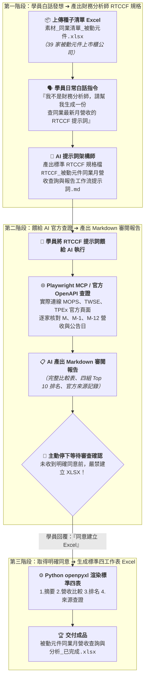

# 9-1 白話自然語言發想提示詞（生成財務研究分析師 RTCCF 規格與同業月營收工作流）

> 💡 **核心精神**：學員**並不是專業的「證券投研分析師」或「財務資料研究員」**，手邊只有一張記載了 39 家被動元件上市與上櫃同業代號的 Excel 簡易名單！  
> 學員**不需要自己手動去公開資訊觀測站（MOPS）翻查 39 次營收公告與計算機狂按**，只要上傳這份 Excel 檔，用日常的大白話向 AI 下達發想指令：  
> 1. 請 AI 幫忙架構一份**以「專業財務資料研究分析師」為角色（Role）的 RTCCF 格式 Markdown 提示詞規格檔**。  
> 2. 指示 AI 透過 **Playwright MCP** 真實瀏覽器與官方 OpenAPI 連線臺灣證券交易所（TWSE）、櫃買中心（TPEx）與公開資訊觀測站（MOPS），**實際核對最新月份營收（M、M-1、M-12），計算月增減、月增率、年增減與年增率**。  
> 3. **嚴格落實兩階段流程**：第一階段先產出可審閱的 Markdown 報告並停下來等待確認；**未取得明確同意前，絕對不生成 Excel 檔案**！  
> 4. 取得明確同意後，第二階段再依據標準四工作表（摘要、營收比較、排名、來源查證）自動生成 Excel 活頁簿。

---

## 🎯 核心工作流：從白話指令到真實查證兩階段防線



---

## 💬 複製即可使用之白話發想指令（一般學員真實口吻）

學員在 AI 對話視窗（ChatGPT Plus / Claude / Gemini Advanced）中，**先上傳《素材_同業清單_被動元件.xlsx》**，並直接貼上以下這段最純粹的大白話發想指令：

```text
你好，主管剛剛丟給我一份 Excel 檔案《素材_同業清單_被動元件.xlsx》，裡面有台灣 39 家被動元件上市與上櫃公司的代號、名稱與主要產品。

主管要我依「當下的最新日期」，去查出這 39 家公司最新的「單月營收」，並計算月增率（MoM）和年增率（YoY），還要抓出成長最快跟衰退最多的前 10 名排行榜，最後產出一份正式的 Excel 報表給主管審核。

但我根本不是專業的證券投研分析師，面對這 39 家公司手動查 MOPS（公開資訊觀測站）會查到瘋掉，而且我很擔心 AI 會「通靈」隨便捏造假的營收數字！

請你扮演頂級的提示詞架構師，以一位「熟悉台灣上市櫃公司月營收公告與公開資訊查詢方式的財務資料研究分析師」的專業角度，幫我寫一份標準的 RTCCF 格式 Markdown 提示詞規格檔：

1. 查證規範：必須指示 AI 透過瀏覽器工具（如 Playwright MCP）或官方 OpenAPI，實際連線公開資訊觀測站（MOPS）、臺灣證券交易所（TWSE）或櫃買中心（TPEx）核對真實數據，不可以只確認網址或憑記憶瞎掰。
2. 兩階段防線（超級重要）：
   - 第一階段：AI 必須先依據執行當下月份（判定 M、M-1、M-12）查出各公司數據、計算月增減金額、月增率、年增減金額與年增率，產出一份包含完整比較表、四組排名與官方來源記錄的繁體中文 Markdown 報告，並儲存在工作區供我下載。
   - 停下來等待：交付 Markdown 報告後，AI 必須立刻停下來，詢問我是否審閱同意建立 Excel。在沒有收到我明確回覆「同意建立 Excel」之前，嚴禁產出任何 XLSX 檔案！
3. 第二階段標準 Excel：
   - 收到我明確同意後，AI 才能建立 Excel，且格式必須固定包含標準四張工作表：
     • 工作表 1：摘要（涵蓋率、月增減家數、本月重點、未取得資料列）
     • 工作表 2：營收比較（固定 12 欄、千分位、保留前導零、百分比保留兩位小數、Excel 算式）
     • 工作表 3：排名（月增率最高/最低各前 10、年增率最高/最低各前 10）
     • 工作表 4：來源查證（固定 6 欄、資料年月、公告出表日、官方可點選來源連結）

請直接產出完整的 Markdown 規格內容，讓我能直接儲存為 Markdown 檔案格式（建議檔名：`RTCCF_被動元件同業月營收查詢與報告工作流提示詞.md`），方便我在本地儲存、檢視與人機協作微調，謝謝！
```

---

## 💾 步驟成果：儲存為 Markdown 檔案格式（.md）

AI 回覆產出標準 RTCCF 提示詞後，學員請進行以下操作：
1. **複製 AI 產出內容**：點擊 AI 對話框右上角的複製按鈕。
2. **儲存為 Markdown 檔案**：在本地專案資料夾中新建檔案，儲存為 [**`RTCCF_被動元件同業月營收查詢與報告工作流提示詞.md`**](./RTCCF_被動元件同業月營收查詢與報告工作流提示詞.md)。
3. **進行人機協作（Human-in-the-loop）**：學員可在任何文字編輯器（VS Code / 筆記軟體）中開啟這份 `.md` 檔案，自由檢視、補充特殊核對邏輯或確認欄位需求。
4. **進入步驟 9-2**：確認內容後，將該 Markdown 提示詞整段餵給 AI，AI 就會啟動 Playwright MCP 查證 39 家公司的月營收數據，並先產生一份 Markdown 審閱報告供您確認！

---

## 💡 為什麼要建立「兩階段防線」與「儲存為 Markdown」？

1. **防通靈核心機制（Human-in-the-loop 兩階段審查）**：  
   金融財務數字攸關重大決策，差一個零或正負號顛倒就是嚴重事故。第一階段強制 AI 停下來交付 Markdown 報告，讓分析師能肉眼快速掃描 39 家數據與官方來源，確認無誤後才下令轉換為 Excel，徹底杜絕黑盒子直出報表帶來的致命風險。
2. **標準化提示詞資產沉澱**：  
   這份 `.md` 檔案能作為企業每個月營收開獎時的標準作業流程（SOP）。每個月 10 號各上市櫃公司公告月營收時，只要直接把這份提示詞再餵給 AI，就能在幾分鐘內自動完成整組同業分析！
3. **可追溯性與稽核要求**：  
   報告中每筆數字均附帶官方出表日與來源超連結，無論主管如何質疑數據來源，都能一鍵點開官方公告以資佐證。
