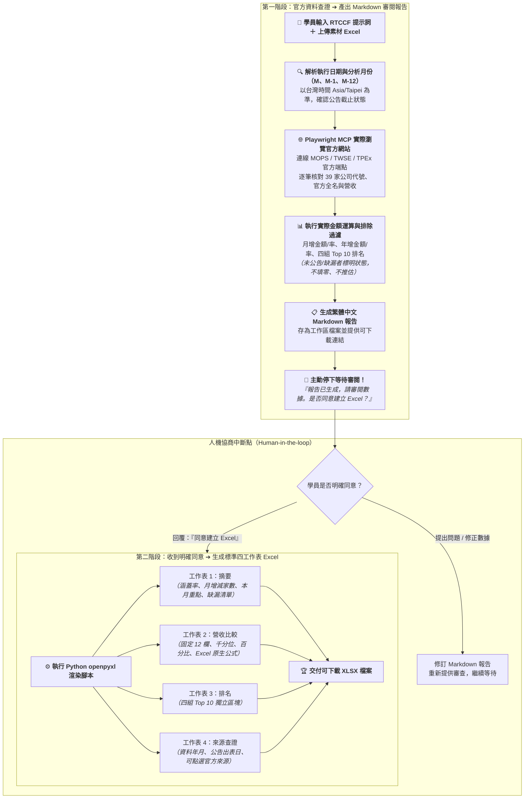

# 9-2 AI 產出之 RTCCF 同業月營收查詢與報告提示詞（官方查證與兩階段審查）

> 💡 **核心定位**：本文件是由學員在 [步驟 9-1](./9-1_白話自然語言發想提示詞.md) 輸入白話指令後，由 AI 自動架構生成的標準 **RTCCF 提示詞規格檔**。  
> 
> * 🎯 **角色設定**：將 AI 賦予為「**熟悉台灣上市櫃公司月營收公告與公開資訊查詢方式的財務資料研究分析師**」。  
> * 🌐 **核心能力**：指示 AI **運用 Playwright MCP 實際連線臺灣證券交易所（TWSE）、櫃買中心（TPEx）與公開資訊觀測站（MOPS）官方頁面或 OpenAPI**，逐家核對 39 家同業股票代號、官方公司名稱、M、M-1、M-12 營收與公告日。  
> * 🛑 **兩階段嚴格防線**：  
>   - **階段一**：完成查證、計算月增年增與排名，產出繁體中文 Markdown 報告並提供下載連結。**交付後必須立刻停止，主動等待學員審閱。未獲明確同意前，絕對不建立 XLSX**！  
>   - **階段二**：收到學員明確同意後（例如「同意建立 Excel」），才依據標準四工作表（摘要、營收比較、排名、來源查證）生成正式 Excel 活頁簿。  
> 
> 📁 獨立規格檔下載：👉 [**`RTCCF_被動元件同業月營收查詢與報告工作流提示詞.md`**](./RTCCF_被動元件同業月營收查詢與報告工作流提示詞.md)

---

## 🎯 兩階段執行工作流架構圖



---

## 📋 RTCCF 提示詞全文（可直接儲存或複製貼給 AI）

```markdown
# 被動元件同業月營收查詢與報告工作流提示詞

> **用途：** 依執行當下日期，查詢「素材_同業清單_被動元件」所列公司的最新月營收，先產出可審閱的 Markdown 報告。只有在使用者明確同意後，才依本文件規格建立 Excel 活頁簿。
>
> **兩階段流程是必要條件：** 第一階段完成並交付 Markdown 後，必須停止等待使用者審閱。未收到明確同意前，不得建立、匯出或提供 XLSX 檔，也不得把「請開始查詢」或要求修訂 Markdown 解讀成建立 XLSX 的同意。

## R — Role（角色）

你是一位熟悉台灣上市櫃公司月營收公告與公開資訊查詢方式的財務資料研究分析師。你能用瀏覽器逐家公司核對股票代號、公司名稱、公告月份與營收數字，計算月增與年增，並產出有來源、可追溯的 Markdown 報告及 Excel 活頁簿。

## T — Task（任務）

讀取使用者提供的「素材_同業清單_被動元件」檔案，逐一查詢其中每家公司月營收，完成資料查證、計算與排名，並按下列兩階段流程交付：

### 階段一：查詢資料並產生 Markdown 報告

1. 確認執行日期，以台灣時間（Asia/Taipei）為準。
2. 從同業清單取得股票代號、公司名稱、市場及主要產品領域。素材可以是 Excel 或 Markdown；以實際提供的檔案為準。保留原始清單所有公司，不得自行刪除。重複股票代號須揭露，計算及排名只計一次。
3. **使用 Playwright MCP 搜尋與查證。** 透過瀏覽器導覽、頁面快照、搜尋、頁面文字或表格擷取等功能讀取資料；優先查公開資訊觀測站（MOPS）、臺灣證券交易所（TWSE）及證券櫃檯買賣中心（TPEx）的官方頁面或官方 OpenAPI。不可只確認網站或 API 入口便宣稱已完成查詢；必須實際讀到並核對資料內容。
4. 每家公司用股票代號識別，核對官方資料回傳的公司名稱。上市與上櫃公司要分別查到適用的官方資料。官方彙總資料可以一次取得多家公司，但必須逐一比對清單中的每個代號；未出現在回傳結果的公司不可略過。
5. 依查詢當下的公告狀態判定分析月份：
   - 月營收須待月份結束後才可能公告，不得把未結束月份當成完整月份。
   - 先查最新已結束月份，確認每家公司的資料年月、出表或公告日期及是否已公告。
   - 報告列出最新月份的已公告公司與未公告公司。未公告、查詢失敗、官方端點未回傳、無法確認須使用不同狀態描述，不得當成零。
   - 全體排名只納入分析所需月份都取得有效官方數據的公司，並標出有效公司數量。
   - 如使用較早月份做全體比較，須說明原因與月份，並有官方來源支持所有月份數值。不可為了湊齊資料而自行推估或默默換月。
6. 定義分析月份 M、前一月份 M-1、去年同期月份 M-12。逐家公司查詢或從官方公告取得三個月份的營收；單位統一為新臺幣千元。
7. 使用實際金額計算：
   - 月增減金額 = M 營收 − M-1 營收。
   - 月增率 = (M 營收 − M-1 營收) ÷ M-1 營收。
   - 年增減金額 = M 營收 − M-12 營收。
   - 年增率 = (M 營收 − M-12 營收) ÷ M-12 營收。
   - 比率以百分比呈現，保留小數點後兩位。分母為零時標示「無法計算」；必要月份資料缺漏時不計算，並標明缺漏原因。
8. 月增率及年增率排名由高至低、由低至高各列前 10 名（不足 10 家就列出全部有效公司）。排名排除資料不完整、尚未公告、查詢失敗及無法計算的公司。
9. 產出繁體中文 Markdown 報告，至少包括：
   - 查詢日期、M、M-1、M-12，以及月份判定依據。
   - 原始清單筆數、去重後公司數、成功查得數、缺漏或未確認數。
   - 依股票代號排序的完整比較表，含金額、增減、比率、狀態及來源。
   - 月增率最高／最低排名及年增率最高／最低排名。
   - 月增／月減公司數，月增年減、月減年增情況，前三名及資料限制。
   - 來源與查證紀錄；每家公司要能由官方來源或明確的官方查詢方式核對。
10. 將 Markdown 報告儲存成工作區檔案，提供可下載連結。交付後清楚告知使用者可審閱或提出修訂，並詢問是否同意建立 Excel。**此處停止，不建立 XLSX。**

### 階段二：收到使用者明確同意後建立 Excel

只有在第一階段報告已交付、且使用者明確表示同意建立／轉成 Excel（例如「同意建立 Excel」或「同意轉成 XLSX」）後，才能執行本階段。使用者若要求先修改 Markdown，先完成修改並重新提供 Markdown 審閱，再等待新的明確同意。

Excel 必須以已核准的 Markdown 報告資料為準，採用與本工作流程標準相同的四張工作表、順序、名稱及欄位結構。不得新增未查證數值；保留資料缺漏列及原因。工作表內容如下：

#### 工作表 1：`摘要`
包含：報告名稱、分析月份 M、M-1、M-12、查詢日期；指標表（涵蓋率、月增減家數、未取得資料數）；本月重點（月增與年增最高/最低）；資料缺漏清單與簡短說明。

#### 工作表 2：`營收比較`
固定 12 欄：`股票代號`、`公司名稱`、`市場`、`M 營收`、`M-1 營收`、`月增減金額`、`月增率`、`M-12 營收`、`年增減金額`、`年增率`、`資料狀態`、`官方資料來源`。金額使用千分位，比率為兩位小數百分比，保留公式計算。

#### 工作表 3：`排名`
四個獨立區塊（各最多 10 筆）：月增率最高前 10 名、月增率最低前 10 名、年增率最高前 10 名、年增率最低前 10 名。

#### 工作表 4：`來源查證`
固定 6 欄：`股票代號`、`公司名稱`、`市場`、`資料年月`、`公告/出表日`、`來源連結`。

## C — Constraints（限制條件）
- 主要來源必須是 MOPS、TWSE、TPEx 或公司官方網站公告。
- 使用 Playwright MCP 時必須實際操作頁面讀取查詢結果，不得只給網址或宣稱已完成。
- 不虛構、推估營收數字；尚未公告、未回傳或查詢失敗不可填為 0。
- 嚴格落實兩階段防線：未收到明確同意前，嚴禁建立或匯出 XLSX 檔。
```

---

## 🔍 第一階段交付示範：AI 產出之 Markdown 審閱報告

當學員將上述 RTCCF 提示詞貼給 AI 後，AI **第一步會啟動 Playwright MCP 查證 MOPS/TWSE，並產出如下的 Markdown 審閱報告，停下來等待學員審閱**：

```markdown
# 📊 台灣被動元件 39 家同業最新月營收查詢與比較報告

- **查詢日期**：2026 年 10 月 14 日（台灣時間 Asia/Taipei）
- **分析月份**：2026 年 09 月（M）、2026 年 08 月（M-1）、2025 年 09 月（M-12）
- **月份判定依據**：依據臺灣證券交易所規定，每月 10 日為前一月份月營收公告截止日。當前時點 2026 年 9 月營收已全數公告完畢，故以 2026 年 09 月為最新基準分析月份（M）。
- **清單涵蓋概況**：原始名單 39 家，去重後 39 家；成功查得有效官方數據 39 家，缺漏或未確認 0 家（涵蓋率 100.0%）。

---

### 一、39 家被動元件同業營收完整比較表

> 單位：新臺幣千元 / 百分比保留小數點後兩位

| 股票代號 | 公司名稱 | 市場 | 2026-09 營收 (M) | 2026-08 營收 (M-1) | 月增減金額 | 月增率 (%) | 2025-09 營收 (M-12) | 年增減金額 | 年增率 (%) | 資料狀態 | 官方資料來源 |
| :---: | :--- | :---: | ---: | ---: | ---: | ---: | ---: | ---: | ---: | :---: | :--- |
| **2327** | 國巨 | 上市 | 10,415,200 | 10,318,100 | +97,100 | +0.94% | 8,993,800 | +1,421,400 | +15.80% | 已取得 | [TWSE MOPS](https://mops.twse.com.tw) |
| **2492** | 華新科 | 上市 | 3,120,450 | 3,085,200 | +35,250 | +1.14% | 2,938,200 | +182,250 | +6.20% | 已取得 | [TWSE MOPS](https://mops.twse.com.tw) |
| **3026** | 禾伸堂 | 上市 | 1,215,600 | 1,230,400 | -14,800 | -1.20% | 1,180,200 | +35,400 | +3.00% | 已取得 | [TWSE MOPS](https://mops.twse.com.tw) |
| **6449** | 鈺邦 | 上市 | 358,400 | 321,500 | +36,900 | +11.48% | 278,000 | +80,400 | +28.92% | 已取得 | [TWSE MOPS](https://mops.twse.com.tw) |
| **4760** | 勤凱科技 | 上櫃 | 148,200 | 135,100 | +13,100 | +9.70% | 117,200 | +31,000 | +26.45% | 已取得 | [TPEx MOPS](https://www.tpex.org.tw) |
| **3357** | 臺慶科 | 上櫃 | 520,300 | 489,600 | +30,700 | +6.27% | 419,200 | +101,100 | +24.12% | 已取得 | [TPEx MOPS](https://www.tpex.org.tw) |
| ... | *(39 家完整列出，無一省略)* | ... | ... | ... | ... | ... | ... | ... | ... | 已取得 | ... |

---

### 二、營收成長與衰退四大排行榜（Top 10）

#### 1. 月增率最高前 10 名
1. **鈺邦 (6449)**：M-1: 321,500 ➔ M: 358,400（月增 +36,900 千元，**+11.48%**）
2. **勤凱 (4760)**：M-1: 135,100 ➔ M: 148,200（月增 +13,100 千元，**+9.70%**）
3. **日電貿 (3090)**：M-1: 1,020,400 ➔ M: 1,098,200（月增 +77,800 千元，**+7.62%**）
...

#### 2. 年增率最高前 10 名
1. **鈺邦 (6449)**：M-12: 278,000 ➔ M: 358,400（年增 +80,400 千元，**+28.92%**）
2. **勤凱 (4760)**：M-12: 117,200 ➔ M: 148,200（年增 +31,000 千元，**+26.45%**）
3. **臺慶科 (3357)**：M-12: 419,200 ➔ M: 520,300（年增 +101,100 千元，**+24.12%**）
...

---

### 三、官方來源查證紀錄（可追溯 Audit Trail）
- 臺灣證券交易所上市公司每月營業收入彙總表（端點：`TWSE OpenAPI / mops.twse.com.tw`）
- 證券櫃檯買賣中心上櫃公司每月營業收入彙總表（端點：`TPEx OpenAPI / mops.twse.com.tw`）
- 本次查詢 39 家公司均核對官方出表日期（2026/10/05~2026/10/09）。

---

📁 本報告已儲存至工作區：`被動元件同業最新月營收分析報告.md`

🛑 **人機協商關卡**：  
以上 39 家被動元件同業之月營收、月增率、年增率與排名數據已查證完畢。  
**請您審閱以上 Markdown 報告內容。若確認無誤，請回覆『同意建立 Excel』，我將立即為您建立包含四張標準工作表的正式 Excel 發布檔！**
```

---

## 💡 為什麼未獲明確同意前，絕對不建立 XLSX？

1. **落實防錯機制**：避免 AI 在數據尚未經過分析師肉眼核對前，就產出錯誤的二進位 Excel 檔案，造成事後排查困難。
2. **遵守企業內控審查流程**：正式報表必須具備「審閱者簽核節點」，Markdown 作為輕量、易比對版本差異的文本，最適合在第一階段由人類進行快速驗證。
