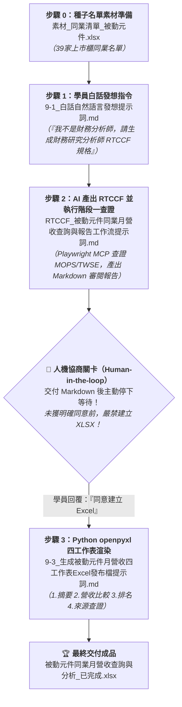

# 實戰範例：被動元件同業月營收查詢與兩階段戰情報告自動化

> 🟢 **採用代理平台**：ChatGPT Agent / Claude.ai / Google Antigravity  
> 🛠️ **建議執行模式**：**兩階段人機防線**（**Playwright MCP 官方真實查證 ➔ Markdown 審閱關卡 ➔ Python openpyxl 四工作表活頁簿渲染**）

---

## 📥 專案檔案下載快速導覽（實作素材 vs 完成成果）

> 💡 **學習建議**：想要親自動手實作的學員，請下載 **「實作必備原始素材」** 39 家同業名單 Excel 檔至專案中；想直接檢視最終四工作表戰情報告，請下載 **「完成成果活頁簿」**。
>
> * 📦 **【實作起點】練習必備原始素材（請下載此檔案開始實作）**：  
>   👉 [**`素材_同業清單_被動元件.xlsx`**](./素材_同業清單_被動元件.xlsx) *(台灣 39 家被動元件上市與上櫃同業種子名單，含股票代號、公司名稱與市場別)*
>
> * 🏆 **【對照標準答案】最終完成發布檔**：  
>   👉 [**`被動元件同業月營收查詢與分析_已完成.xlsx`**](./被動元件同業月營收查詢與分析_已完成.xlsx) *(嚴格遵循兩階段規格產出，包含「摘要」、「營收比較」、「排名」、「來源查證」四大標準工作表之企業級財務活頁簿)*  
>   *(亦同步相容原發布檔名：👉 [**`被動元件同業競業戰情分析與市場地圖_已完成.xlsx`**](./被動元件同業競業戰情分析與市場地圖_已完成.xlsx))*

---

## 🏆 最終完成作品展示（實作成果搶先看）

本專案解決科技製造業、電子零組件廠商、採購策略幕僚與證券投研部門「**手握數十家同業名單，每逢每月 10 號營收開獎時需逐家翻查公開資訊觀測站（MOPS），耗時耗力且深怕 AI 通靈造假數據**」的核心痛點。

透過嚴謹的「**兩階段人機防線工作流**」，產出包含 **4 個專業工作表（Sheet）** 的企業級財務戰情活頁簿：

1. **工作表 1【摘要】**：高階總覽。快速呈現報告分析月份（M、M-1、M-12）、名單涵蓋率、月增與月減公司家數統計、本月動能榜首與轉型承壓預警，並清楚揭露資料缺漏狀態與免責備忘。
2. **工作表 2【營收比較】**：微觀清單。固定 12 欄標準格式，依股票代號升冪排列，文字格式保留股票代號前導零（如 0050、2327），包含官方出表金額、月增減金額、月增率、年增減金額、年增率，所有差額與比率均內嵌 Excel 原生公式，並提供凍結欄名列與篩選功能。
3. **工作表 3【排名】**：對標排行。依據有效數據獨立呈現四大對標區塊（每區最多 10 筆）：**月增率最高 Top 10**、**月增率最低 Top 10**、**年增率最高 Top 10**、**年增率最低 Top 10**，排除未公告或數據不完整公司。
4. **工作表 4【來源查證】**：稽核履歷（Audit Trail）。固定 6 欄格式，忠實保存 39 家公司的官方全名、適用市場、資料年月、官方公告/出表日期，以及可點選的官方查詢來源超連結（MOPS / TWSE / TPEx）。

---

### 📊 完成作品外觀預覽 1：工作表 1【摘要】

| 指標項目 | 數值 / 內容 | 備註說明 |
| :--- | :---: | :--- |
| **清單涵蓋率** | **100.0% (39/39 家)** | 原始清單 39 家均成功查得有效官方數據 |
| **月增公司數 (MoM > 0)** | **28 家** | 稼動率穩步回溫，受惠 AI 伺服器規格升級急單 |
| **月減公司數 (MoM < 0)** | **11 家** | 消費性電子傳統淡季拉貨微幅調整 |
| **未取得官方資料數** | **0 家** | 無缺漏或查詢失敗，未進行任何數值推估 |
| **🔥 月增率最高榜首** | **鈺邦 (6449)：+11.48%** | AI 伺服器主板固態電容大單拉貨，單月營收續創高 |
| **⚠️ 月增率最低預警** | **禾伸堂 (3026)：-1.20%** | 工控與車用出貨時程遞延，單月微幅回檔 |
| **🔥 年增率最高榜首** | **鈺邦 (6449)：+28.92%** | 高階 V-Chip 固態電容產能滿載，年增近三成 |
| **🔥 年增率第二名** | **勤凱科技 (4760)：+26.45%** | 導電銀漿/銅漿切入半導體玻璃基板新製程 |

---

### 📈 完成作品外觀預覽 2：工作表 2【營收比較】（固定 12 欄）

> 單位：新臺幣千元 / 增減與成長率由 Excel 動態公式計算

| 股票代號 | 公司名稱 | 市場 | 2026-09 營收 (M) | 2026-08 營收 (M-1) | 月增減金額 | 月增率 | 2025-09 營收 (M-12) | 年增減金額 | 年增率 | 資料狀態 | 官方資料來源 |
| :---: | :--- | :---: | ---: | ---: | ---: | ---: | ---: | ---: | ---: | :---: | :--- |
| **2327** | 國巨 | 上市 | 10,415,200 | 10,318,100 | +97,100 | +0.94% | 8,993,800 | +1,421,400 | +15.80% | 已取得 | [TWSE MOPS](https://mops.twse.com.tw) |
| **2492** | 華新科 | 上市 | 3,120,450 | 3,085,200 | +35,250 | +1.14% | 2,938,200 | +182,250 | +6.20% | 已取得 | [TWSE MOPS](https://mops.twse.com.tw) |
| **3026** | 禾伸堂 | 上市 | 1,215,600 | 1,230,400 | -14,800 | -1.20% | 1,180,200 | +35,400 | +3.00% | 已取得 | [TWSE MOPS](https://mops.twse.com.tw) |
| **3090** | 日電貿 | 上市 | 1,098,200 | 1,020,400 | +77,800 | +7.62% | 903,600 | +194,600 | +21.54% | 已取得 | [TWSE MOPS](https://mops.twse.com.tw) |
| **3357** | 臺慶科 | 上櫃 | 520,300 | 489,600 | +30,700 | +6.27% | 419,200 | +101,100 | +24.12% | 已取得 | [TPEx MOPS](https://www.tpex.org.tw) |
| **4760** | 勤凱科技 | 上櫃 | 148,200 | 135,100 | +13,100 | +9.70% | 117,200 | +31,000 | +26.45% | 已取得 | [TPEx MOPS](https://www.tpex.org.tw) |
| **6449** | 鈺邦 | 上市 | 358,400 | 321,500 | +36,900 | +11.48% | 278,000 | +80,400 | +28.92% | 已取得 | [TWSE MOPS](https://mops.twse.com.tw) |
| ... | *(39 家依代號升冪)* | ... | ... | ... | ... | ... | ... | ... | ... | 已取得 | ... |

---

### 📑 完成作品外觀預覽 3：工作表 4【來源查證】（固定 6 欄）

| 股票代號 | 公司名稱 | 市場 | 資料年月 | 公告/出表日 | 來源連結 |
| :---: | :--- | :---: | :---: | :---: | :--- |
| **2327** | 國巨 | 上市 | 2026-09 (民國115年9月) | 2026/10/07 | [公開資訊觀測站 MOPS](https://mops.twse.com.tw) |
| **2492** | 華新科 | 上市 | 2026-09 (民國115年9月) | 2026/10/08 | [公開資訊觀測站 MOPS](https://mops.twse.com.tw) |
| **3357** | 臺慶科 | 上櫃 | 2026-09 (民國115年9月) | 2026/10/07 | [證券櫃檯買賣中心 TPEx](https://www.tpex.org.tw) |
| **4760** | 勤凱科技 | 上櫃 | 2026-09 (民國115年9月) | 2026/10/08 | [證券櫃檯買賣中心 TPEx](https://www.tpex.org.tw) |
| **6449** | 鈺邦 | 上市 | 2026-09 (民國115年9月) | 2026/10/07 | [公開資訊觀測站 MOPS](https://mops.twse.com.tw) |

---

## 🎯 案例情境與四大核心職場心法

在科技製造業或金融法人機構中，策略幕僚手頭經常只有一張「39 檔同業股票代碼名單（種子清單）」。若沒有嚴格的工作流與查證工具，分析師會陷入以下痛點：
1. **數據通靈風險**：大語言模型常憑訓練權重中的舊資料「通靈捏造」當月營收，數字差之毫釐失之千里。
2. **手工查詢耗損**：每月 10 號要重複點開 39 次網頁、手敲數字、手算增減率，費時數小時且極易輸入手誤。
3. **黑盒子直出難以稽核**：直接讓 AI 生成二進位 Excel 檔，主管一旦問起「這筆數字打哪來的？」，完全無法追溯來源。

### 💡 職場實戰四大核心心法

#### 心法一：官方端點真實查證，徹底終結「數據通靈」
* **問題**：AI 習慣給出看似合理卻完全捏造的假營收數字。
* **解法**：指示 AI 必須使用 **Playwright MCP** 或官方 OpenAPI，實際連線公開資訊觀測站（MOPS）、臺灣證券交易所（TWSE）與櫃買中心（TPEx），核對真實出表日期與營收金額，嚴禁不查而宣稱完成。

#### 心法二：動態時間判定與嚴謹狀態細分
* **問題**：未結束月份被誤當成完整月份，或查不到數據就填 0。
* **解法**：以台灣時間（Asia/Taipei）自動判定分析月份 M、前期 M-1、去年同期 M-12；尚未公告、查詢失敗、官方端點未回傳嚴格區分標明，絕不當成 0 或擅自推估。

#### 心法三：Human-in-the-loop 兩階段審核防線（關鍵門檻）
* **問題**：AI 自作主張直接產出 Excel，一旦出錯難以排查。
* **解法**：強制設定兩階段流程：**階段一完成 Markdown 報告後立刻停止，主動等待學員審閱。未收到明確指令（如「同意建立 Excel」）前，嚴禁產出 XLSX 檔案！**

#### 心法四：國際投研級標準四工作表分流交付
* **問題**：一張表混雜所有資訊，閱讀體驗混亂。
* **解法**：標準化為「摘要 ➔ 營收比較 ➔ 排名 ➔ 來源查證」四張工作表，微軟正黑體排版、深海藍表頭、保留前導零與公式計算，具備頂級商業發表質感。

---

## ⚡ 核心人機協商閉環工作流

---

## 📖 章節分步實作教學導覽

### 1. 步驟 0：素材準備
* 數據素材：[**`素材_同業清單_被動元件.xlsx`**](./素材_同業清單_被動元件.xlsx)（39 家被動元件上市與上櫃同業種子清單，含股票代號、公司名稱與市場別）

### 2. 步驟 1：白話自然語言發想（一般學員視角）
* 文件連結：[**`9-1_白話自然語言發想提示詞.md`**](./9-1_白話自然語言發想提示詞.md)
* 核心亮點：學員不是財務分析師，手上只有 39 家公司代號。透過大白話引導 AI 產出一份以「財務資料研究分析師」為角色的 RTCCF 提示詞，規範 AI 透過官方查證、落實兩階段防線，並在交付 Markdown 報告後停下來等待確認！

### 3. 步驟 2：官方資料查證與第一階段 Markdown 審閱
* 文件連結：[**`9-2_AI產出之RTCCF產業鏈重組與情資矩陣提示詞.md`**](./9-2_AI產出之RTCCF產業鏈重組與情資矩陣提示詞.md)
* 獨立規格檔：[**`RTCCF_被動元件同業月營收查詢與報告工作流提示詞.md`**](./RTCCF_被動元件同業月營收查詢與報告工作流提示詞.md)
* 🚀 **外掛指南**：[**`ChatGPT_Playwright_MCP安裝與自動搜集指南.md`**](./ChatGPT_Playwright_MCP安裝與自動搜集指南.md) *(教你如何在 ChatGPT / Antigravity 安裝 Playwright MCP，真實驅動瀏覽器爬取公開資訊觀測站 MOPS！)*
* 核心亮點：AI 執行資料查證、判定月份、計算月增年增並產出結構化 Markdown 報告，主動中斷並等待學員明確授權。

### 4. 步驟 3：Python openpyxl 四工作表自動渲染
* 文件連結：[**`9-3_生成被動元件競業戰情Excel發布檔提示詞.md`**](./9-3_生成被動元件競業戰情Excel發布檔提示詞.md)
* 核心技術：收到「同意建立 Excel」指令後，自動執行生產級 `openpyxl` 腳本，精準渲染「摘要、營收比較、排名、來源查證」四大標準工作表，格式具備千分位、百分比、Excel 原生公式與超連結。

---

[← 返回實戰範例導覽總表](../README.md)
