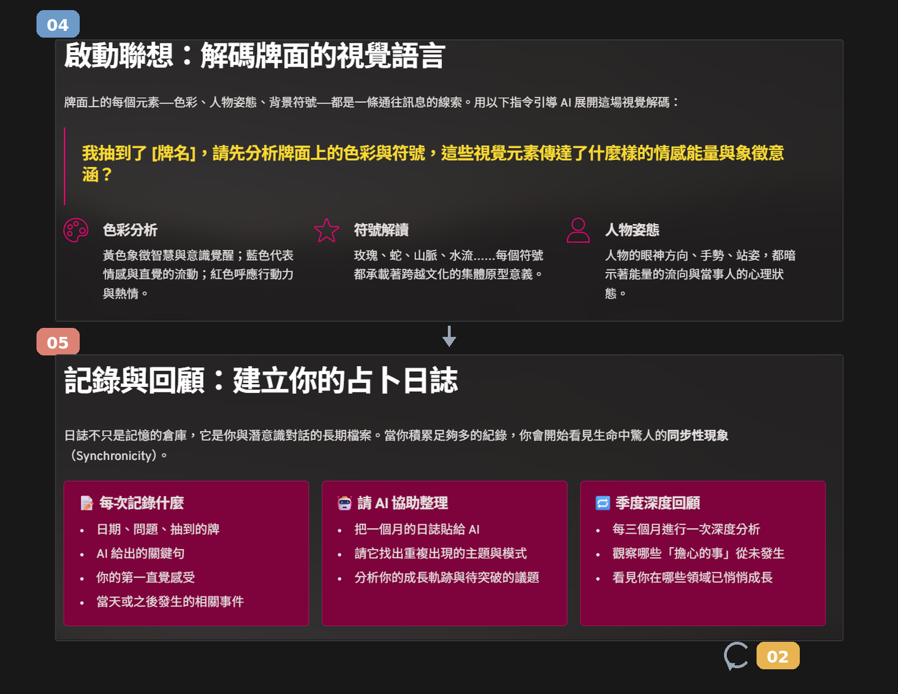
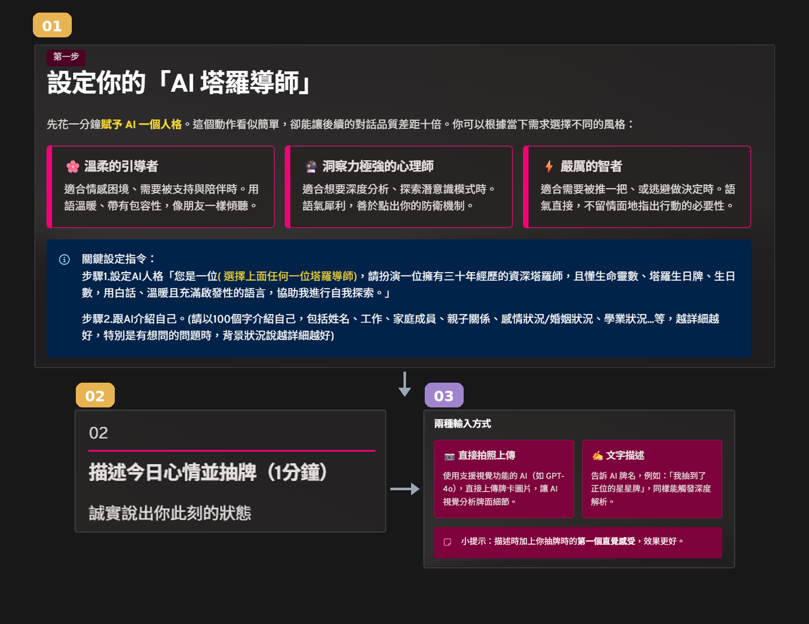

# 每日抽牌占卜與身心靈成長標準作業流程

> 📌 **用途說明**：本文件將 Word 檔內部嵌入之圖檔提取並建立結構化 Markdown 說明，供 AI 快速掌握工作流程。  
> 🚀 **Token 效益**：純文字 Markdown 流程結構，避免讀取 1.25MB 的 Word 容器。

---

## 🧭 作業流程圖解

* **流程圖 1：每日抽牌與多模態解讀架構**  
  

* **流程圖 2：榮格心理投射與視覺報告落地鏈路**  
  

---

## 📋 四階段標準作業鏈路

1. **第一階段：多模態影像識別與符號提取**
   * 輸入抽牌實體照片（如 `IMG_6285.JPG`），AI 辨識牌名（如：韋特塔羅 愚人 The Fool）、正逆位狀態、核心色系與人物神態細節。
2. **第二階段：榮格心理原型投射與情緒診斷**
   * 結合提問者當日心境，以榮格心理學（原型 Archetype、陰影 Shadow、阿尼瑪/阿尼姆斯）深度剖析潛意識訊息，嚴禁迷信恐嚇。
3. **第三階段：減法生活行動指引與能量語錄**
   * 提煉「1 件今天可以放下的事（減法思維）」與「1 件專注執行的 micro-action」，搭配今日能量金句。
4. **第四階段：現代視覺卡片報告與終極收斂**
   * 產出符合現代社群美學的 Markdown / SVG / HTML 卡片報告，並將完整規格收斂為可終生調用的 `RTCCF_v1.md`。
