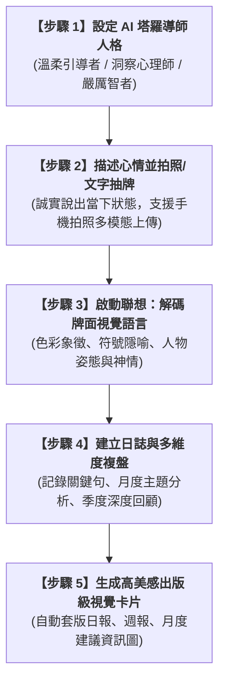

# 實戰範例：AI 每日塔羅占卜報告與身心靈成長視覺化

> 🟣 **採用代理平台**：Claude.ai Agent / Claude Artifacts / 多模態視覺模型  
> 🛠️ **建議執行模式**：**Artifacts 模式 / 視覺設計對齊模式**（透過 Claude 多模態視覺辨識解碼牌面細節，結合心理學與身心靈諮商架構，產出雜誌出版級的卡片式占卜日報、週報與月度行動指南）

---

## 🏆 最終完成作品展示（實作成果搶先看）

本專案將日常隨手抽牌的直覺靈感，升級為**出版級、精美卡片式排版**的身心靈成長視覺報告書：

| 交付成品 | 視覺預覽 | 核心呈現維度 |
| :--- | :---: | :--- |
| **[日報] 每日塔羅牌占卜報告書** |  | • 牌面與正逆位解析 • 今日關鍵提醒與情緒防禦姿態 • 落地行動建議與待辦清單刪減 • 今日能量語錄與幸運元素（場所/數字/小物） |
| **[週報] 一週塔羅占卜報告書** |  | • 7 天牌陣全局矩陣一覽 • 當週內在整頓與行動能量走勢 • 本週最需注意的三件事 • 內在優勢盤點與溫柔療癒提醒 |
| **[月報] 月份塔羅行動建議資訊圖** |  | • 上月牌陣能量重點回顧 • 感情與人際關係深度交流指南 • 生活節奏穩定與精力管理行動建言 • 四大關鍵能量指引與手寫溫度祝福 |

---

## 🎯 案例情境與核心學習價值

傳統身心靈占卜與每日抽牌常面臨以下實務痛點：
1. **死背牌義與制式解讀**：市售塔羅書籍牌義過於生硬，難以貼合現代上班族的職場壓力、親密關係與情緒內耗。
2. **缺乏長期軌跡與盲點辨識**：每日抽完牌後隨即忘記，無法追蹤「逆位牌連續出現」或「特定花色頻繁發生」背後所反映的潛意識心理防禦機制與同步性現象（Synchronicity）。
3. **零碎筆記缺乏視覺質感**：記錄零散於通訊軟體或筆記本，缺乏儀式感與視覺激勵效果，難以分享於社群或作為心靈日誌長久珍藏。

> 💡 **本單元核心精神**：  
> 賦予 Claude 鮮明且專業的「AI 塔羅導師」人格，透過**多模態拍照上傳 ➔ 牌面色彩與符號解碼 ➔ 人機共創占卜日誌 ➔ 現代卡片佈局自動生成**，將自我探索轉化為每日最具儀式感的高效能生活美學！

---

## 🧭 5 分鐘通關地圖（SOP 流程總覽）

---

## 📂 專案檔案清單與功能說明

| 檔案類型 | 檔案名稱 | 核心內容與功用說明 |
| :--- | :--- | :--- |
| 📘 **工作流手冊** | [`每日抽牌占卜工作流程圖 (1).docx`](./每日抽牌占卜工作流程圖%20(1).docx) | 包含 5 階段操作流程圖與 AI 提示指令設定規範 |
| 🖼️ **成品範本 1** | [`IMG_6286.JPG`](./IMG_6286.JPG) | 每日塔羅占卜報告書（以權杖七逆位為例之都會卡片設計） |
| 🖼️ **成品範本 2** | [`IMG_6287.JPG`](./IMG_6287.JPG) | 一週塔羅占卜報告書（7 天牌陣走勢與三大事項提醒） |
| 🖼️ **成品範本 3** | [`IMG_6285.JPG`](./IMG_6285.JPG) | 月份塔羅行動建議（星空魔法繪本風之月度能量回顧） |

---

## 🚀 待推進實作項目（下一步）

- [ ] 提煉純白話抽牌發想提示詞（`4-1_白話自然語言發想提示詞.md`）
- [ ] 撰寫 RTCCF 多模態解牌與視覺報告提示詞（`4-2_AI產出之RTCCF多模態解牌與視覺報告提示詞.md`）
- [ ] 實作 HTML / CSS / SVG 卡片海報樣板自動排版工作流

---

[← 返回 2026_10_19 案例總表](../README.md)
