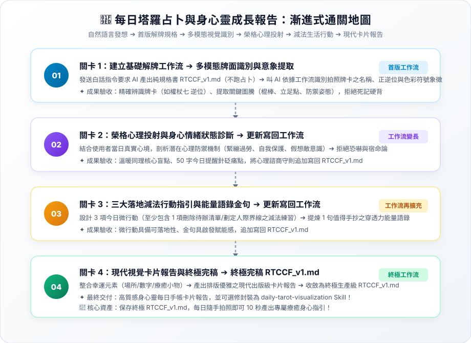

# 實戰範例：AI 每日塔羅占卜報告與身心靈成長視覺化

> 🤖 **採用代理平台**：主流 AI Agent 平台（如 Claude Projects / ChatGPT / Gemini 等具備多模態視覺辨識與美感排版能力之智慧代理人）  
> 🛠️ **建議執行模式**：**多模態對話模式 / 知識庫代理人模式**（透過 AI Agent 對話式協作直接辨識拍照牌卡圖像、解碼符號意象、進行榮格心理投射，並自動化產出高美感之每日成長卡片報告）  
> 💡 **身心靈探索新手導讀**：非塔羅占卜背景？請先閱讀 👉 [**`業務背景與工作流入門解析.md`**](./業務背景與工作流入門解析.md)，快速了解牌面符號學、榮格心理學投射機制與可跨界借鏡之提示工程技術！

---

## 🏆 最終完成作品展示（實作成果搶先看）

> 📥 **核心交付成品清單**：  
> 1. 實體抽牌多模態照片辨識：[**`IMG_6285.JPG`**](./IMG_6285.JPG)、[**`IMG_6286.JPG`**](./IMG_6286.JPG)、[**`IMG_6287.JPG`**](./IMG_6287.JPG)（支援相機隨手拍直接上傳）。  
> 2. 出版級卡片式每日占卜報告書（自帶 Emoji 錨點、50 字核心提醒、榮格心理防禦診斷、三大減法行動、手抄語錄與幸運微儀式）。  
> 3. 每日占卜標準作業流程圖手冊：[**`每日抽牌占卜工作流程圖.docx`**](./每日抽牌占卜工作流程圖.docx)。  
> 4. 終極生產級每日身心靈解碼規格書：[**`5-2_AI產出之RTCCF多模態解牌與視覺報告提示詞.md`**](./5-2_AI產出之RTCCF多模態解牌與視覺報告提示詞.md)（四模組整合完稿版）。

---

## 🎯 案例情境與核心學習價值

現代都會專業人士在高工時、高壓競爭與專案超載的環境下，經常面臨身心耗竭與情緒盲點：
1. **死記牌義與宿命論恐嚇痛點**：
   * 傳統塔羅書籍動輒數百頁死板條目，初學者難以融會貫通；仿間解牌常充斥宿命論、詛咒或迷信言論，反而加重焦慮。
2. **缺乏實質落地改變行動**：
   * 占卜若僅停留在抽象安慰，無法真正解決現實困境；需要聚焦於生活減法、劃定心理界線與身心呼吸鬆綁。
3. **多模態影像理解與現代美感排版**：
   * 透過 AI 多模態視覺技術，隨手拍下抽到的牌卡即可秒級解碼色彩、圖騰與人物神態，並轉化為出版級現代卡片排版。

> 💡 **核心方法論：漸進式優化（Progressive Refinement）**  
> 複雜的身心靈解讀**切忌一次輸入所有任務**！本教學採用**「一次一個任務、做一步驗一步」**的漸進式優化策略：  
> 1. **第 1 個產出是工作流規格書**：第 1 次用自然語言發想，唯一目標是產出通用規格書 **`RTCCF_v1.md`**（純規格、不執行特定牌卡解碼，存為 `.md` 檔人機才能協作）。  
> 2. **叫 AI 依據工作流開始工作**：人工檢核規格無誤後，正式指示 AI 依據這份 `RTCCF_v1.md` 開始執行多模態照片辨識與意象提取。  
> 3. **後續關卡用自然語言執行新任務**：依序丟出新任務（榮格心理投射與診斷、三大減法行動與手抄金句、幸運生活指南與現代卡片排版）。  
> 4. **完成後更新寫回同一個工作流**：每道關卡驗收無誤後，請 AI 將新規則追加覆蓋寫回 **`RTCCF_v1.md`**。**關卡愈多，工作流就會愈長、功能愈強大！**

---

## 🧭 5 分鐘通關地圖（SOP 流程總覽）



---

## 🛠️ 實戰闖關手冊：漸進式優化四步曲

請開啟您偏好的 **AI Agent 平台**（如 Claude / ChatGPT / Gemini 等支援多模態影像理解之對話視窗），依序完成以下四個關卡：

### 🟢 關卡 1：建立基礎工作流（RTCCF_v1.md）➔ 依工作流執行多模態牌面識別

* **輸入素材**：上傳 [`IMG_6285.JPG`](./IMG_6285.JPG) 至 AI Agent 對話框中。
* **步驟 1-A（第 1 個產出是工作流）**：開啟 👉 [**`關卡1_多模態牌面識別與意象提取.md`**](./關卡1_多模態牌面識別與意象提取.md)，發送白話指令，要求 AI 產出第一版通用規格書 **`RTCCF_v1.md`**（強制儲存為 `.md` 檔案，不進行個人算命）。
* **人工檢核工作流**：檢視 `RTCCF_v1.md` 規則是否通用、反宿命論底線與多模態符號捕捉是否嚴謹。
* **步驟 1-B（叫 AI 依據工作流開始工作）**：在同對話發送指令，叫 AI 嚴格依照 `RTCCF_v1.md` 辨識照片中之牌卡名稱、正逆位與視覺符號！
* **🔍 人工驗收成果**：
  * [ ] 牌卡名稱、組別元素與正位/逆位狀態是否 100% 正確？
  * [ ] 是否精確捕捉牌面上的核心色彩寓意與人物神態環境細節？

---

### 🟣 關卡 2：榮格心理投射與身心情緒狀態診斷 ➔ 更新寫回 RTCCF_v1.md（工作流變長）

* **任務情境**：輸入今日一句話心情，進行共時性投射，診斷情緒防禦機制與 50 字核心提醒。
* **步驟 2-A（自然語言執行任務）**：開啟 👉 [**`關卡2_榮格心理投射與身心情緒診斷.md`**](./關卡2_榮格心理投射與身心情緒診斷.md)，用白話自然語言請 AI 深度剖析心理盲點。
* **🔍 人工驗收成果**：
  * [ ] **洞察直指核心**：今日提醒是否在 50 字以內一針見血點破過度防禦盲點？
  * [ ] **溫暖賦能對談**：文字是否同理溫暖，完全無任何宿命論恐嚇用語？
* **步驟 2-B（任務完成後更新工作流）**：指示 AI 將榮格心理投射規範追加寫回 **`RTCCF_v1.md`**，**工作流擴充變長！**

---

### 🟡 關卡 3：三大接地氣減法微行動與能量語錄 ➔ 更新寫回 RTCCF_v1.md（工作流再擴充）

* **任務情境**：擺脫抽象空談，規劃 3 項減法微行動（心態鬆綁、清單精簡、界線劃定）與手抄金句。
* **步驟 3-A（自然語言執行任務）**：開啟 👉 [**`關卡3_減法生活行動建議與能量語錄.md`**](./關卡3_減法生活行動建議與能量語錄.md)，用白話自然語言請 AI 規劃接地氣微行動。
* **🔍 人工驗收成果**：
  * [ ] **落實減法哲學**：是否包含具體刪減清單、拒絕請求之實質動作？
  * [ ] **金句雋永有力量**：語錄是否文字精煉、適合抄寫於手帳或設為鎖屏桌布？
* **步驟 3-B（任務完成後更新工作流）**：指示 AI 將減法行動模型追加寫回 **`RTCCF_v1.md`**，**工作流再次變長！**

---

### 🟢 關卡 4：現代視覺卡片報告與終極完稿 ➔ 終極完稿 RTCCF_v1.md

* **任務情境**：整合幸運元素微儀式，產出排版優雅之現代出版級卡片報告。
* **步驟 4-A（自然語言執行任務）**：開啟 👉 [**`關卡4_現代視覺卡片報告與終極完稿.md`**](./關卡4_現代視覺卡片報告與終極完稿.md)，用白話自然語言請 AI 產出完整卡片報告。
* **🔍 人工驗收成果**：
  * [ ] 視覺排版結構清晰，Emoji 錨點、段落呼吸感佳。
  * [ ] 幸運場所、數字與精油小物切合生活，具備微儀式療癒感。
* **步驟 4-B（最終收斂更新工作流）**：指示 AI 整合四大模組，收斂為 **終極生產級 `RTCCF_v1.md`**（完整範本收錄於 [`5-2_AI產出之RTCCF多模態解牌與視覺報告提示詞.md`](./5-2_AI產出之RTCCF多模態解牌與視覺報告提示詞.md)）！未來每天早晨只需隨手拍照上傳即可 10 秒全自動產出專屬報告！
* 📌 **【重要資產提醒】**：**請務必永久妥善保留這份 `RTCCF_v1.md` 檔案！** 這是歷經人機協作打磨的最高結晶。

---

### ⭐ 選修進階（Optional）：將 RTCCF_v1 工作流封裝為「AI Agent Skill」

當工作流穩定後，可依據 Claude / Agent Skill 官方規範將其封裝為即插即用的技能套件：
* **標準 Skill 目錄結構**：
  ```text
  skills/daily-tarot-visualization/
  └── SKILL.md            # 必要：包含 YAML frontmatter (name, description) 的完整每日解牌 SOP
  ```
* **一鍵升級指引**：請詳閱 👉 [**`關卡4_現代視覺卡片報告與終極完稿.md`**](./關卡4_現代視覺卡片報告與終極完稿.md#選修進階optional將-rtccf_v1-工作流封裝為ai-agent-skill) 中的選修封裝指令。

---

## 📂 專案檔案清單與功能說明

| 檔案類型 | 檔案名稱 | 核心內容與功用說明 |
| :--- | :--- | :--- |
| 📘 **操作手冊** | [`每日抽牌占卜工作流程圖.docx`](./每日抽牌占卜工作流程圖.docx) | 包含塔羅牌組架構、象徵學意象解碼與每日占卜流程指引 |
| 📸 **抽牌照片 1** | [`IMG_6285.JPG`](./IMG_6285.JPG) | 隨手拍照之實體牌卡多模態輸入素材（真實生活場景） |
| 📸 **抽牌照片 2** | [`IMG_6286.JPG`](./IMG_6286.JPG) | 實體牌卡照片素材 |
| 📸 **抽牌照片 3** | [`IMG_6287.JPG`](./IMG_6287.JPG) | 實體牌卡照片素材 |
| 🟢 **實作關卡 1** | [`關卡1_多模態牌面識別與意象提取.md`](./關卡1_多模態牌面識別與意象提取.md) | 影像多模態理解、正逆位與符號色彩提取，產出首版 `RTCCF_v1.md` |
| 🟣 **實作關卡 2** | [`關卡2_榮格心理投射與身心情緒診斷.md`](./關卡2_榮格心理投射與身心情緒診斷.md) | 心理防禦機制診斷、非宿命論 50 字盲點提醒，更新寫回 `RTCCF_v1.md` |
| 🟡 **實作關卡 3** | [`關卡3_減法生活行動建議與能量語錄.md`](./關卡3_減法生活行動建議與能量語錄.md) | 三大接地氣減法微行動、手抄哲思能量金句，更新寫回 `RTCCF_v1.md` |
| 🟢 **實作關卡 4** | [`關卡4_現代視覺卡片報告與終極完稿.md`](./關卡4_現代視覺卡片報告與終極完稿.md) | 幸運指南、出版級現代卡片視覺排版，收斂終極 `RTCCF_v1.md` 與選修 Skill |
| 🏆 **終極規格書** | [`5-2_AI產出之RTCCF多模態解牌與視覺報告提示詞.md`](./5-2_AI產出之RTCCF多模態解牌與視覺報告提示詞.md) | 包含動態演進軌跡矩陣與四模組收斂之終極生產級 RTCCF 全文 |
| 🗺️ **通關架構圖** | [`SOP通關流程圖.svg`](./SOP通關流程圖.svg) | 亮色精緻卡片式漸進式優化 SOP 全景圖（純 SVG，無 mermaid） |
