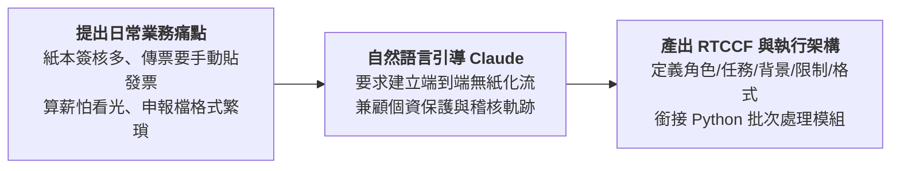

# 1-1 白話自然語言發想提示詞（人資財務無紙化自動化）

> 💡 **核心精神**：以最直觀的辦公室痛點為出發點，向 Claude 描述三大後勤流程（打卡算薪、報銷歸檔、用印審核）的繁瑣現況，引導 AI 協助梳理出結構化的自動化方案架構。

---

## 🎯 核心工作流



---

## 📋 自然語言發想指令（Prompt）

可在 Claude 對話視窗中直接發送：

```text
我們公司是一家台灣中小企業，目前行政、人資與財務會計的日常流程中，仍有許多紙本簽核與人工重複作業：

1. 員工每月打卡算薪水，產生薪資明細表後要手動發放，很擔心薪資被其他人看到；還要手動切傳票進財務系統。
2. 同仁費用報銷時，要拿紙本貼發票、找主管簽名，會計付款後再打入會計系統印傳票，最後手動把傳票跟發票釘在一起歸檔，非常花時間。
3. 合約與用印申請常常找主管紙本簽核，歸檔容易遺失或找不到版本。
4. 每期營業稅、各類所得扣繳、二代健保補充保費，都要轉成政府規定的特殊純文字格式（如 81 字元 TXT 檔、U8 格式）。

請扮演企業流程數位化專家，幫我盤點這三項流程，規劃一套能保留完整簽核軌跡、合乎稅務與個資法規的無紙化與自動化解決方案架構，並為我輸出為標準的 RTCCF 提示詞架構！
```

---

[← 返回專案首頁](./README.md)
