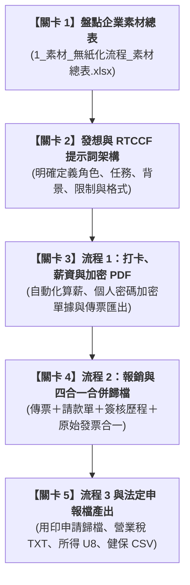

# 實戰範例：中小企業人資財務無紙化與自動化流程

> 🟣 **採用代理平台**：Claude.ai Agent / Claude Projects  
> 🛠️ **建議執行模式**：**Artifacts 模式 / Code 模式**（透過 Claude 對話式協作直接分析業務表格、產出自動化腳本與合規報表，實現一鍵式流程交付）

---

## 🏆 最終完成作品展示（實作成果搶先看）

> 📥 **核心交付成品清單**：  
> 1. 流程 1【薪資計算與加密發放】：[**`2_完成檔案_流程1_薪資明細單_加密範例_E001_202610.pdf`**](./2_完成檔案_流程1_薪資明細單_加密範例_E001_202610.pdf) ｜ [**`2_完成檔案_流程1_薪資傳票_歸檔範例.pdf`**](./2_完成檔案_流程1_薪資傳票_歸檔範例.pdf) ｜ [**`2_完成檔案_流程1_年度薪資所得統計_範例_2026.xlsx`**](./2_完成檔案_流程1_年度薪資所得統計_範例_2026.xlsx)  
> 2. 流程 2【費用報銷與多件合併列印】：[**`2_完成檔案_流程2_費用報銷_合併列印範例.pdf`**](./2_完成檔案_流程2_費用報銷_合併列印範例.pdf)（自動整合：會計傳票 ➔ 已簽核請款單 ➔ 簽核歷程 ➔ 發票憑證附件）  
> 3. 流程 3【用印申請與合約歸檔】：[**`2_完成檔案_流程3_用印申請_歸檔範例.pdf`**](./2_完成檔案_流程3_用印申請_歸檔範例.pdf)  
> 4. 稅務法遵【官方申報檔產出工具】：自動產出營業稅進銷項檔（81字元 TXT）、各類所得申報檔（UTF-8 分隔符號 U8）、二代健保補充保費檔（Big5 CSV）

---

## 🎯 案例情境與核心學習價值

台灣許多中小企業（SME）在日常行政、人資與財務會計作業中，長年面臨以下痛點：
1. **紙本簽核與重工撕扯**：請款報銷需反覆列印發票黏貼單、紙本找主管簽章，最後會計再人工登打入 ERP，傳票列印後再手動裝訂附件，耗時費力且容易漏件。
2. **機敏薪資資料外洩疑慮**：薪資計算需經個人資料保護法規範，傳統紙本或一般未加密 Email 寄送容易有資安外洩風險；MIS 網管亦不應隨意窺探薪資核心數據。
3. **繁瑣法定申報格式斷層**：每年每月的營業稅申報、各類所得扣繳、二代健保補充保費，需符合政府機關特定的純文字固定字元格式（如 81 字元 TXT、U8 格式），人工核對容易造成邏輯錯誤或退件。

> 💡 **本單元核心精神**：  
> 透過 Claude 建立完整的「無紙化與自動化作業標準流」，串聯打卡薪資、報銷憑證合併歸檔、合約用印與法定申報檔，讓人資財務一人即可高效駕馭全公司後勤營運！

---

## 🧭 5 分鐘通關地圖（SOP 流程總覽）

---

## 📂 專案檔案清單與功能說明

| 檔案類型 | 檔案名稱 | 核心內容與功用說明 |
| :--- | :--- | :--- |
| 📘 **流程說明** | [`3_說明檔_使用說明.docx`](./3_說明檔_使用說明.docx) | 完整記載三大流程操作手冊、申報檔規則與資安注意事項 |
| 🎯 **提示詞規範** | [`無紙化及自動化流程_RTCCF.docx`](./無紙化及自動化流程_RTCCF.docx) | 標準 RTCCF 框架（角色/任務/背景/限制/格式）提示詞範本 |
| 📊 **原始素材** | [`1_素材_無紙化流程_素材總表.xlsx`](./1_素材_無紙化流程_素材總表.xlsx) | 包含員工名單、薪資月結、報銷申請、用印登記、申報設定素材 |
| 📑 **流程 1 成果** | [`2_完成檔案_流程1_薪資明細單_加密範例_E001_202610.pdf`](./2_完成檔案_流程1_薪資明細單_加密範例_E001_202610.pdf) | 身分證號加密之個人薪資明細單（防窺保護） |
| 📑 **流程 1 成果** | [`2_完成檔案_流程1_薪資傳票_歸檔範例.pdf`](./2_完成檔案_流程1_薪資傳票_歸檔範例.pdf) | 拋轉財務系統之薪資總表會計傳票 |
| 📑 **流程 1 成果** | [`2_完成檔案_流程1_年度薪資所得統計_範例_2026.xlsx`](./2_完成檔案_流程1_年度薪資所得統計_範例_2026.xlsx) | 扣繳所得稅、勞健保、退休金年度彙總表 |
| 📑 **流程 2 成果** | [`2_完成檔案_流程2_費用報銷_合併列印範例.pdf`](./2_完成檔案_流程2_費用報銷_合併列印範例.pdf) | 完整四合一電子稽核 PDF（傳票＋請款＋簽核＋憑證） |
| 📑 **流程 3 成果** | [`2_完成檔案_流程3_用印申請_歸檔範例.pdf`](./2_完成檔案_流程3_用印申請_歸檔範例.pdf) | 內控用印審核與合約掃描歸檔發布本 |
| 💻 **執行工具** | [`4_程式_packet.py`](./4_程式_packet.py) | 核心自動化批次處理與 PDF 拼裝腳本 |
| 📦 **擴充模組** | `無紙化流程套件.zip` / `申報檔產生.zip` / `員工查詢系統.zip` | 包含營業稅、所得與二代健保匯出模組與私有密鑰金庫 |

---

## 🚀 待推進實作項目（下一步）

- [ ] 提煉純文字發想提示詞（`1-1_白話自然語言發想提示詞.md`）
- [ ] 轉換標準 Markdown 格式之 RTCCF 提示詞（`1-2_AI產出之RTCCF審查與結構化提示詞.md`）
- [ ] 自動化 Python 批次產檔與驗證步驟優化

---

[← 返回 2026_10_19 案例總表](../README.md)
