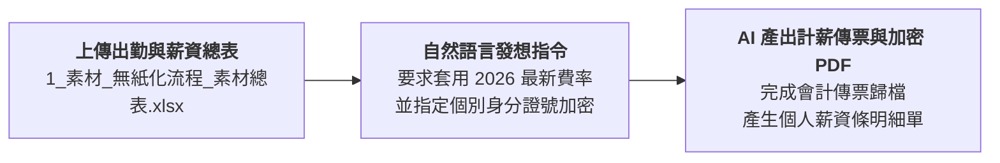

# 1-1 白話自然語言發想提示詞（人資計薪與加密單據）

> 💡 **核心精神**：向 Claude 描述人資每月的計薪流程與個資防洩漏需求，引導 AI 建立端到端自動化方案。

---

## 🎯 核心工作流



---

## 📋 自然語言發想指令（Prompt）

可在 Claude 對話視窗中直接發送：

```text
我們公司是一家台灣中小企業，目前每月人資算薪水仍仰賴人工核對與手動作業：

1. 員工打卡資料匯入 Excel 後，要依 2026 年最新法定費率（勞保 12.5%、健保 5.17%、勞退 6%、加班倍率 1.34/1.67/2.67）計算實發金額。
2. 算完後要拋轉會計系統切薪資傳票。
3. 最大的痛點是：薪資條需要個別發放給員工，紙本容易被看到，寄一般 Email 附件又怕被網管或他人窺探。我希望系統能自動為每位員工產生一份 PDF 薪資單，並以員工各自的身分證字號設定為開啟密碼（AES-256 加密）。
4. 另外在年底或離職時，能自動彙總全年薪資所得與特休未休折算工資。

請扮演人資薪酬自動化專家，幫我規劃一套安全、合規且高效率的計薪與加密發放解決方案，並輸出標準 RTCCF 架構！
```

---

[← 返回專案首頁](./README.md)
