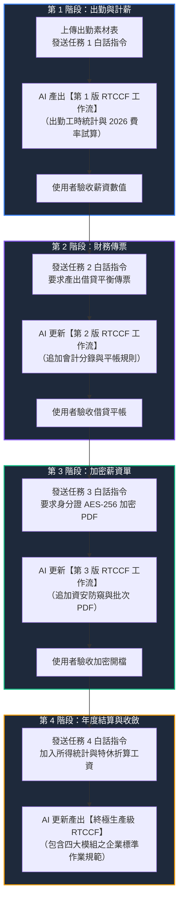

# 1-1 白話自然語言發想提示詞（人資計薪與加密單據）

> 💡 **核心方法論：漸進式優化（Progressive Refinement）**  
> 面對複雜的企業級工作流，**切忌「妄想一次輸入就做對全部任務」**！  
> 本單元採用台灣職場推崇的**「漸進式優化」**方法：**一次只給一個任務，做一步、驗一步；每驗收完成一個任務，就請 AI 動態更新一次 RTCCF 格式工作流規格書**，步步為營，最終收斂出完美零失誤的生產級工作流。

---

## 🧭 漸進式優化推進圖（一次一個任務 ➔ AI 更新 RTCCF）



---

## 📋 漸進式白話指令四部曲（可分階段複製至 AI Agent 對話視窗）

### 🟢【第 1 階段任務】：出勤工時統計與 2026 最新計薪

> 🎯 **目標**：上傳 [`1_素材_無紙化流程_素材總表.xlsx`](./1_素材_無紙化流程_素材總表.xlsx)，請 AI 讀取打卡資料並依 2026 法定費率核算，產出**第 1 版 RTCCF**。

```text
我們公司是一家台灣中小企業，我已經上傳了員工打卡與名冊 Excel 表（1_素材_無紙化流程_素材總表.xlsx）。

【目前第 1 個任務：出勤與計薪核算】
請先專注幫我處理這個任務：
1. 讀取「流程1_出勤紀錄」分頁的打卡時間，計算每位同仁的平日延長工時與休息日加班時數。
2. 依據 2026 年最新法定費率（勞保 12.5%、健保 5.17%、勞退 6%、加班倍率 1.34 / 1.67 / 2.67）與月結表規則，精確計算出每位同仁的實發薪資與應扣款。
3. 幫我把這個任務的作業標準，梳理成第一版「RTCCF 格式工作流規格書」，並呈現試算核對成果讓我驗收！
```

---

### 🟣【第 2 階段任務】：加入財務薪資傳票與借貸平衡

> 🎯 **目標**：驗收完第 1 階段的算薪結果後，要求 AI 加入會計傳票任務，並**動態更新現有的 RTCCF 工作流**。

```text
第一階段的薪資試算我核對過沒問題了！現在我們要推進【第 2 個任務：生成財務薪資傳票】。

1. 請依據剛算出來的薪資總額與扣款明細，建立標準複式簿記傳票。
2. 借方包含：薪資支出、加班費、伙食費；貸方包含：代收勞保費、代收健保費、代收勞退自提與應付薪資（實發金額）。
3. 必須保證「借方總額 ＝ 貸方總額」，100% 一塊錢都不差。
4. 請幫我「更新現有的 RTCCF 工作流」，將會計傳票與借貸勾稽的規則擴充進去，輸出更新後的第二版 RTCCF！
```

---

### 🟢【第 3 階段任務】：批次產出身分證 AES-256 加密 PDF 薪資單

> 🎯 **目標**：驗收傳票借貸平帳後，加入機敏個資加密防護任務，請 AI **再度擴充更新 RTCCF 工作流**。

```text
傳票分錄很棒，借貸完全平衡！接下來我們要處理最關鍵的【第 3 個任務：個人薪資單安全加密發放】。

1. 過去用一般 Email 寄送明文 PDF 有嚴重洩密風險。我希望為每位員工產生一份獨立的「薪資明細單 PDF」。
2. 每份 PDF 必須啟用高強度加密（AES-256），預設以「該員工的身分證字號」作為唯一開啟密碼。
3. 請幫我「更新現有的 RTCCF 工作流」，把資安防護、密碼規則與 PDF 批次加密生成邏輯整合進去，輸出第三版 RTCCF，並提供可執行的自動化腳本概念！
```

---

### 🟡【第 4 階段任務】：年度薪資所得統計與特休結算（收斂終極版）

> 🎯 **目標**：加入年底特休折算工資與年度所得統計，請 AI 產出**終極完整版生產級 RTCCF**。

```text
加密薪資單的邏輯與測試完全符合要求！最後我們要補齊【第 4 個任務：年度薪資與特休未休折算工資結算】。

1. 請依據勞基法曆年制特休規定，將未休畢天數依日薪折算為應發工資。
2. 彙整全年度薪資所得、免稅加班費上限與扣繳保費總額，支援次年報稅統計。
3. 到這裡整個自動化鏈路已經完整，請幫我統整並產出【最終完整生產級 RTCCF 工作流規格書】，作為我們公司日後每月計薪發放的標準作業指引！
```

---

## 💡 教學提示與心法總結

* **為什麼不要一次丟所有任務？**  
  一口氣把出勤、勞健保、借貸傳票、AES-256 加密、特休結算塞給 AI，AI 容易在細節上產生幻覺或混淆各項規則。
* **漸進式優化的精髓**：  
  「發送任務 ➔ AI 產出初版 RTCCF ➔ 人工驗收 ➔ 發送下一任務 ➔ AI 動態擴充 RTCCF」。每一步都有踏實的成果可供檢視，這才是企業級 AI 導入真正能上線落地的關鍵！

---

[← 返回專案首頁](./README.md)

