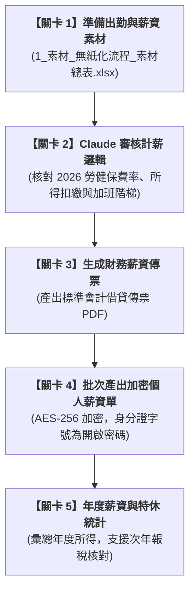

# 實戰範例：中小企業員工打卡薪資計算與加密發放自動化

> 🟣 **採用代理平台**：Claude.ai Agent / Claude Projects  
> 🛠️ **建議執行模式**：**Artifacts 模式 / Code 模式**（透過 Claude 對話式協作直接分析出勤薪資總表、執行 2026 法定費率勾稽，並自動化批次產出個人密碼保護之薪資明細單與會計傳票）  
> 💡 **非本科新手導讀**：非人資背景？請先閱讀 👉 [**`業務背景與工作流入門解析.md`**](./業務背景與工作流入門解析.md)，快速了解工作角色、勞基法規底線與可跨界借鏡之技術！

---

## 🏆 最終完成作品展示（實作成果搶先看）

> 📥 **核心交付成品清單**：  
> 1. 個人防窺薪資單：[**`2_完成檔案_流程1_薪資明細單_加密範例_E001_202610.pdf`**](./2_完成檔案_流程1_薪資明細單_加密範例_E001_202610.pdf)（AES-256 高強度加密，預設以員工身分證字號為開啟密碼）  
> 2. 拋轉財務會計傳票：[**`2_完成檔案_流程1_薪資傳票_歸檔範例.pdf`**](./2_完成檔案_流程1_薪資傳票_歸檔範例.pdf)（完整科目借貸分錄與簽核欄位）  
> 3. 年度所得稅扣繳統計：[**`2_完成檔案_流程1_年度薪資所得統計_範例_2026.xlsx`**](./2_完成檔案_流程1_年度薪資所得統計_範例_2026.xlsx)（含應稅工資、免稅加班、勞健保與特休未休折算工資）

---

## 🎯 案例情境與核心學習價值

中小企業人資每月在進行計薪作業時，往往面臨繁重的手工計算與極高的個資外洩風險：
1. **法規計算複雜且易錯**：
   * **出勤紀錄嚴格合規**：依台灣《勞基法》第 30 條，出勤必須逐日記錄至「分鐘」，工資清冊與出勤紀錄需保存 5 年。
   * **2026 最新法定費率**：勞保 12.5%、健保 5.17%、雇主勞退 6%；平日與休息日加班費率 1.34 / 1.67 / 2.67 階梯倍率。
2. **機敏薪資資料外洩痛點**：
   * 傳統紙本列印薪資條成本高且容易遺失；若透過公司一般 Email 寄送未加密 PDF，極易遭網管或他人攔截窺探。
3. **會計拋轉與特休結算斷層**：
   * 計薪完畢後需手動切傳票入財務系統；特休（曆年制）若於年底或離職未休畢，需依法折算工資。

> 💡 **本單元核心精神**：  
> 透過 Claude 打造安全且符合法規的人資計薪工作流，一鍵完成公式運算、傳票拋轉與「身分證字號自動加密 PDF」批量產出！

---

## 🧭 5 分鐘通關地圖（SOP 流程總覽）

---

## 📂 專案檔案清單與功能說明

| 檔案類型 | 檔案名稱 | 核心內容與功用說明 |
| :--- | :--- | :--- |
| 📘 **操作手冊** | [`3_說明檔_使用說明.docx`](./3_說明檔_使用說明.docx) | 包含薪資計算規則、勞基法合規重點與資安部署建議 |
| 📊 **原始素材** | [`1_素材_無紙化流程_素材總表.xlsx`](./1_素材_無紙化流程_素材總表.xlsx) | 員工名冊、打卡出勤表、薪資月結計算公式表 |
| 📑 **交付成品 1** | [`2_完成檔案_流程1_薪資明細單_加密範例_E001_202610.pdf`](./2_完成檔案_流程1_薪資明細單_加密範例_E001_202610.pdf) | 單一員工個人加密明細單範例 |
| 📑 **交付成品 2** | [`2_完成檔案_流程1_薪資傳票_歸檔範例.pdf`](./2_完成檔案_流程1_薪資傳票_歸檔範例.pdf) | 薪資總表會計傳票歸檔範例 |
| 📗 **交付成品 3** | [`2_完成檔案_流程1_年度薪資所得統計_範例_2026.xlsx`](./2_完成檔案_流程1_年度薪資所得統計_範例_2026.xlsx) | 全年所得、保費與特休結算表 |
| 📦 **查詢系統** | `員工查詢系統.zip` | 包含 `payslip.py` 批次加密腳本與安全金庫模組 |

---

## 🚀 待推進實作項目（下一步）

- [ ] 撰寫純文字白話發想指令（`1-1_白話自然語言發想提示詞.md`）
- [ ] 提煉 RTCCF 結構化提示詞（`1-2_AI產出之RTCCF審查與結構化提示詞.md`）
- [ ] Python 批次產出加密 PDF 與自動驗證流程

---

[← 返回 2026_10_19 案例總表](../README.md)
