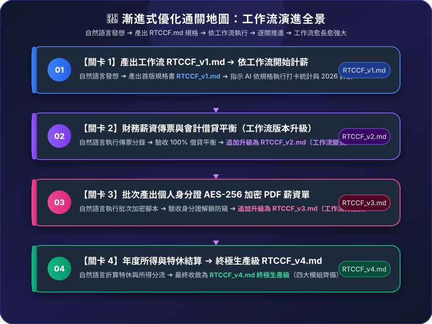

# 實戰範例：中小企業員工打卡薪資計算與加密發放自動化

> 🤖 **採用代理平台**：主流 AI Agent 平台（如 Claude Projects / ChatGPT / Gemini 等具備專案知識庫與 Code 執行能力之智慧代理人）  
> 🛠️ **建議執行模式**：**Code 模式 / 腳本執行模式**（透過 AI Agent 對話式協作直接分析出勤薪資總表、執行 2026 法定費率勾稽，並自動化批次產出個人密碼保護之薪資明細單與會計傳票）  
> 💡 **非本科新手導讀**：非人資背景？請先閱讀 👉 [**`業務背景與工作流入門解析.md`**](./業務背景與工作流入門解析.md)，快速了解工作角色、勞基法規底線與可跨界借鏡之技術！

---

## 🏆 最終完成作品展示（實作成果搶先看）

> 📥 **核心交付成品清單**：  
> 1. 個人防窺薪資單：[**`2_完成檔案_流程1_薪資明細單_加密範例_E001_202610.pdf`**](./2_完成檔案_流程1_薪資明細單_加密範例_E001_202610.pdf)（AES-256 高強度加密，預設以員工身分證字號為開啟密碼）  
> 2. 拋轉財務會計傳票：[**`2_完成檔案_流程1_薪資傳票_歸檔範例.pdf`**](./2_完成檔案_流程1_薪資傳票_歸檔範例.pdf)（完整科目借貸分錄與簽核欄位，保證借貸平帳）  
> 3. 年度所得稅扣繳統計：[**`2_完成檔案_流程1_年度薪資所得統計_範例_2026.xlsx`**](./2_完成檔案_流程1_年度薪資所得統計_範例_2026.xlsx)（含應稅工資、免稅加班、勞健保與特休未休折算工資）

---

## 🎯 案例情境與核心學習價值

中小企業人資每月在進行計薪作業時，往往面臨繁重的手工計算與極高的個資外洩風險：
1. **法規計算複雜且易錯**：
   * **出勤紀錄嚴格合規**：依台灣《勞動基準法》第 30 條，出勤必須逐日記錄至「分鐘」，工資清冊與出勤紀錄需保存 5 年。
   * **2026 最新法定費率**：勞保 12.5%（員工 20%、雇主 70%、政府 10%）、健保 5.17%、雇主勞退 6%；平日與休息日加班費率 1.34 / 1.67 / 2.67 階梯倍率。
2. **機敏薪資資料外洩痛點**：
   * 傳統紙本列印薪資條成本高且容易遺失；若透過公司一般 Email 寄送未加密 PDF，極易遭網管或他人攔截窺探。
3. **會計拋轉與特休結算斷層**：
   * 計薪完畢後需手動切傳票入財務系統；特休（曆年制）若於年底或離職未休畢，需依法折算工資。

> 💡 **核心方法論：漸進式優化（Progressive Refinement）**  
> 複雜的工作流**切忌一次輸入所有任務**！本教學採用**「一次一個任務、做一步驗一步」**的漸進式優化策略：  
> 1. **第 1 個產出是工作流規格書**：第 1 次用自然語言發想，唯一目標是產出通用規格書 **`RTCCF_v1.md`**（純規格、不執行計算，存為 `.md` 檔人機才能協作）。  
> 2. **叫 AI 依據工作流開始工作**：人工檢核規格無誤後，正式指示 AI 依據這份 `RTCCF_v1.md` 開始執行出勤與計薪。  
> 3. **後續關卡用自然語言執行新任務**：依序丟出新任務（切傳票、產加密 PDF、特休結算）。  
> 4. **完成後更新寫回同一個工作流**：每道關卡驗收無誤後，請 AI 將新規則追加覆蓋寫回 **`RTCCF_v1.md`**。**關卡愈多，工作流就會愈長、功能愈強大！**

---

## 🧭 5 分鐘通關地圖（SOP 流程總覽）

---

## 🛠️ 實戰闖關手冊：漸進式優化四步曲

請開啟您偏好的 **AI Agent 平台**（如 Claude / ChatGPT / Gemini 等）對話視窗，依序完成以下四個關卡：

### 🟢 關卡 1：建立基礎工作流（RTCCF_v1.md）➔ 依工作流執行出勤計薪

* **輸入素材**：上傳 [`1_素材_無紙化流程_素材總表.xlsx`](./1_素材_無紙化流程_素材總表.xlsx) 至 AI Agent 對話框中。
* **步驟 1-A（第 1 個產出是工作流）**：開啟 👉 [**`關卡1_出勤統計與2026計薪試算.md`**](./關卡1_出勤統計與2026計薪試算.md)，發送白話指令，要求 AI 產出第一版通用規格書 **`RTCCF_v1.md`**（強制儲存為 `.md` 檔案，不跑特定月份試算數據）。
* **人工檢核工作流**：檢視 `RTCCF_v1.md` 規則是否通用、法規條件（平日加班 1.34/1.67、2026 勞健保負擔）是否嚴謹。
* **步驟 1-B（叫 AI 依據工作流開始工作）**：在同對話發送指令，叫 AI 嚴格依照 `RTCCF_v1.md` 讀取 Excel 開始正式算薪！
* **🔍 人工驗收計薪成果**：
  * [ ] 是否正確讀取打卡時間（精確至分鐘）？
  * [ ] 平日延長工時是否依 1.34 / 1.67 階梯倍率計算？（不可誤用 1.33 / 1.66）
  * [ ] 勞保費（12.5%）、健保費（5.17%）之員工自行負擔金額是否與法定級距表完全吻合？

---

### 🟣 關卡 2：財務薪資傳票與借貸平衡 ➔ 更新寫回 RTCCF_v1.md（工作流變長）

* **任務情境**：薪資試算無誤後，人資需將發薪數據交棒給會計入帳。
* **步驟 2-A（自然語言執行任務）**：開啟 👉 [**`關卡2_財務薪資傳票與借貸平衡.md`**](./關卡2_財務薪資傳票與借貸平衡.md)，用白話自然語言請 AI 切出傳票分錄。
* **🔍 人工驗收傳票**：
  * [ ] **借方科目（薪資成本）**：薪資支出 ＋ 加班費 ＋ 伙食費。
  * [ ] **貸方科目（資金去向）**：應付薪資（實發總額） ＋ 代收勞健保 ＋ 代收勞退自提。
  * [ ] **借貸完全平帳**：借方總金額與貸方總金額是否 **100% 一塊錢都不差**？
* **步驟 2-B（任務完成後更新工作流）**：指示 AI 將會計分錄與平帳鐵則追加寫回 **`RTCCF_v1.md`**，**工作流擴充變長！**

---

### 🟢 關卡 3：批次產出個人身分證 AES-256 加密 PDF 薪資單 ➔ 更新寫回 RTCCF_v1.md（工作流再擴充）

* **任務情境**：防範發薪洩密與符合勞基法第 23 條（提供工資明細），建立專屬防窺薪資單。
* **步驟 3-A（自然語言執行任務）**：開啟 👉 [**`關卡3_批次產出個人加密薪資單PDF.md`**](./關卡3_批次產出個人加密薪資單PDF.md)，用白話自然語言請 AI 撰寫腳本產出加密 PDF。
* **🔍 人工驗收加密**：
  * [ ] 是否針對每位員工個別生成獨立的薪資明細單 PDF？
  * [ ] 開啟 PDF 時是否立即跳出密碼輸入框？
  * [ ] 輸入該同仁的身分證字號（如 `A1XXXXXXXX`）能成功解鎖，輸入錯誤密碼則拒絕開啟？
* **步驟 3-B（任務完成後更新工作流）**：指示 AI 將資安加密約束與批次產出規格追加寫回 **`RTCCF_v1.md`**，**工作流再次變長！**

---

### 🟡 關卡 4：年度薪資所得統計與特休結算 ➔ 終極完稿 RTCCF_v1.md

* **任務情境**：年底報稅申報（各類所得扣繳）與結算特休未休天數工資。
* **步驟 4-A（自然語言執行任務）**：開啟 👉 [**`關卡4_年度所得統計與特休結算.md`**](./關卡4_年度所得統計與特休結算.md)，用白話自然語言請 AI 結算特休與年度所得。
* **🔍 人工驗收年度所得**：
  * [ ] 特休（曆年制）未休天數是否正確按日薪（月薪 ÷ 30）折算為應發補償工資？
  * [ ] 是否清楚區分「應稅薪資所得」與「免稅加班費（每月 46 小時以內）」？
* **步驟 4-B（最終收斂更新工作流）**：指示 AI 整合四大模組，收斂為 **終極生產級 `RTCCF_v1.md`**（完整範本收錄於 [`1-2_AI產出之RTCCF審查與結構化提示詞.md`](./1-2_AI產出之RTCCF審查與結構化提示詞.md)）！未來每月發薪直接調用這份終極工作流即可全自動運作！

---

## 📂 專案檔案清單與功能說明

| 檔案類型 | 檔案名稱 | 核心內容與功用說明 |
| :--- | :--- | :--- |
| 📘 **操作手冊** | [`3_說明檔_使用說明.docx`](./3_說明檔_使用說明.docx) | 包含薪資計算規則、勞基法合規重點與資安部署建議 |
| 📊 **原始素材** | [`1_素材_無紙化流程_素材總表.xlsx`](./1_素材_無紙化流程_素材總表.xlsx) | 員工名冊、打卡出勤表、薪資月結計算公式表 |
| 🟢 **實作關卡 1** | [`關卡1_出勤統計與2026計薪試算.md`](./關卡1_出勤統計與2026計薪試算.md) | 打卡時間讀取、加班階梯倍率與勞健保試算指令與驗收 |
| 🟣 **實作關卡 2** | [`關卡2_財務薪資傳票與借貸平衡.md`](./關卡2_財務薪資傳票與借貸平衡.md) | 複式簿記傳票分錄、借貸平衡勾稽指令與驗收 |
| 🟢 **實作關卡 3** | [`關卡3_批次產出個人加密薪資單PDF.md`](./關卡3_批次產出個人加密薪資單PDF.md) | 身分證 AES-256 加密防窺、批次 PDF 腳本指令與驗收 |
| 🟡 **實作關卡 4** | [`關卡4_年度所得統計與特休結算.md`](./關卡4_年度所得統計與特休結算.md) | 曆年制特休折現工資、所得稅報稅統計指令與驗收 |
| 📑 **終極規格** | [`1-2_AI產出之RTCCF審查與結構化提示詞.md`](./1-2_AI產出之RTCCF審查與結構化提示詞.md) | 四關演進收斂之終極生產級工作流規格書 |
| 📑 **交付成品 1** | [`2_完成檔案_流程1_薪資明細單_加密範例_E001_202610.pdf`](./2_完成檔案_流程1_薪資明細單_加密範例_E001_202610.pdf) | 單一員工個人加密明細單範例 |
| 📑 **交付成品 2** | [`2_完成檔案_流程1_薪資傳票_歸檔範例.pdf`](./2_完成檔案_流程1_薪資傳票_歸檔範例.pdf) | 薪資總表會計傳票歸檔範例 |
| 📗 **交付成品 3** | [`2_完成檔案_流程1_年度薪資所得統計_範例_2026.xlsx`](./2_完成檔案_流程1_年度薪資所得統計_範例_2026.xlsx) | 全年所得、保費與特休結算表 |
| 📦 **查詢系統** | `員工查詢系統.zip` | 包含 `payslip.py` 批次加密腳本與安全金庫模組 |

---

## 🛡️ 企業實務資安部署建議（個資不上雲端）

中小企業導入 AI 最常擔心的就是：**「真實員工的身分證字號與薪資，真的能上傳給外部雲端 AI 嗎？」**

在實務部署中，強烈建議採用**「脫敏研發 ➔ 本機離線執行」**雙軌機制：
1. **脫敏研發（在 AI Agent 平台上）**：
   使用本專案提供的 3 位虛擬員工（範例員工 A、B、C）與遮罩身分證（如 `A1XXXXXXXX`），在 AI Agent 平台上完成所有邏輯驗證、提示詞微調與 Python 腳本（`payslip.py`）生成。
2. **本機離線執行（在公司內部）**：
   當流程驗證通過後，將生成的 Python 腳本下載至人資或財務電腦上執行。由本機電腦直接讀取公司內部真實的名冊與打卡總表，**真實員工姓名、身分證與薪資 100% 留在本機電腦，完全不流經任何外部雲端**，兼顧極致效率與最高資安隱私合規！

---

## 🚀 待推進實作項目（下一步）

- [x] 撰寫四大關卡獨立實作指令（`關卡1`～`關卡4` 專屬 markdown 檔案）
- [x] 提煉 RTCCF 結構化提示詞 👉 [**`1-2_AI產出之RTCCF審查與結構化提示詞.md`**](./1-2_AI產出之RTCCF審查與結構化提示詞.md)（已收斂終極生產級規格書）
- [ ] Python 批次產出加密 PDF 與自動驗證流程

---

[← 返回 2026_10_19 案例總表](../README.md)

