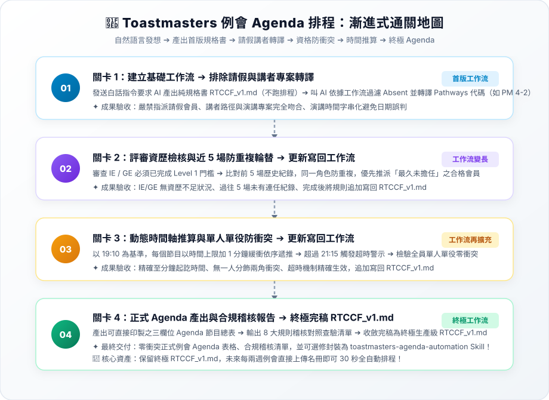

# 4-1 白話自然語言發想提示詞（Toastmasters 例會排程）

> 💡 **核心精神**：向 AI 描述演講會排課幹部的日常痛點，將「看請假表、查進度表、翻前五場歷史、算分鐘時間」等繁雜動作，化為簡單口語發想。  
> 📌 **最新漸進式優化實作指引**：本案例已全面升級為「漸進式優化四步曲」，請直接前往 👉 [**`關卡1_請假過濾與講者專案轉譯.md`**](./關卡1_請假過濾與講者專案轉譯.md) 依序通關！

---

## 🎯 核心工作流總覽



---

## 📋 自然語言發想指令（Prompt）

可於 AI 對話視窗中上傳名冊並發送：

```text
你是一位熟悉國際演講會（Toastmasters International）分會運作與例會排程的資深幹部。

我上傳了兩份檔案：
1. 「Signup Sheet.xlsx」（裡面有歷史各場次角色紀錄、出席登記與請假名單）
2. 「Member Speech Planning.xlsx」（記錄每位會員當前 Pathways 路徑、Level 與下一個演講專案）

請幫我為即將舉行的目標例會排定正式的 Agenda 節目表，排程時請嚴格遵守以下規則：
1. 【排除請假】：名單標註 Absent 的會員絕對不能安排任何職務。
2. 【講者專案轉譯】：確認報名講者的 Pathways 路徑（PM、PI、VC、DL、EH、MS 等）與 Next Project，轉成標準縮寫格式（如 PM 4-2）。
3. 【評審資格門檻】：Individual Evaluator 與 General Evaluator 必須已完成 Level 1（進度在 Level 2 以上或已完成 L1P4）。
4. 【防重複與公平輪替】：參考目標例會前最近 5 場歷史紀錄，同一角色不可重複擔任，優先挑選「最久沒擔任過該角色」的合格會員。
5. 【單人單役】：每位會員當天限任 1 個角色（講者也算 1 個）。
6. 【時間推算】：從 19:10 開始，每個節目以表定時間上限加 1 分鐘緩衝依序推算。若全場結束時間晚於 21:15，請特別警示。
7. 【防呆輸出】：演講時間請以純文字格式呈現（如 "4-6"、"5-7"），避免被 Excel 轉換為日期。

請幫我排定本場例會的最佳陣容，並輸出完整 Agenda 節目清單與檢核報告！
```

---

[← 返回專案首頁](./README.md)
