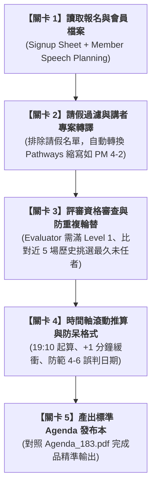

# 實戰範例：國際演講會例會 Agenda 自動排程與角色資格檢核

> 🟣 **採用代理平台**：Claude.ai Agent / Claude Projects  
> 🛠️ **建議執行模式**：**Artifacts 模式 / Code 模式**（透過 Claude 同時解析多份 Excel 報名表與會員進度表，自動執行跨表勾稽、資格審查與防重複演算法，一次產出高規格 Agenda 節目表）  
> 💡 **非本科新手導讀**：非演講會幹部？請先閱讀 👉 [**`業務背景與工作流入門解析.md`**](./業務背景與工作流入門解析.md)，快速了解國際演講會運作、8 大排課規則與可跨界運用之「多約束條件排程演算法」！

---

## 🏆 最終完成作品展示（實作成果搶先看）

> 📥 **核心交付成品與參考樣板**：  
> 1. 參考歷史標準版型：[**`Agenda_183.pdf`**](./Agenda_183.pdf)（標準 Toastmasters 雙欄時間推進與 Objectives 格式）  
> 2. 原始報名總表素材：[**`Signup Sheet.xlsx`**](./Signup Sheet.xlsx)（歷史場次角色、請假名單與報名紀錄）  
> 3. 會員進度追蹤素材：[**`Member Speech Planning.xlsx`**](./Member Speech Planning.xlsx)（會員當前 Pathways 路徑、Level 與下一專案）  
> 4. 人工排課規則文件：[**`排課SOP說明與規則_20261020.docx`**](./排課SOP說明與規則_20261020.docx)

---

## 🎯 案例情境與核心學習價值

在 Toastmasters 國際演講會（Toastmasters International）分會中，教育副會長（VPE）或排程幹部每隔一至兩週就必須排定一場包含 15～20 個角色的正式例會 Agenda。在傳統人工排程作業中，往往需要耗費數小時人工肉眼在多個試算表間來回切換核對，極易發生「資格不符」或「撞期違規」等尷尬情況：

1. **多重嚴苛排班規則檢核**：
   * **請假過濾**：已登記 Absent 之會員絕對不可安排任何工作。
   * **講者與專案對齊**：依每位 Speaker 目前修習的 Pathways 路徑（PM、PI、VC、DL、EH、MS 等）與 Next Project 自動推算演講代碼（如 `PM 4-2`）。
   * **評審資格硬性門檻**：個人評審（Individual Evaluator）與總評（General Evaluator）**必須已完成 Level 1**，無紀錄或初學者不得擔任。
   * **近 5 場防重複輪替**：TME、Timer、Ah Counter、Language Evaluator、News Master 等角色需向左比對前 5 場歷史，避免同一人頻繁輪值；優先選擇「最久未擔任該角色」者。
   * **單人單役原則**：每人每場嚴格限任 1 個角色（擔任 Speaker 者即不能兼任其他幹部）。
2. **時間軸精準動態推算**：
   * 會議固定於 19:10 啟動，每個節目必須依表定時間上限外加 **1 分鐘緩衝** 進行滾動推算。
   * 全場結束時間若晚於 21:15，需自動觸發超時預警提示。
3. **Excel 資料型態防呆陷阱**：
   * 演講長度（如 `4-6`、`5-7` 分鐘）若直接寫入，極易被 Excel 誤判為日期格式（如變為 4月6日），需在格式層級做防呆控制。

> 💡 **本單元核心精神**：  
> 透過 Claude 建立完整的多表關聯與資格審查 Agent，一鍵讀取報名表與會員資歷，秒級產出零失誤、時間精準對齊的專業 Agenda！

---

## 🧭 5 分鐘通關地圖（SOP 流程總覽）

---

## 📂 專案檔案清單與功能說明

| 檔案類型 | 檔案名稱 | 核心內容與功用說明 |
| :--- | :--- | :--- |
| 📘 **SOP 規則** | [`排課SOP說明與規則_20261020.docx`](./排課SOP說明與規則_20261020.docx) | 包含 8 步驟排定手冊、Pathways 縮寫表、資格條件與時間公式 |
| 📊 **會員進度** | [`Member Speech Planning.xlsx`](./Member Speech Planning.xlsx) | 全體會員路徑進度（Path、Next Project、Level 完成度） |
| 📋 **出勤報名** | [`Signup Sheet.xlsx`](./Signup Sheet.xlsx) | 歷史 180+ 場次角色紀錄、出席登記與請假名單 |
| 📑 **參考成品** | [`Agenda_183.pdf`](./Agenda_183.pdf) | 標準例會 Agenda 版型（表頭資訊、時間流程、Objectives） |

---

## 🚀 待推進實作項目（下一步）

- [ ] 撰寫純白話需求發想提示詞（`4-1_白話自然語言發想提示詞.md`）
- [ ] 產出 RTCCF 多表審查與排程提示詞（`4-2_AI產出之RTCCF排程與資格檢核提示詞.md`）
- [ ] 實作自動化排程與 Agenda 格式生成流程

---

[← 返回 2026_10_19 案例總表](../README.md)
