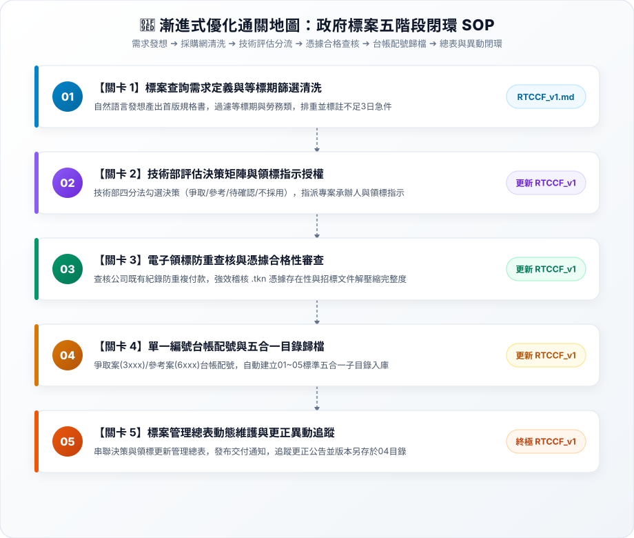

# 6-1 白話自然語言發想提示詞（政府標案篩選與電子領標作業自動化）

> 💡 **核心精神**：向 AI 描述政府採購網查詢繁瑣、技術與管理跨部門協同斷層、重複付費領標以及更正公告漏追的職場痛點，引導 AI 規劃一套「等標期篩選 ➔ 評估配號 ➔ 電子領標歸檔 ➔ 異動追蹤」的標準閉環工作流。  
> 📌 **最新漸進式優化實作指引**：本案例已全面導入「漸進式優化四步曲」，請直接前往 👉 [**`關卡1_標案查詢需求與等標期篩選清洗.md`**](./關卡1_標案查詢需求與等標期篩選清洗.md) 依序通關！

---

## 🎯 核心工作流總覽



---

## 📋 自然語言發想指令（Prompt）

可於 AI 對話視窗中直接複製發送，讓 AI 了解全貌並設計工作流架構：

```text
我們公司是一家參與政府各類公共工程與委託技術服務的工程顧問團隊。平時參與政府招標時，技術部與管理部之間面臨繁重且容易出錯的手工流程：

1. 標案查詢與篩選混亂：
   管理部每週二、每週五都要到「政府電子採購網（web.pcc.gov.tw）」用技術部給的關鍵字搜尋勞務類標案。但採購網標案非常多，常查到過期的、重複的，或是距截止投標只剩不到 3 天的急件，人工整理成清單耗費半天，容易漏標。

2. 跨部門評估與編號無序：
   清單給技術部後，技術部需要勾選「爭取（要投標並指派承辦人）」、「參考（不投標但具市場參考價值）」、「待確認」或「不採用」。但目前缺乏統一的計畫編號台帳，大家各自開資料夾，導致跨年度號碼衝突、歷史資料夾找不到。

3. 電子領標付費與憑證管理風險：
   決定爭取或參考後，管理部要執行「電子領標」。常發生同仁沒查公司內部紀錄而重複付費領標；或者領標後下載的文件解壓縮混亂，最嚴重的甚至弄丟「電子領標憑據（.tkn 或領標收據）」，導致投標當場被判定為不合格標！

4. 異動與更正公告漏追：
   機關常在等標期中發更正公告、延期截標或補充答詢文件，但團隊沒及時更新，拿舊文件去估算企劃書造成嚴重廢標風險。

我手邊有相關的作業流程與表單規範。我希望透過 AI 規劃一套完整的自動化工作流：
- 建立從「查詢需求與等標期清洗 ➔ 技術決策與 3xxx/6xxx 自動配號 ➔ 電子領標憑據查驗與五合一標準目錄歸檔 ➔ 異動監控與管理總表更新」的標準閉環。
- 每案固定規範五大子目錄（01_公告、02_領標憑據及付款、03_原始招標文件、04_更正及補充、05_內部評估）。
- 針對截止投標不足 3 工作天的案件，自動啟動急件警示機制。

請幫我規劃這套跨部門標案管理工作流，並轉譯為標準的 RTCCF 提示詞！
```

---

[← 返回專案首頁](./README.md)

