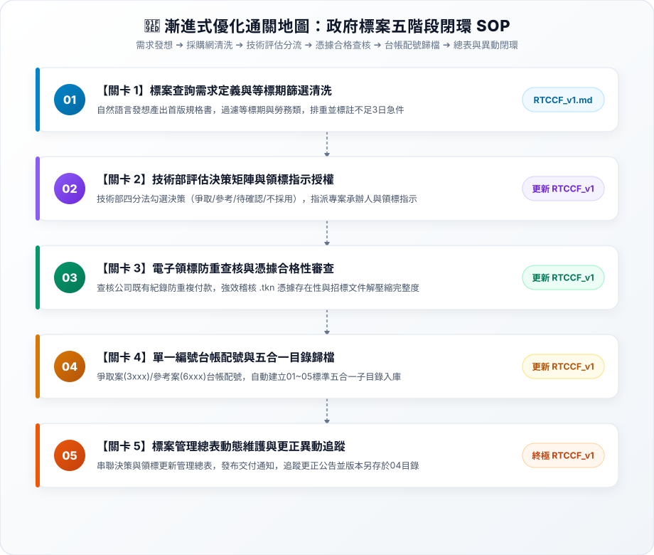

# 實戰範例：政府採購標案篩選與電子領標作業自動化

> 🤖 **採用代理平台**：主流 AI Agent 平台（如 Claude Projects / ChatGPT / Gemini 等具備專案知識庫與 Code 執行能力之智慧代理人）  
> 🛠️ **建議執行模式**：**Code 模式 / 腳本執行模式**（透過 AI Agent 對話式協作直接過濾採購網標案、執行等標期排重與急件標記、四分法決策授權、憑據合格稽核，並自動化建置五合一標準目錄與標案管理總表）  
> 💡 **非標案新手導讀**：非工程投標背景？請先閱讀 👉 [**`業務背景與工作流入門解析.md`**](./業務背景與工作流入門解析.md)，快速了解政府採購法時效、電子領標憑據防呆與跨界可借鏡之技術！

---

## 🏆 最終完成作品展示（實作成果搶先看）

> 📥 **核心交付成品清單**：  
> 1. 完整作業流程與規則簡報：[**`政府採購標案篩選與電子領標作業流程.pptx`**](./政府採購標案篩選與電子領標作業流程.pptx)（涵蓋技術與管理分工、審核規格、號段台帳）  
> 2. 審核規格標準書：[**`審核規格.docx`**](./審核規格.docx)（查詢完整性、等標期排重、領標授權與憑據複核標準）  
> 3. 採購網站素材與操作節點：[**`採購網站素材.docx`**](./採購網站素材.docx)（政府採購網截圖與領標操作路徑）  
> 4. 資料需求與交付物定義：[**`資料需求清單.docx`**](./資料需求清單.docx) 與 [**`最終產品.docx`**](./最終產品.docx)  
> 5. 五合一目錄建置腳本：[**`skills/government-tender-automation/scripts/init_tender_folder.py`**](./skills/government-tender-automation/scripts/init_tender_folder.py)  
> 6. 終極生產級封裝規格書：[**`6-2_AI產出之RTCCF審查與結構化提示詞.md`**](./6-2_AI產出之RTCCF審查與結構化提示詞.md)（五模組整合完稿版）

---

## 🎯 案例情境與核心學習價值

企業在參與政府公共工程、勞務與技術服務採購時，技術團隊與管理團隊往往面臨嚴峻的時效壓力與極高的行政失誤風險：
1. **等標期時效與急件風險**：
   * 政府標案截止投標時間具有嚴格不可逆性，超出一秒即為無效標；若未每週定期清查，往往等到距截標不足 3 個工作天（急件）才發現，導致備標時間不足而痛失良機。
2. **電子領標憑據防呆與防重複付費**：
   * 投標時標封內必須檢附**「電子領標憑據（.tkn）」**，缺漏者直接被判定為不合格標；缺乏台帳查核容易重複線上付費購買，造成公帑浪費。
3. **跨部門決策與版本管理的資訊黑洞**：
   * 技術部與管理部缺乏統一台帳，爭取標案（投標）與參考標案（情報庫）編號衝突；機關發布更正公告或延期截標時，未及時更新總表導致工程師誤用舊文件估價。

> 💡 **核心方法論：漸進式優化（Progressive Refinement）**  
> 複雜的工作流**切忌一次輸入所有任務**！本教學採用**「一次一個任務、做一步驗一步」**的漸進式優化策略：  
> 1. **第 1 個產出是工作流規格書**：第 1 次用自然語言發想，唯一目標是產出通用規格書 **`RTCCF_v1.md`**（純規格、不執行特定搜尋，存為 `.md` 檔人機才能協作）。  
> 2. **叫 AI 依據工作流開始工作**：人工檢核規格無誤後，正式指示 AI 依據這份 `RTCCF_v1.md` 開始執行標案篩選與等標期清洗。  
> 3. **後續關卡用自然語言執行新任務**：依序丟出新任務（技術評估分流、領標憑據查驗、台帳編號與五合一歸檔、更正異動追蹤與總表更新）。  
> 4. **完成後更新寫回同一個工作流**：每道關卡驗收無誤後，請 AI 將新規則追加覆蓋寫回 **`RTCCF_v1.md`**。**關卡愈多，工作流就會愈長、功能愈強大！**

---

## 🧭 5 分鐘通關地圖（SOP 流程總覽）



---

## 🛠️ 通關前置整備（必做動作）：前置資料清洗

一般上班族溝通習慣使用多份 Word 檔（本案例含 660KB 圖片檔）與 6 頁 PPTX 簡報。如果直接將這些 Office 檔案全部上傳至 Claude，光是圖片與 XML 排版就會吃掉上萬 Tokens，導致免費額度在 1~2 輪對話即被耗盡。

因此，**進入關卡 1 前，必須執行【前置資料清洗】**。本案例提供兩種教材版本：

| 版本類型 | 取用方式 / 連結 | 說明與適用情境 |
| :--- | :--- | :--- |
| 🚀 **【推薦】課堂實作清洗包（極省 Token）** | 📥 [**`【課堂實作下載包】政府採購標案篩選與電子領標_AI實戰包.zip`**](./【課堂實作下載包】政府採購標案篩選與電子領標_AI實戰包.zip)<br>（或瀏覽目錄 👉 [`02_AI清洗後教材_課堂實作專用/`](./02_AI清洗後教材_課堂實作專用/)） | **課堂實作唯一推薦！** 將 6 頁 PPTX 流程、審核規格與交付清單全面精煉為純文字 Markdown。**Token 節省 95% 以上**，可直接匯入 Claude Projects。 |
| 📁 **學員原始檔案（真實職場樣貌）** | 瀏覽目錄 👉 [`01_學員原始檔案_下載區/`](./01_學員原始檔案_下載區/) | 完整保留 5 份 Office 原始檔（包含 660KB 採購截圖 Word 檔與 6 頁簡報），供對照與進階挑戰。 |

---

## 🛠️ 實戰闖關手冊：漸進式優化五步曲

請開啟您偏好的 **AI Agent 平台**（如 Claude / ChatGPT / Gemini 等）對話視窗，依序完成以下五個關卡：

### 🟢 關卡 1：建立基礎工作流（RTCCF_v1.md）➔ 依工作流篩選清洗標案

* **輸入素材**：上傳 [`資料需求清單.docx`](./資料需求清單.docx) 與 [`審核規格.docx`](./審核規格.docx) 至 AI Agent 對話框中。
* **步驟 1-A（第 1 個產出是工作流）**：開啟 👉 [**`關卡1_標案查詢需求與等標期篩選清洗.md`**](./關卡1_標案查詢需求與等標期篩選清洗.md)，發送白話指令，要求 AI 產出第一版通用規格書 **`RTCCF_v1.md`**（強制儲存為 `.md` 檔案，不跑特定標案搜尋）。
* **人工檢核工作流**：檢視 `RTCCF_v1.md` 規則是否通用、等標期與勞務類別過濾是否明確、機關+案號+次別唯一性排重與不足3日急件警示是否齊備。
* **步驟 1-B（叫 AI 依據工作流開始工作）**：在同對話發送指令，叫 AI 嚴格依照 `RTCCF_v1.md` 讀取標案清單，執行資料清洗與急件標記！
* **🔍 人工驗收成果**：
  * [ ] 非勞務類或已過等標期之案件是否被準確剔除？
  * [ ] 相同機關+案號+次別是否已去重複？
  * [ ] 距截標不足 3 個工作天之標案是否已正確標註【🚨 急件】？

---

### 🟣 關卡 2：技術部評估決策矩陣與領標指示授權 ➔ 更新寫回 RTCCF_v1.md（工作流變長）

* **任務情境**：技術部依四分法（爭取／參考／待確認／不採用）勾選決策，爭取案指定專案承辦人與領標指示。
* **步驟 2-A（自然語言執行任務）**：開啟 👉 [**`關卡2_技術部評估決策與領標指示授權.md`**](./關卡2_技術部評估決策與領標指示授權.md)，用白話自然語言請 AI 執行四分法決策分流與授權防呆。
* **🔍 人工驗收成果**：
  * [ ] **責任承辦人明確**：爭取標案是否已指派專案負責工程師？
  * [ ] **領標授權齊備**：爭取與參考案件是否已具備領標指示與費用動支授權？
  * [ ] **不採用結案防呆**：不採用案件是否已載明理由並予以結案存查？
* **步驟 2-B（任務完成後更新工作流）**：指示 AI 將技術決策矩陣與授權防呆機制追加寫回 **`RTCCF_v1.md`**，**工作流擴充變長！**

---

### 🟢 關卡 3：電子領標防重查核與憑據合格性審查 ➔ 更新寫回 RTCCF_v1.md（工作流再擴充）

* **任務情境**：管理部辦理線上電子領標，查核既有紀錄避免重複刷卡，強效檢驗 `.tkn` 憑據存在性與招標文件可讀性。
* **步驟 3-A（自然語言執行任務）**：開啟 👉 [**`關卡3_電子領標防重查核與憑據合格性審查.md`**](./關卡3_電子領標防重查核與憑據合格性審查.md)，用白話自然語言請 AI 進行領標合規審查。
* **🔍 人工驗收成果**：
  * [ ] **防重刷卡生效**：同一招標次別已領標者，是否阻斷重複付費並直接取用既有檔案？
  * [ ] **異常阻斷生效**：缺漏 `.tkn` 電子憑據之標案是否被強制阻斷、禁止交付技術部？
  * [ ] **文件齊全可讀**：招標文件包（.zip）解壓縮正常且投標須知可開啟。
* **步驟 3-B（任務完成後更新工作流）**：指示 AI 將防重查核與憑據稽核標準追加寫回 **`RTCCF_v1.md`**，**工作流再次變長！**

---

### 🟡 關卡 4：單一編號台帳配號與五合一目錄歸檔 ➔ 更新寫回 RTCCF_v1.md（工作流繼續擴充）

* **任務情境**：單一編號台帳配號（爭取 3xxx / 參考 6xxx），自動建立 01～05 標準專案目錄並分流歸戶。
* **步驟 4-A（自然語言執行任務）**：開啟 👉 [**`關卡4_單一編號台帳配號與五合一目錄歸檔.md`**](./關卡4_單一編號台帳配號與五合一目錄歸檔.md)，用白話自然語言請 AI 執行台帳配號與目錄建檔。
* **🔍 人工驗收成果**：
  * [ ] **號段精準歸戶**：爭取標案是否配發 `3001～6000` 號段？參考標案是否配發 `6001～9999` 號段？
  * [ ] **台帳唯一原則**：號碼是否依序累加、無跳號或重複，且不因年度重置？
  * [ ] **五合一固定子目錄齊全**：`01_公告`、`02_領標憑據及付款`、`03_原始招標文件`、`04_更正及補充`、`05_內部評估`。
* **步驟 4-B（任務完成後更新工作流）**：指示 AI 將台帳原則與目錄架構追加寫回 **`RTCCF_v1.md`**，**工作流再次變長！**

---

### 🟠 關卡 5：標案管理總表動態維護與更正異動追蹤 ➔ 終極完稿 RTCCF_v1.md

* **任務情境**：串聯決策與領標更新「標案管理總表」，發布領標交付通知，監控更正公告並版本另存於 04 子目錄。
* **步驟 5-A（自然語言執行任務）**：開啟 👉 [**`關卡5_標案管理總表動態維護與更正異動追蹤.md`**](./關卡5_標案管理總表動態維護與更正異動追蹤.md)，用白話自然語言請 AI 執行總表維護、通知發布與更正處理。
* **🔍 人工驗收成果**：
  * [ ] 更正文件存放於 `04_更正及補充`，原始招標文件未遭任何覆蓋或破壞。
  * [ ] 標案管理總表已動態更新最新截止時間與剩餘工作天數。
  * [ ] 領標完成通知清楚載明編號、案名、最新截標時限與資料夾連結。
* **步驟 5-B（最終收斂更新工作流）**：指示 AI 整合五大模組，收斂為 **終極生產級 `RTCCF_v1.md`**（完整範本收錄於 [`6-2_AI產出之RTCCF審查與結構化提示詞.md`](./6-2_AI產出之RTCCF審查與結構化提示詞.md)）！未來每週調用這份終極工作流即可自動跑完全程！
* 📌 **【重要資產提醒】**：**請務必永久妥善保留這份 `RTCCF_v1.md` 檔案！** 這是歷經人機協作打磨的最高結晶。

---

### ⭐ 選修進階（Optional）：將 RTCCF_v1 工作流封裝為「AI Agent Skill」

當工作流穩定後，可依據官方 Agent Skill 規範將其封裝為即插即用的技能套件：
* **標準 Skill 目錄結構**：
  ```text
  skills/government-tender-automation/
  ├── SKILL.md            # 必要：包含 YAML frontmatter (name, description) 的完整封裝 SOP
  └── scripts/            # 選用：固定不變的自動化建置腳本
      └── init_tender_folder.py  # 五合一目錄建立腳本
  ```
* **一鍵升級指引**：請詳閱 👉 [**`關卡5_標案管理總表動態維護與更正異動追蹤.md`**](./關卡5_標案管理總表動態維護與更正異動追蹤.md#選修進階optional將-rtccf_v1-工作流封裝為ai-agent-skill) 中的選修封裝指令。

---

## 📂 專案檔案清單與功能說明

| 檔案類型 | 檔案名稱 | 核心內容與功用說明 |
| :--- | :--- | :--- |
| 📊 **原始簡報** | [`政府採購標案篩選與電子領標作業流程.pptx`](./政府採購標案篩選與電子領標作業流程.pptx) | 跨部門分工流程、審核規格、號段管理原則與資料夾規則 |
| 📘 **審核標準** | [`審核規格.docx`](./審核規格.docx) | 查詢完整性、等標期排重、領標授權與憑據複核合格標準 |
| 📑 **需求清單** | [`資料需求清單.docx`](./資料需求清單.docx) | 查詢需求、基本資料、勾選結果與領標取得之欄位定義 |
| 🌐 **網站素材** | [`採購網站素材.docx`](./採購網站素材.docx) | 政府電子採購網招標查詢與電子領標操作介面與素材 |
| 📦 **交付成果** | [`最終產品.docx`](./最終產品.docx) | 關鍵字需求表、標案篩選清單、管理總表與資料包形式說明 |
| 🐍 **核心腳本** | [`skills/government-tender-automation/scripts/init_tender_folder.py`](./skills/government-tender-automation/scripts/init_tender_folder.py) | 五合一標準目錄自動建立與專案資訊說明檔生成程式碼 |
| 🟢 **實作關卡 1** | [`關卡1_標案查詢需求與等標期篩選清洗.md`](./關卡1_標案查詢需求與等標期篩選清洗.md) | 等標期檢查、機關+案號+次別排重、不足3日急件標籤，產出首版 `RTCCF_v1.md` |
| 🟣 **實作關卡 2** | [`關卡2_技術部評估決策與領標指示授權.md`](./關卡2_技術部評估決策與領標指示授權.md) | 四分法勾選決策、承辦人指派與領標指示授權防呆，更新寫回 `RTCCF_v1.md` |
| 🟢 **實作關卡 3** | [`關卡3_電子領標防重查核與憑據合格性審查.md`](./關卡3_電子領標防重查核與憑據合格性審查.md) | 防重複付款查核、.tkn憑據稽核與異常阻斷，更新寫回 `RTCCF_v1.md` |
| 🟡 **實作關卡 4** | [`關卡4_單一編號台帳配號與五合一目錄歸檔.md`](./關卡4_單一編號台帳配號與五合一目錄歸檔.md) | 3xxx爭取/6xxx參考單一編號台帳配號、五合一目錄建立，更新寫回 `RTCCF_v1.md` |
| 🟠 **實作關卡 5** | [`關卡5_標案管理總表動態維護與更正異動追蹤.md`](./關卡5_標案管理總表動態維護與更正異動追蹤.md) | 更正公告版本另存、總表時限更新、交付通知發布，收斂終極 `RTCCF_v1.md` |
| 🏆 **終極規格書** | [`6-2_AI產出之RTCCF審查與結構化提示詞.md`](./6-2_AI產出之RTCCF審查與結構化提示詞.md) | 包含五關動態演進軌跡矩陣與五模組收斂之終極生產級 RTCCF 全文 |
| 🗺️ **通關架構圖** | [`SOP通關流程圖.svg`](./SOP通關流程圖.svg) | 亮色精緻五卡片式漸進式優化 SOP 全景圖（純 SVG，無 mermaid） |
