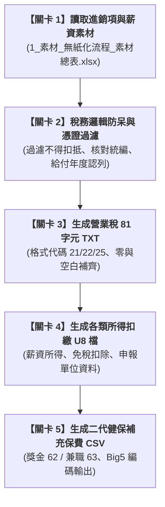

# 實戰範例：營業稅與各類所得法定申報檔產出自動化

> 🟣 **採用代理平台**：Claude.ai Agent / Claude Projects  
> 🛠️ **建議執行模式**：**Artifacts 模式 / Code 模式**（透過 Claude 自動讀取進銷發票與年度薪資總表，精準轉譯為台灣財政部國稅局與健保署指定之官方媒體申報檔格式）  
> 💡 **非本科新手導讀**：非稅務會計背景？請先閱讀 👉 [**`業務背景與工作流入門解析.md`**](./業務背景與工作流入門解析.md)，快速了解「什麼是營業稅 401 申報」、81 字元 TXT 定長歷史包袱與合規過濾防護！

---

## 🏆 最終完成作品展示（實作成果搶先看）

> 📥 **核心交付成品清單**：  
> 1. 營業稅進銷項申報檔：[**`申報檔範例.zip`**](./申報檔範例.zip)（內含符合財政部規範之 **81 字元固定長度 `統一編號.TXT`** 檔案，以及進銷項明細對照 Excel）  
> 2. 各類所得扣繳申報檔：符合國稅局規範之 **`統編.民國年.U8`（UTF-8 分隔符號格式）**，自動彙總所得資料、申報書與扣繳單位基本資料。  
> 3. 二代健保補充保費明細檔：符合健保署媒體申報規範之 **Big5 CSV 格式檔**（自動勾稽獎金 62 類別與兼職 63 類別費率）。  
> 4. 核心產檔工具包：[**`申報檔產生.zip`**](./申報檔產生.zip)（一鍵讀取素材總表並自動執行檢核排除錯誤憑證）

---

## 🎯 案例情境與核心學習價值

台灣中小企業每期申報營業稅（單數月 15 日前）與每年 1 月辦理各類所得扣繳申報時，會計面臨嚴苛的格式檢驗痛點：
1. **嚴苛的官方定長純文字格式**：
   * **營業稅 81 字元 TXT**：格式要求極端嚴格，每一欄位（格式代號、申報年月、買賣雙方統編、發票字軌號碼、金額、稅額等）都有固定起始位置與空白/零補齊規則，差一個字元整批退件。
   * **扣繳申報 U8 檔**：需精確區分應稅、免稅工資與身分證號別，並符合次月發薪（12 月薪資歸次年）之給付日認列原則。
2. **非扣抵憑證的人工過濾風險**：
   * 交際應酬、買受人統編不符、免用統一發票收據等不得扣抵進項，若人工不小心夾帶入申報檔，將面臨虛報進項稅額之稅務罰則。
3. **二代健保補充保費計算門檻**：
   * 員工全年累計獎金超過當月投保金額 4 倍部分需扣 2.11%，兼職人員單次達基本工資亦需扣繳，人工每月核算極易漏扣或多扣。

> 💡 **本單元核心精神**：  
> 透過 Claude 打造「稅務法遵自動轉譯機器人」，直接從日常進銷與薪資 Excel 表格萃取數據，自動排除不得扣抵項目，零失誤產出 100% 通過官方檢核程式的媒體申報檔！

---

## 🧭 5 分鐘通關地圖（SOP 流程總覽）

---

## 📂 專案檔案清單與功能說明

| 檔案類型 | 檔案名稱 | 核心內容與功用說明 |
| :--- | :--- | :--- |
| 📘 **操作手冊** | [`3_說明檔_使用說明.docx`](./3_說明檔_使用說明.docx) | 包含申報檔格式規格、官方檢核流程與事前參數設定指南 |
| 📊 **原始素材** | [`1_素材_無紙化流程_素材總表.xlsx`](./1_素材_無紙化流程_素材總表.xlsx) | 申報設定（統編/稅籍/機關代號）、報銷發票進項、銷項登記 |
| 📦 **產檔工具** | [`申報檔產生.zip`](./申報檔產生.zip) | Python 批次產檔工具原始碼與執行腳本 |
| 📦 **申報範例** | [`申報檔範例.zip`](./申報檔範例.zip) | 官方合格範例檔（含 TXT、U8、CSV 與對照 Excel） |

---

## 🚀 待推進實作項目（下一步）

- [ ] 撰寫純文字白話發想指令（`3-1_白話自然語言發想提示詞.md`）
- [ ] 提煉 RTCCF 結構化提示詞（`3-2_AI產出之RTCCF審查與結構化提示詞.md`）
- [ ] 實作媒體檔案語法校驗與官方檢核工具自動對齊

---

[← 返回 2026_10_19 案例總表](../README.md)
