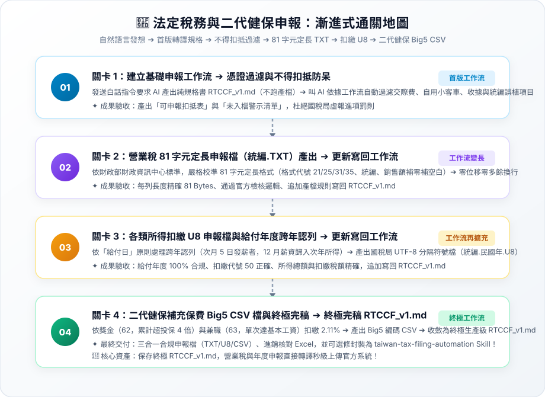

# 實戰範例：營業稅與各類所得法定申報檔產出自動化

> 🤖 **採用代理平台**：主流 AI Agent 平台（如 Claude Projects / ChatGPT / Gemini 等具備專案知識庫與 Code 執行能力之智慧代理人）  
> 🛠️ **建議執行模式**：**Code 模式 / 腳本執行模式**（透過 AI Agent 對話式協作直接分析進銷明細與薪資清冊、過濾不得扣抵憑證、產出財政部 81 字元定長 TXT、國稅局扣繳 U8 與健保署 Big5 CSV 檔）  
> 💡 **非稅務會計新手導讀**：非稅務背景？請先閱讀 👉 [**`業務背景與工作流入門解析.md`**](./業務背景與工作流入門解析.md)，快速了解營業稅 401 申報痛點、各類所得扣繳規範與可跨界借鏡之技術！

---

## 🏆 最終完成作品展示（實作成果搶先看）

> 📥 **核心交付成品清單**：  
> 1. 營業稅 81 字元定長申報文字檔（`統編.TXT`）：符合財政部 BLR 申報系統匯入規範（零位移、金額稅額補零補空白）。  
> 2. 各類所得扣繳申報檔（`統編.民國年.U8`）：符合國稅局 IMX 系統標準 UTF-8 分隔符號檔案（落實實際給付日跨年認列）。  
> 3. 二代健保補充保費申報檔（`.CSV`）：符合健保署標準 Big5 編碼媒體檔（獎金 62 超額門檻與兼職 63 精算）。  
> 4. 法定申報檔產生工具包：[**`申報檔產生.zip`**](./申報檔產生.zip) 與 官方範本 [**`申報檔範例.zip`**](./申報檔範例.zip)。  
> 5. 終極生產級稅務轉譯規格書：[**`3-2_AI產出之RTCCF審查與結構化提示詞.md`**](./3-2_AI產出之RTCCF審查與結構化提示詞.md)（四模組整合完稿版）。

---

## 🎯 案例情境與核心學習價值

中小企業財務人員每逢奇數月申報營業稅、每年 1 月辦理扣繳申報時，往往面臨極為痛苦的官方媒體格式限制：
1. **財政部 81 字元固定長度極端嚴苛**：
   * 營業稅申報檔（`統一編號.TXT`）必須每列剛好 81 Bytes，字軌、金額補零或空白稍有位移或多一個空格，整批檔案直接遭財政部申報系統（BLR）退件。
2. **稅法不得扣抵憑證誤報罰則**：
   * 依《加值型及非加值型營業稅法》第 19 條，交際應酬、自用乘人小客車、收據等嚴禁列入進項稅額扣抵，人工篩選極易疏漏導致稅局補稅處罰。
3. **所得稅給付日認列與跨年換算**：
   * 員工 12 月薪資於次年 1 月 5 日發放者，依法屬於「次年度」所得，傳統 Excel 統計常誤列入當年度扣繳憑單。
4. **二代健保繁雜門檻與 Big5 編碼相容**：
   * 獎金需累計超過當月投保金額 4 倍才扣繳 2.11%，兼職需達最低基本工資；且健保署指定必須為 Big5 編碼 CSV 檔。

> 💡 **核心方法論：漸進式優化（Progressive Refinement）**  
> 複雜的法定稅務轉譯**切忌一次輸入所有任務**！本教學採用**「一次一個任務、做一步驗一步」**的漸進式優化策略：  
> 1. **第 1 個產出是工作流規格書**：第 1 次用自然語言發想，唯一目標是產出通用規格書 **`RTCCF_v1.md`**（純規格、不產出特定期數文字檔，存為 `.md` 檔人機才能協作）。  
> 2. **叫 AI 依據工作流開始工作**：人工檢核規格無誤後，正式指示 AI 依據這份 `RTCCF_v1.md` 開始執行憑證過濾與不得扣抵防呆。  
> 3. **後續關卡用自然語言執行新任務**：依序丟出新任務（營業稅 81 字元定長、所得扣繳 U8 跨年認列、二代健保 Big5 CSV）。  
> 4. **完成後更新寫回同一個工作流**：每道關卡驗收無誤後，請 AI 將新規則追加覆蓋寫回 **`RTCCF_v1.md`**。**關卡愈多，工作流就會愈長、功能愈強大！**

---

## 🧭 5 分鐘通關地圖（SOP 流程總覽）



---

## 🛠️ 實戰闖關手冊：漸進式優化四步曲

請開啟您偏好的 **AI Agent 平台**（如 Claude / ChatGPT / Gemini 等）對話視窗，依序完成以下四個關卡：

### 🟢 關卡 1：建立基礎工作流（RTCCF_v1.md）➔ 依工作流過濾不得扣抵憑證

* **輸入素材**：上傳 [`1_素材_無紙化流程_素材總表.xlsx`](./1_素材_無紙化流程_素材總表.xlsx) 至 AI Agent 對話框中。
* **步驟 1-A（第 1 個產出是工作流）**：開啟 👉 [**`關卡1_憑證過濾與不得扣抵防呆.md`**](./關卡1_憑證過濾與不得扣抵防呆.md)，發送白話指令，要求 AI 產出第一版通用規格書 **`RTCCF_v1.md`**（強制儲存為 `.md` 檔案，不跑特定期數產檔）。
* **人工檢核工作流**：檢視 `RTCCF_v1.md` 規則是否通用、營業稅法第 19 條交際費/自用小客車過濾與統編校驗是否嚴謹。
* **步驟 1-B（叫 AI 依據工作流開始工作）**：在同對話發送指令，叫 AI 嚴格依照 `RTCCF_v1.md` 讀取 Excel 開始篩選進銷發票！
* **🔍 人工驗收成果**：
  * [ ] 交際應酬費、自用乘人小客車相關憑證是否 100% 剔除於進項抵扣清單外？
  * [ ] 免用統一發票收據與買受人統編錯誤項目是否被正確列入警示清單？

---

### 🟣 關卡 2：營業稅 81 字元定長申報檔（統編.TXT）產出 ➔ 更新寫回 RTCCF_v1.md（工作流變長）

* **任務情境**：產出符合財政部 BLR 申報系統標準之 81 字元定長純文字檔。
* **步驟 2-A（自然語言執行任務）**：開啟 👉 [**`關卡2_營業稅81字元定長申報檔產出.md`**](./關卡2_營業稅81字元定長申報檔產出.md)，用白話自然語言請 AI 執行定長轉換與補零補空白。
* **🔍 人工驗收成果**：
  * [ ] **字元數完全精確**：每列（不含換行符）長度是否剛好 81 Bytes？
  * [ ] **補零與補空白**：金額與稅額是否向右靠齊、左側補滿 0？
  * [ ] **格式代號精確**：進項 21/25、銷項 31/35 代號是否正確對照？
* **步驟 2-B（任務完成後更新工作流）**：指示 AI 將 81 字元定長轉譯規範追加寫回 **`RTCCF_v1.md`**，**工作流擴充變長！**

---

### 🟡 關卡 3：各類所得扣繳 U8 申報檔與給付年度跨年認列 ➔ 更新寫回 RTCCF_v1.md（工作流再擴充）

* **任務情境**：處理跨年發薪之「實際給付日」原則，產出國稅局 IMX 系統標準 U8 檔案。
* **步驟 3-A（自然語言執行任務）**：開啟 👉 [**`關卡3_各類所得扣繳U8檔與跨年給付認列.md`**](./關卡3_各類所得扣繳U8檔與跨年給付認列.md)，用白話自然語言請 AI 進行給付年度轉換與 U8 格式產出。
* **🔍 人工驗收成果**：
  * [ ] **跨年給付認列**：12 月薪資若次月 5 日發薪，是否確實歸入次年所得？
  * [ ] **免稅項目排除**：伙食津貼（3,000元內）與加班費（46小時內）是否已自 50 應稅所得扣除？
  * [ ] **UTF-8 編碼正常**：中文姓名與身分證字號於 U8 檔中無亂碼。
* **步驟 3-B（任務完成後更新工作流）**：指示 AI 將所得扣繳與跨年給付認列追加寫回 **`RTCCF_v1.md`**，**工作流再次變長！**

---

### 🟢 關卡 4：二代健保補充保費 Big5 CSV 產檔與終極完稿 ➔ 終極完稿 RTCCF_v1.md

* **任務情境**：計算獎金（62）超過投保 4 倍部分與兼職（63）2.11% 補充保費，產出 Big5 CSV 檔。
* **步驟 4-A（自然語言執行任務）**：開啟 👉 [**`關卡4_二代健保補充保費Big5產檔與終極完稿.md`**](./關卡4_二代健保補充保費Big5產檔與終極完稿.md)，用白話自然語言請 AI 產出補充保費 CSV 與核對表。
* **🔍 人工驗收成果**：
  * [ ] 高額獎金僅針對超額部分扣繳 2.11%，兼職所得達基本工資始啟動扣繳。
  * [ ] CSV 檔案編碼強制為 Big5，健保署檢核系統能順利讀取中文姓名。
* **步驟 4-B（最終收斂更新工作流）**：指示 AI 整合四大模組，收斂為 **終極生產級 `RTCCF_v1.md`**（完整範本收錄於 [`3-2_AI產出之RTCCF審查與結構化提示詞.md`](./3-2_AI產出之RTCCF審查與結構化提示詞.md)）！未來各申報期直接調用這份終極工作流即可秒級轉譯法定檔案！
* 📌 **【重要資產提醒】**：**請務必永久妥善保留這份 `RTCCF_v1.md` 檔案！** 這是歷經人機協作打磨的最高結晶。

---

### ⭐ 選修進階（Optional）：將 RTCCF_v1 工作流封裝為「AI Agent Skill」

當工作流穩定後，可依據 Claude / Agent Skill 官方規範將其封裝為即插即用的技能套件：
* **標準 Skill 目錄結構**：
  ```text
  skills/taiwan-tax-filing-automation/
  └── SKILL.md            # 必要：包含 YAML frontmatter (name, description) 的完整法定申報 SOP
  ```
* **一鍵升級指引**：請詳閱 👉 [**`關卡4_二代健保補充保費Big5產檔與終極完稿.md`**](./關卡4_二代健保補充保費Big5產檔與終極完稿.md#選修進階optional將-rtccf_v1-工作流封裝為ai-agent-skill) 中的選修封裝指令。

---

## 📂 專案檔案清單與功能說明

| 檔案類型 | 檔案名稱 | 核心內容與功用說明 |
| :--- | :--- | :--- |
| 📘 **操作手冊** | [`3_說明檔_使用說明.docx`](./3_說明檔_使用說明.docx) | 包含營業稅 401 申報流程、各類所得扣繳規範與二代健保扣繳說明 |
| 📊 **原始素材** | [`1_素材_無紙化流程_素材總表.xlsx`](./1_素材_無紙化流程_素材總表.xlsx) | 進銷發票清冊、員工年度薪資與扣繳資料、法定欄位代碼表 |
| 🗃️ **申報工具** | [`申報檔產生.zip`](./申報檔產生.zip) | 官方申報檔產出程式與轉換腳本工具包 |
| 🗂️ **標準範本** | [`申報檔範例.zip`](./申報檔範例.zip) | 官方 BLR 81 字元 TXT、IMX U8 與健保署 CSV 格式對照範本 |
| 🟢 **實作關卡 1** | [`關卡1_憑證過濾與不得扣抵防呆.md`](./關卡1_憑證過濾與不得扣抵防呆.md) | 不得扣抵發票篩選、收據統編排除，產出首版 `RTCCF_v1.md` |
| 🟣 **實作關卡 2** | [`關卡2_營業稅81字元定長申報檔產出.md`](./關卡2_營業稅81字元定長申報檔產出.md) | 財政部 81 Bytes 定長補零補空白，更新寫回 `RTCCF_v1.md` |
| 🟡 **實作關卡 3** | [`關卡3_各類所得扣繳U8檔與跨年給付認列.md`](./關卡3_各類所得扣繳U8檔與跨年給付認列.md) | 給付日跨年認列原則、所得 U8 分隔符號產檔，更新寫回 `RTCCF_v1.md` |
| 🟢 **實作關卡 4** | [`關卡4_二代健保補充保費Big5產檔與終極完稿.md`](./關卡4_二代健保補充保費Big5產檔與終極完稿.md) | 獎金兼職補充保費精算、Big5 CSV 產檔，收斂終極 `RTCCF_v1.md` 與選修 Skill |
| 🏆 **終極規格書** | [`3-2_AI產出之RTCCF審查與結構化提示詞.md`](./3-2_AI產出之RTCCF審查與結構化提示詞.md) | 包含動態演進軌跡矩陣與四模組收斂之終極生產級 RTCCF 全文 |
| 🗺️ **通關架構圖** | [`SOP通關流程圖.svg`](./SOP通關流程圖.svg) | 亮色精緻卡片式漸進式優化 SOP 全景圖（純 SVG，無 mermaid） |
