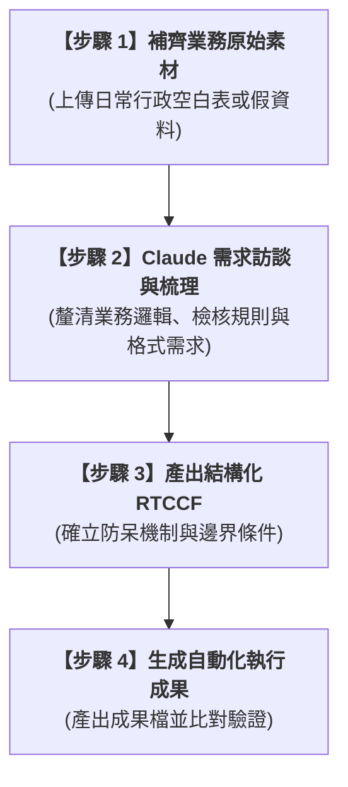

# 實戰範例：職場行政業務效能提升與流程優化（待補充素材）

> 🟣 **採用代理平台**：Claude.ai Agent / Claude Projects  
> 🛠️ **建議執行模式**：**Work / Artifacts 模式**  
> ⚠️ **狀態備註**：**本專案原始素材待補充**（專案框架與自動化 SOP 結構已預先就緒）

---

## 📌 專案當前狀態與說明

本單元規劃收納學員提出的**職場行政與日常營運自動化**實戰課題。目前雲端硬碟原始資料夾尚在彙整上傳中，本目錄已預先建立符合全系列規範的標準架構，待學員提供原始業務檔案（如 Excel 表格、Word SOP 或系統截圖）後，即可立即啟動完整的 AI 人機協商工作流。

---

## 🎯 預期核心學習目標與架構

當素材補充完畢後，本單元將依循下列標準閉環進行建置：

1. **白話自然語言發想**：將行政現場的痛點（例如表單核對、排程繁瑣、跨表彙整、資料清洗等）化為白話指令。
2. **RTCCF 提示詞工程**：透過 Claude 自動提煉專業的 Role、Task、Context、Constraints、Format。
3. **交付成果自動化**：產出端到端免人工的 Excel / Word / PDF 交付成果，落實智慧辦公。

---

## 🧭 預備通關地圖（SOP 流程總覽）

---

## 📂 專案預備檔案清單

| 檔案類型 | 檔案名稱 | 說明 |
| :--- | :--- | :--- |
| 📘 **專案總覽** | [`README.md`](./README.md) | 本專案架構與建置規範（當前檔案） |
| 📊 **原始素材** | *(待上傳)* | 待學員補齊之業務原始檔（.xlsx / .docx / .pdf 等） |
| 🎯 **提示詞規範** | `2-1_白話自然語言發想提示詞.md` | 待素材就緒後梳理生成 |

---

[← 返回 2026_10_19 案例總表](../README.md)
