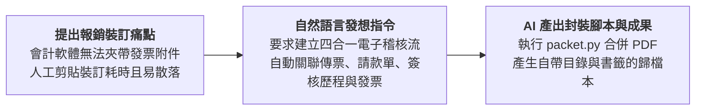

# 2-1 白話自然語言發想提示詞（報銷憑證四合一歸檔）

> 💡 **核心精神**：向 Claude 描述發票報銷與傳票裝訂的傳統痛苦，讓 AI 設計外部自動合併與注入目錄書籤的架構。

---

## 🎯 核心工作流



---

## 📋 自然語言發想指令（Prompt）

可在 Claude 對話視窗中直接發送：

```text
我們公司在處理同仁費用報銷時，會計每個月都要花大量時間處理紙本單據：

1. 同仁填完請款單、貼了發票後找各級主管簽核。
2. 會計審核付款後，在會計軟體切傳票印出來。但會計軟體根本不支援附件列印功能，導致會計必須手動把「傳票」、「請款單」、「簽核信件」跟「原始發票」一張一張釘在一起存檔。
3. 國稅局查帳或會計師查核時，翻紙本傳票非常麻煩，且容易有缺漏。

我手邊有請款資料的 Excel（記錄了單號、簽核歷程、金額與對應發票檔名）。我希望透過 Claude 規劃一套「四合一自動歸檔工作流」：
- 依單據編號，自動把「1. 會計傳票」、「2. 已簽核請款單」、「3. Excel 簽核歷程」、「4. 發票/憑證圖檔」依序組裝成一份完整的 PDF。
- 這份 PDF 必須具備標準目錄頁、PDF 書籤導覽，並在頁尾自動印上「單據編號 第 x / y 頁」。

請幫我規劃這套自動化拼裝方案，並轉譯為標準的 RTCCF 提示詞！
```

---

[← 返回專案首頁](./README.md)
