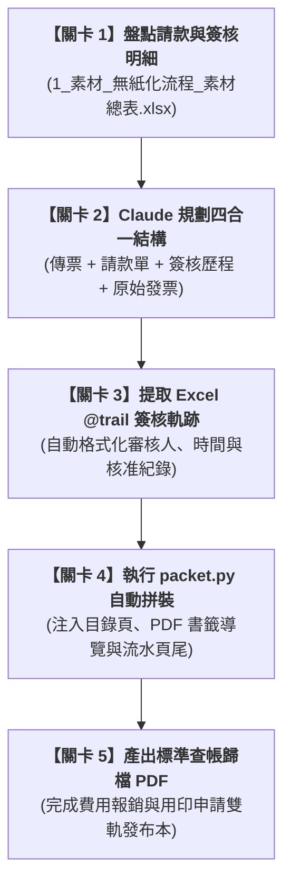

# 實戰範例：費用報銷審核與憑證傳票四合一歸檔自動化

> 🟣 **採用代理平台**：Claude.ai Agent / Claude Projects  
> 🛠️ **建議執行模式**：**Artifacts 模式 / Code 模式**（透過 Claude 自動提取請款明細、串聯簽核歷程與原始發票影像，自動拼裝產出具備目錄與書籤之四合一電子稽核 PDF 封裝包）  
> 💡 **非本科新手導讀**：非財會背景？請先閱讀 👉 [**`業務背景與工作流入門解析.md`**](./業務背景與工作流入門解析.md)，快速了解「會計為什麼每個月都在貼發票」、商會法要求與系統外拼裝引擎架構！

---

## 🏆 最終完成作品展示（實作成果搶先看）

> 📥 **核心交付成品清單**：  
> 1. 四合一費用報銷歸檔本：[**`2_完成檔案_流程2_費用報銷_合併列印範例.pdf`**](./2_完成檔案_流程2_費用報銷_合併列印範例.pdf)（按順序自動封裝：第 1 部分 會計傳票 ➔ 第 2 部分 已簽核請款單 ➔ 第 3 部分 簽核歷程軌跡 ➔ 第 4 部分 發票/憑證附件；自動生成目錄與分頁頁尾）  
> 2. 行政用印審核歸檔本：[**`2_完成檔案_流程3_用印申請_歸檔範例.pdf`**](./2_完成檔案_流程3_用印申請_歸檔範例.pdf)（完整收錄用印登記、多級審核意見與用印後掃描合約）  
> 3. 核心自動封裝腳本：[**`4_程式_packet.py`**](./4_程式_packet.py)（支援命令列一鍵合併、書籤注入與自適應字型排版）

---

## 🎯 案例情境與核心學習價值

中小企業在每月的日常費用報銷與用印管理中，行政與會計人員最耗時的噩夢往往在於「紙本裝訂與查帳核對」：
1. **傳統會計軟體（如金城資訊等）無法整合附件**：
   * 系統切出傳票後，只能印出孤零零一張紙，發票附件、請款單據與簽核 Email 散落在各處，只能人工手動影印、剪貼與裝訂。
2. **查帳與內控審計成本極高**：
   * 會計師查帳或稅局調單時，需要去庫房翻找厚重的紙本傳票夾；若附件遺失或簽核順序不清，容易產生內控瑕疵。
3. **無紙化痛點：如何合法合規？**：
   * 商業會計法規定會計憑證至少保存 5 年、帳簿 10 年。電子歸檔必須完整保留「誰、何時、何項意見核准」的不可竄改簽核軌跡。

> 💡 **本單元核心精神**：  
> 透過 Claude 人機協商，建立「外部自動拼裝引擎」！自動讀取 Excel 簽核紀錄、抓取請款單與發票圖檔，一鍵合成具備出版級目錄與章節書籤的四合一標準查帳 PDF！

---

## 🧭 5 分鐘通關地圖（SOP 流程總覽）

---

## 📂 專案檔案清單與功能說明

| 檔案類型 | 檔案名稱 | 核心內容與功用說明 |
| :--- | :--- | :--- |
| 📘 **操作手冊** | [`3_說明檔_使用說明.docx`](./3_說明檔_使用說明.docx) | 包含報銷簽核 SOP、用印申請規範與法規符合性檢核 |
| 📊 **原始素材** | [`1_素材_無紙化流程_素材總表.xlsx`](./1_素材_無紙化流程_素材總表.xlsx) | 請款明細、費用報銷登記、用印登記與主管簽核歷程 |
| 📑 **報銷成果** | [`2_完成檔案_流程2_費用報銷_合併列印範例.pdf`](./2_完成檔案_流程2_費用報銷_合併列印範例.pdf) | 四合一報銷歸檔 PDF 完成品 |
| 📑 **用印成果** | [`2_完成檔案_流程3_用印申請_歸檔範例.pdf`](./2_完成檔案_流程3_用印申請_歸檔範例.pdf) | 用印申請與合約歸檔完成品 |
| 💻 **合併程式** | [`4_程式_packet.py`](./4_程式_packet.py) | 核心自動化合併列印腳本（基於 pypdf 與 reportlab） |
| 📦 **完整套件** | `無紙化流程套件.zip` | 包含範本檔、測試憑證與執行環境 |

---

## 🚀 待推進實作項目（下一步）

- [ ] 撰寫純文字白話發想指令（`2-1_白話自然語言發想提示詞.md`）
- [ ] 提煉 RTCCF 結構化提示詞（`2-2_AI產出之RTCCF審查與結構化提示詞.md`）
- [ ] 實作單據批次自動合併與異常檢測流程

---

[← 返回 2026_10_19 案例總表](../README.md)
