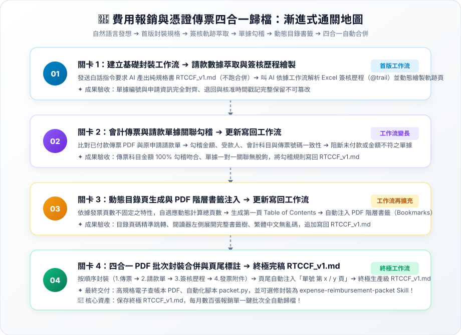

# 實戰範例：費用報銷審核與憑證傳票四合一歸檔自動化

> 🤖 **採用代理平台**：主流 AI Agent 平台（如 Claude Projects / ChatGPT / Gemini 等具備專案知識庫與 Code 執行能力之智慧代理人）  
> 🛠️ **建議執行模式**：**Code 模式 / 腳本執行模式**（透過 AI Agent 對話式協作直接分析請款資料表、解析主管簽核歷程、勾稽財務傳票科目，並自動化批次產出自帶目錄與書籤之四合一電子歸檔本）  
> 💡 **非財務會計新手導讀**：非會計背景？請先閱讀 👉 [**`業務背景與工作流入門解析.md`**](./業務背景與工作流入門解析.md)，快速了解報銷內控痛點、商業會計法憑證保存規範與可跨界借鏡之技術！

---

## 🏆 最終完成作品展示（實作成果搶先看）

> 📥 **核心交付成品清單**：  
> 1. 四合一報銷合併歸檔本：[**`2_完成檔案_流程2_費用報銷_合併列印範例.pdf`**](./2_完成檔案_流程2_費用報銷_合併列印範例.pdf)（自帶封面目錄、左側 PDF 階層書籤樹、頁尾流水號）  
> 2. 用印申請歸檔範例：[**`2_完成檔案_流程3_用印申請_歸檔範例.pdf`**](./2_完成檔案_流程3_用印申請_歸檔範例.pdf)（行政內控簽核與用印憑據整合範本）  
> 3. 核心自動化封裝腳本：[**`4_程式_packet.py`**](./4_程式_packet.py)（支援命令列與批次目錄自動拼裝）  
> 4. 終極生產級封裝規格書：[**`2-2_AI產出之RTCCF審查與結構化提示詞.md`**](./2-2_AI產出之RTCCF審查與結構化提示詞.md)（四模組整合完稿版）

---

## 🎯 案例情境與核心學習價值

企業每月在處理同仁費用報銷時，財務會計往往面臨極為繁重的人工裝訂與稽核痛點：
1. **ERP 軟體斷層與紙本拼裝痛苦**：
   * 市售大多數會計軟體（ERP）僅支援列印單張傳票，無法夾帶外部請款單與發票附件；導致會計每個月必須花費數十小時手動剪貼、影印與打孔裝訂。
2. **簽核軌跡散落與內控合規風險**：
   * 請款單、主管審批歷程（Email 或系統）、發票憑證各自獨立，易遭拆散或遺失，面臨商業會計法憑證保存 5 年、帳簿 10 年之嚴格稽核挑戰。
3. **動態附件頁數與查帳檢索困難**：
   * 每筆報銷之發票數量不一（1~多張），傳統拼裝無法自動編排目錄，會計師與國稅局查帳時翻閱極為不便。

> 💡 **核心方法論：漸進式優化（Progressive Refinement）**  
> 複雜的封裝工作流**切忌一次輸入所有任務**！本教學採用**「一次一個任務、做一步驗一步」**的漸進式優化策略：  
> 1. **第 1 個產出是工作流規格書**：第 1 次用自然語言發想，唯一目標是產出通用規格書 **`RTCCF_v1.md`**（純規格、不執行實體合併，存為 `.md` 檔人機才能協作）。  
> 2. **叫 AI 依據工作流開始工作**：人工檢核規格無誤後，正式指示 AI 依據這份 `RTCCF_v1.md` 開始執行請款數據與簽核歷程萃取。  
> 3. **後續關卡用自然語言執行新任務**：依序丟出新任務（傳票單據勾稽、動態目錄與書籤、批次四合一實體封裝）。  
> 4. **完成後更新寫回同一個工作流**：每道關卡驗收無誤後，請 AI 將新規則追加覆蓋寫回 **`RTCCF_v1.md`**。**關卡愈多，工作流就會愈長、功能愈強大！**

---

## 🧭 5 分鐘通關地圖（SOP 流程總覽）



---

## 🛠️ 實戰闖關手冊：漸進式優化四步曲

請開啟您偏好的 **AI Agent 平台**（如 Claude / ChatGPT / Gemini 等）對話視窗，依序完成以下四個關卡：

### 🟢 關卡 1：建立基礎工作流（RTCCF_v1.md）➔ 依工作流萃取請款與簽核歷程

* **輸入素材**：上傳 [`1_素材_無紙化流程_素材總表.xlsx`](./1_素材_無紙化流程_素材總表.xlsx) 至 AI Agent 對話框中。
* **步驟 1-A（第 1 個產出是工作流）**：開啟 👉 [**`關卡1_請款資料萃取與簽核歷程繪製.md`**](./關卡1_請款資料萃取與簽核歷程繪製.md)，發送白話指令，要求 AI 產出第一版通用規格書 **`RTCCF_v1.md`**（強制儲存為 `.md` 檔案，不跑特定單據合併）。
* **人工檢核工作流**：檢視 `RTCCF_v1.md` 規則是否通用、簽核歷程時序不可變原則與繁中字型防呆是否嚴謹。
* **步驟 1-B（叫 AI 依據工作流開始工作）**：在同對話發送指令，叫 AI 嚴格依照 `RTCCF_v1.md` 讀取 Excel 開始萃取請款單號、金額與 @trail 簽核歷程！
* **🔍 人工驗收成果**：
  * [ ] 請款單號、部門、申請人、事由與金額是否與原始紀錄完全一致？
  * [ ] 簽核主管姓名、職稱、核准/退回動作與時間戳記是否時序完整？

---

### 🟣 關卡 2：會計傳票與單據關聯勾稽 ➔ 更新寫回 RTCCF_v1.md（工作流變長）

* **任務情境**：將 ERP 傳票與請款單據、發票金額進行科目與金額勾稽，落實內控防呆。
* **步驟 2-A（自然語言執行任務）**：開啟 👉 [**`關卡2_會計傳票與單據關聯勾稽.md`**](./關卡2_會計傳票與單據關聯勾稽.md)，用白話自然語言請 AI 執行借貸科目與金額勾稽。
* **🔍 人工驗收成果**：
  * [ ] **科目歸屬正確**：費用科目與事由是否吻合（旅費、文具用品、交際費等）？
  * [ ] **金額一毛不差**：請款單金額 ＝ 發票憑證合計 ＝ 會計傳票借方金額。
  * [ ] **異常阻斷生效**：缺漏發票或差額單據是否已被標記阻斷？
* **步驟 2-B（任務完成後更新工作流）**：指示 AI 將會計勾稽機制追加寫回 **`RTCCF_v1.md`**，**工作流擴充變長！**

---

### 🟡 關卡 3：動態目錄頁生成與 PDF 階層書籤注入 ➔ 更新寫回 RTCCF_v1.md（工作流再擴充）

* **任務情境**：針對每筆報銷附件頁數不一的特性，自適應計算頁碼，產出目錄頁與左側書籤。
* **步驟 3-A（自然語言執行任務）**：開啟 👉 [**`關卡3_動態目錄與PDF階層書籤注入.md`**](./關卡3_動態目錄與PDF階層書籤注入.md)，用白話自然語言請 AI 動態計算頁次並注入 PDF 書籤。
* **🔍 人工驗收成果**：
  * [ ] **目錄頁碼精準**：封面目錄（TOC）所標註之頁次範圍是否與實體附件完全對應？
  * [ ] **書籤層級分明**：開啟 PDF 閱讀器，左側樹狀書籤是否可秒級點擊跳轉？
  * [ ] **繁中相容無亂碼**：中文書籤與目錄文字是否均正常顯示？
* **步驟 3-B（任務完成後更新工作流）**：指示 AI 將自適應目錄與書籤規格追加寫回 **`RTCCF_v1.md`**，**工作流再次變長！**

---

### 🟢 關卡 4：四合一 PDF 批次封裝合併與頁尾標註 ➔ 終極完稿 RTCCF_v1.md

* **任務情境**：產出完整的 Python 批次封裝程式碼，在頁尾壓印「單號 第 x / y 頁」，產出正式歸檔本。
* **步驟 4-A（自然語言執行任務）**：開啟 👉 [**`關卡4_四合一PDF批次合併與頁尾標註.md`**](./關卡4_四合一PDF批次合併與頁尾標註.md)，用白話自然語言請 AI 產出合併腳本與歸檔本。
* **🔍 人工驗收成果**：
  * [ ] 固定拼裝順序（目錄 ➔ 傳票 ➔ 請款單 ➔ 簽核歷程 ➔ 發票附件）。
  * [ ] 頁尾「單號 第 x / y 頁」流水號清晰無遮擋。
  * [ ] 發票圖片等比例縮放適應 A4 版面。
* **步驟 4-B（最終收斂更新工作流）**：指示 AI 整合四大模組，收斂為 **終極生產級 `RTCCF_v1.md`**（完整範本收錄於 [`2-2_AI產出之RTCCF審查與結構化提示詞.md`](./2-2_AI產出之RTCCF審查與結構化提示詞.md)）！未來每月報銷直接調用這份終極工作流即可批次全自動歸檔！
* 📌 **【重要資產提醒】**：**請務必永久妥善保留這份 `RTCCF_v1.md` 檔案！** 這是歷經人機協作打磨的最高結晶。

---

### ⭐ 選修進階（Optional）：將 RTCCF_v1 工作流封裝為「AI Agent Skill」

當工作流穩定後，可依據 Claude / Agent Skill 官方規範將其封裝為即插即用的技能套件：
* **標準 Skill 目錄結構**：
  ```text
  skills/expense-reimbursement-packet/
  ├── SKILL.md            # 必要：包含 YAML frontmatter (name, description) 的完整封裝 SOP
  └── scripts/            # 選用：固定不變的自動化封裝程式碼
      └── packet.py       # 四合一 PDF 合併、書籤注入與頁碼標註腳本
  ```
* **一鍵升級指引**：請詳閱 👉 [**`關卡4_四合一PDF批次合併與頁尾標註.md`**](./關卡4_四合一PDF批次合併與頁尾標註.md#選修進階optional將-rtccf_v1-工作流封裝為ai-agent-skill) 中的選修封裝指令。

---

## 📂 專案檔案清單與功能說明

| 檔案類型 | 檔案名稱 | 核心內容與功用說明 |
| :--- | :--- | :--- |
| 📘 **操作手冊** | [`3_說明檔_使用說明.docx`](./3_說明檔_使用說明.docx) | 包含報銷審核流程、商業會計法憑證保存規範與操作指南 |
| 📊 **原始素材** | [`1_素材_無紙化流程_素材總表.xlsx`](./1_素材_無紙化流程_素材總表.xlsx) | 請款單清單、簽核歷程 @trail、附件檔案對照表 |
| 📑 **報銷範例** | [`2_完成檔案_流程2_費用報銷_合併列印範例.pdf`](./2_完成檔案_流程2_費用報銷_合併列印範例.pdf) | 自帶動態目錄、PDF 階層書籤樹之四合一報銷歸檔成果範本 |
| 📑 **用印範例** | [`2_完成檔案_流程3_用印申請_歸檔範例.pdf`](./2_完成檔案_流程3_用印申請_歸檔範例.pdf) | 行政內控用印申請之簽核與憑據整合範本 |
| 🐍 **核心程式** | [`4_程式_packet.py`](./4_程式_packet.py) | 以 ReportLab 與 pypdf 實作之四合一合併與書籤注入腳本 |
| 🟢 **實作關卡 1** | [`關卡1_請款資料萃取與簽核歷程繪製.md`](./關卡1_請款資料萃取與簽核歷程繪製.md) | 請款資訊提取、@trail 簽核軌跡頁繪製，產出首版 `RTCCF_v1.md` |
| 🟣 **實作關卡 2** | [`關卡2_會計傳票與單據關聯勾稽.md`](./關卡2_會計傳票與單據關聯勾稽.md) | 借貸科目對應、金額 100% 勾稽防呆，更新寫回 `RTCCF_v1.md` |
| 🟡 **實作關卡 3** | [`關卡3_動態目錄與PDF階層書籤注入.md`](./關卡3_動態目錄與PDF階層書籤注入.md) | 自適應頁碼計算、封面目錄繪製與 PDF 書籤樹，更新寫回 `RTCCF_v1.md` |
| 🟢 **實作關卡 4** | [`關卡4_四合一PDF批次合併與頁尾標註.md`](./關卡4_四合一PDF批次合併與頁尾標註.md) | 實體合併、頁尾流水號壓印，收斂終極 `RTCCF_v1.md` 與選修 Skill |
| 🏆 **終極規格書** | [`2-2_AI產出之RTCCF審查與結構化提示詞.md`](./2-2_AI產出之RTCCF審查與結構化提示詞.md) | 包含動態演進軌跡矩陣與四模組收斂之終極生產級 RTCCF 全文 |
| 🗺️ **通關架構圖** | [`SOP通關流程圖.svg`](./SOP通關流程圖.svg) | 亮色精緻卡片式漸進式優化 SOP 全景圖（純 SVG，無 mermaid） |
