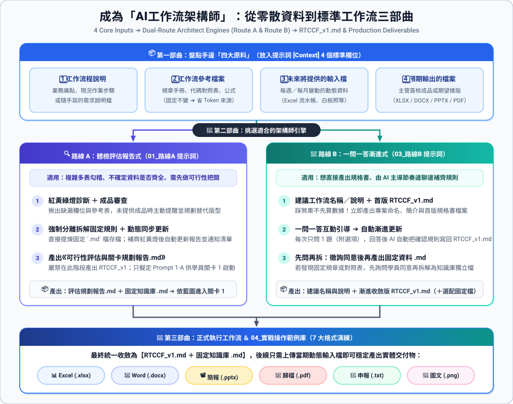

# 🧭 如何從零散資料規劃工作流：AI 工作流總架構師實戰指南

> 💡 **核心教學價值**：  
> 在課堂上，學員看到許多精采的自動化案例（費用報銷四合一、營業稅 81 字元、訂房月報 PPT 等），關卡與教材都是老師預先規劃好的。  
> **但是當學員回到自己的公司，面對手頭上一堆格式混亂的 Excel、幾份 PDF 規章、幾張手機照片，以及主管交代的一份簡短說明檔時——學員通常沒有人幫忙規劃流程，更不知道手邊的資料到底齊不齊全、適不適合做成 AI 工作流，也不知道該產出什麼實體檔案（Excel / Word / PPT / PDF / 圖片）！**  
> 
> 本章節專門為解決這個「從 0 到 1 的真實痛點」而設計：**教學生如何調用 AI 化身為「資深 AI 工作流總架構師」，對手邊現有的檔案與目標實體成果進行可行性診斷，產出一份完整的 Markdown 評估與關卡規劃報告！**

---

## 🏗️ 核心運作架構：從「零散素材」到「實體交付成果」

---

## 🎯 AI 評估報告必須解答的 7 大核心問題

當學員將手邊檔案、說明檔與期望目標成果交給 AI 後，AI 會產出一份標準純文字的 **`【工作流可行性評估與關卡規劃報告.md】`**，嚴格解答以下 7 個關鍵問題：

1. 🏷️ **專案名稱**：收斂出清晰、精確、符合企業級標準的自動化專案主題。
2. 🎯 **最終實體交付成品規格審查（Delivery Artifacts）**：
   - 明確盤點最終要產出的實體格式：**Excel (`.xlsx`) / Word (`.docx`) / 簡報 (`.pptx`) / 文件 (`.pdf`) / 圖片 (`.png`) / 法定檔案 (`.txt`)**。
   - **主動盤查並提醒成品檔案**：
     - 許多學員一開始只上傳了原始流水帳，**根本沒有提供「最終成品檔案」或「過去人工做好的樣版」**。
     - AI 必須主動審查學員是否有上傳成品；**若學員沒有提供成品檔案，AI 必須主動詢問並提醒學員補齊成品檔案**（或提供截圖、明確說明預期排版），避免 AI 瞎猜排版或產出不符合主管要求的格式。
3. 🚦 **資料齊全度盤點與缺漏補齊警示（Gap Analysis）**：
   - 評定燈號：🟢 綠燈（齊全）／ 🟡 黃燈（缺對照表或範本）／ 🔴 紅燈（素材嚴重不足）。
   - **若資料不齊全，明確列出補齊清單**：具體指出缺了什麼表？缺少什麼公式？指導學生補齊後再開始，避免白費力氣。
4. 📌 **固定資料表 vs 使用者動態輸入解耦（極致省 Token）**：
   - 哪些規章、代碼對照表應該由原始檔案中清洗提煉為純 Markdown 常駐在專案知識庫？
   - 哪一份屬於每期例行輸入的流水帳 Excel？
5. 🪜 **建議關卡數與階段拆解理由（拒絕過度設計）**：
   - **簡單單純業務：1 道關卡即可完成，報告就寫 1 個關卡即可！** 不需要為了拆關而硬拆。
   - **複雜多表業務：才切分為 2~5 道漸進式關卡**，落實「做一步驗一步」。
6. 💬 **各關卡建議 Prompt 與實體產檔機制**：
   - 每一道關卡具體給出口語化 Prompt、輸入素材、實體檔案產出技術（如 Python 腳本產生 Word/PPT/Excel/PDF），以及 3~4 項人工驗收 Checklist。
7. 🏆 **規格書演進機制（RTCCF）**：
   - 規劃第一版規格書 `RTCCF_v1.md`，並隨每道關卡驗收通過後追加寫回，使工作流規格持續擴充，最終收斂為生產級 SOP。

---

## 📂 本指南工具與範例庫清單

本資料夾已為您準備齊全的提示詞工具、標準樣版與 7 個涵蓋各種實體檔案格式之真實實戰範例：

| 檔案 / 資料夾名稱 | 模組定位 | 核心內容與教學用途 |
| :--- | :--- | :--- |
| 🤖 [**`01_AI工作流架構師評估提示詞.md`**](./01_AI工作流架構師評估提示詞.md) | 學生啟動引擎 | 學生直接全選複製、附帶手上所有檔案發給 AI 的 **RTCCF 結構化 Prompt**。約束 AI 嚴格輸出 7 大維度評估報告。 |
| 📑 [**`02_工作流可行性評估與關卡規劃報告樣版.md`**](./02_工作流可行性評估與關卡規劃報告樣版.md) | 標準交付對照 | 定義 AI 輸出的 Markdown 報告標準骨架，包含實體產檔規格，供學生與老師驗收對照。 |
| 📁 [**`03_實戰操作範例庫/`**](./03_實戰操作範例庫/) | 7 個實戰操作範例 | **由淺至深，涵蓋 XLSX、DOCX、PPTX、PDF、PNG、TXT 所有實體成品**，可直接打包上傳測試！ |

---

## 🧪 7 個實戰操作範例庫導覽（由淺至深，完整涵蓋各類實體成品）

本章節完全採用本案例庫中**學員過去所提供的真實原始資料、說明與最後完成的實體成品**，由淺至深階梯式排列。每個範例均已打包為 `.zip` 下載檔，包含原始檔案、業務說明、目標成果範本與 AI 評估規劃報告，方便學生與老師一鍵下載課堂實作演練：

---

### ⚡ 範例 01：【最淺・單關閉環】跨平台行銷投放數據交叉分析
* 📂 **範例資料夾**：👉 [`03_實戰操作範例庫/範例1_最淺單關閉環_跨平台行銷數據分析/`](./03_實戰操作範例庫/範例1_最淺單關閉環_跨平台行銷數據分析/)
* 📦 **課堂一鍵下載包**：📥 [**`範例1_最淺單關閉環_跨平台行銷數據分析.zip`**](./03_實戰操作範例庫/範例1_最淺單關閉環_跨平台行銷數據分析/範例1_最淺單關閉環_跨平台行銷數據分析.zip)
* 🎓 **學員真實專案**：[`2026_09_07 跨平台成效數據交叉分析與異常診斷自動化`](../2026_09_07_AI工具提示詞設計與智慧辦公效率提升班/跨平台成效數據交叉分析/README.md)
* 🎯 **最終交付實體成果**：實體 Excel 分析活頁簿 (`.xlsx`，含原始數據、指標總表、異常診斷、預算建議 4 工作表) ＋ 主管一頁式摘要 (`.md`)
* 🚦 **AI 評估診斷狀態**：🟡 **黃燈（可做課堂單關練習版；正式週報需補齊營收/轉換價值欄位以計算 ROAS，建議規劃：1 道關卡閉環！）**
* 💡 **教學重點（最關鍵教學亮點）**：
  > 💡 **單關閉環與未提供成品處理示範**：  
  > 1. **單關閉環**：輸入單純、規則固定，1 個關卡即可完成「指標計算 ➔ 異常標籤 ➔ 預算增減 ➔ Excel產檔」，拒絕過度設計。  
  > 2. **未提供成品檔案的處置標準**：學員不提供成品檔案時，由架構師將版型整理為 `週報版型規格.md` 常駐專案知識庫作為 AI 產檔依據，示範無範本時的防呆替代方案！

---

### 📊 範例 02：【進階・多表勾稽 ➔ 實體 Excel 產出】出納付款審核與銀行網銀放行
* 📂 **範例資料夾**：👉 [`03_實戰操作範例庫/範例2_進階多表勾稽_出納付款審核與放行/`](./03_實戰操作範例庫/範例2_進階多表勾稽_出納付款審核與放行/)
* 📦 **課堂一鍵下載包**：📥 [**`範例2_進階多表勾稽_出納付款審核與放行.zip`**](./03_實戰操作範例庫/範例2_進階多表勾稽_出納付款審核與放行/範例2_進階多表勾稽_出納付款審核與放行.zip)
* 🎓 **學員真實專案**：[`2026_09_07 出納付款審核與銀行放行總表自動化`](../2026_09_07_AI工具提示詞設計與智慧辦公效率提升班/出納付款審核與銀行放行總表自動化/README.md)
* 🎯 **最終交付實體成果**：📥 [**`01_付款放行歸戶總表_完成成果.xlsx`**](./03_實戰操作範例庫/範例2_進階多表勾稽_出納付款審核與放行/最終交付實體成品_XLSX/01_付款放行歸戶總表_完成成果.xlsx)（實體 Excel 活頁簿）
* 🚦 **AI 評估診斷狀態**：🟢 **綠燈（建議規劃：2 道關卡）**
* 💡 **教學重點**：多部門請款多對一歸戶合併、手續費內外扣計算，並直接產出可上傳網銀之實體 `.xlsx` 活頁簿。

---

### 🔴 範例 03：【真實痛點・缺漏需補齊 ➔ 實體法定 TXT 產出】營業稅電子申報媒體檔
* 📂 **範例資料夾**：👉 [`03_實戰操作範例庫/範例3_資料缺漏需補齊_營業稅法定申報檔/`](./03_實戰操作範例庫/範例3_資料缺漏需補齊_營業稅法定申報檔/)
* 📦 **課堂教材下載包（兩種模式）**：
  - 1️⃣ 🔴 **課堂診斷包（體驗紅燈阻斷）**：內含於 [**`範例3_資料缺漏需補齊_營業稅法定申報檔.zip`**](./03_實戰操作範例庫/範例3_資料缺漏需補齊_營業稅法定申報檔/範例3_資料缺漏需補齊_營業稅法定申報檔.zip)（含原始缺漏 Excel 與說明檔）。
  - 2️⃣ 🟢 **補齊後通關實作包（供課堂直接進行）**：📥 [**`範例3_補齊素材後_通關實作包.zip`**](./03_實戰操作範例庫/範例3_資料缺漏需補齊_營業稅法定申報檔/補齊素材後_可供通關測試/範例3_補齊素材後_通關實作包.zip)（含已補齊之代碼 Excel、81 字元規範與完成成品）。
* 🎓 **學員真實專案**：[`2026_10_19 營業稅與各類所得法定申報檔產出自動化`](../2026_10_19_Claude_ai_職場效能全攻略/營業稅與各類所得法定申報檔產出自動化/README.md)
* 🎯 **最終交付實體成果**：📥 [**`營業稅81字元法定申報檔_完成成果.TXT`**](./03_實戰操作範例庫/範例3_資料缺漏需補齊_營業稅法定申報檔/補齊素材後_可供通關測試/最終交付實體成品_TXT/營業稅81字元法定申報檔_完成成果.TXT)（財政部法定 81 字元定長文字檔）
* 🚦 **AI 評估診斷狀態**：🔴 **紅燈阻斷警告 ➔ 🟢 補齊素材後通關（建議規劃：2 道關卡）**
* 💡 **教學重點（最關鍵教學亮點）**：
  > 💡 **課堂教學二部曲設計**：  
  > 1. **步驟 1（體驗紅燈）**：學生上傳原始流水帳，AI 亮紅燈阻斷並輸出【缺漏待補齊清單】，嚴禁在缺漏基礎上瞎猜隨機幻覺。  
  > 2. **步驟 2（提供補齊素材，使範例可以順利通關）**：上課時直接讓學生解壓縮 **`範例3_補齊素材後_通關實作包.zip`**，提供已補齊統編與代碼之 Excel 及 81 字元定長規範。重新評估後 AI 立即亮起 🟢 **綠燈**，引導學生順利完成法定申報檔產出！

---

### 📝 範例 04：【多模態混合 ➔ 實體 Word 產出】工程監造手寫白板辨識與施工日誌
* 📂 **範例資料夾**：👉 [`03_實戰操作範例庫/範例4_高階多模態複雜混合_工程白板照片辨識/`](./03_實戰操作範例庫/範例4_高階多模態複雜混合_工程白板照片辨識/)
* 📦 **課堂一鍵下載包**：📥 [**`範例4_高階多模態複雜混合_工程白板照片辨識.zip`**](./03_實戰操作範例庫/範例4_高階多模態複雜混合_工程白板照片辨識/範例4_高階多模態複雜混合_工程白板照片辨識.zip)
* 🎓 **學員真實專案**：[`2026_09_07 工程監造白板照片辨識`](../2026_09_07_AI工具提示詞設計與智慧辦公效率提升班/工程監造白板照片辨識/README.md)
* 🎯 **最終交付實體成果**：📥 [**`01_公共工程施工查驗紀錄表_完成成果.docx`**](./03_實戰操作範例庫/範例4_高階多模態複雜混合_工程白板照片辨識/最終交付實體成品_DOCX/01_公共工程施工查驗紀錄表_完成成果.docx)（實體 Word 官方制式表單）
* 🚦 **AI 評估診斷狀態**：🟢 **綠燈（多模態架構，建議規劃：3 道關卡）**
* 💡 **教學重點**：手機拍攝現場白板多模態 OCR 萃取，結合合約公差自動比對，套表生成官方正式 Word 格式日報表。

---

### 📽️ 範例 05：【指標分析 ➔ 實體 PPTX 簡報產出】觀光飯店訂房月報動態生成
* 📂 **範例資料夾**：👉 [`03_實戰操作範例庫/範例5_營運月報動態簡報生成_PPTX/`](./03_實戰操作範例庫/範例5_營運月報動態簡報生成_PPTX/)
* 📦 **課堂一鍵下載包**：📥 [**`範例5_營運月報動態簡報生成_PPTX.zip`**](./03_實戰操作範例庫/範例5_營運月報動態簡報生成_PPTX/範例5_營運月報動態簡報生成_PPTX.zip)
* 🎓 **學員真實專案**：[`2026_09_07 訂房月報統計與 PPT 自動化`](../2026_09_07_AI工具提示詞設計與智慧辦公效率提升班/訂房月報統計與 PPT 自動化/README.md)
* 🎯 **最終交付實體成果**：📥 [**`01_觀光飯店訂房營運月報_完成成果.pptx`**](./03_實戰操作範例庫/範例5_營運月報動態簡報生成_PPTX/最終交付實體成品_PPTX/01_觀光飯店訂房營運月報_完成成果.pptx)（實體 16:9 PowerPoint 簡報）
* 🚦 **AI 評估診斷狀態**：🟢 **綠燈（建議規劃：2 道關卡）**
* 💡 **教學重點**：從 Excel 訂房流水帳計算 ADR、RevPAR，並透過母片佔位符動態注入，直接生成 16:9 高質感實體 PowerPoint 簡報。

---

### 📑 範例 06：【多憑證審核 ➔ 實體 PDF 歸檔產出】費用報銷傳票四合一電子歸檔
* 📂 **範例資料夾**：👉 [`03_實戰操作範例庫/範例6_憑證審核與傳票四合一歸檔_PDF/`](./03_實戰操作範例庫/範例6_憑證審核與傳票四合一歸檔_PDF/)
* 📦 **課堂一鍵下載包**：📥 [**`範例6_憑證審核與傳票四合一歸檔_PDF.zip`**](./03_實戰操作範例庫/範例6_憑證審核與傳票四合一歸檔_PDF/範例6_憑證審核與傳票四合一歸檔_PDF.zip)
* 🎓 **學員真實專案**：[`2026_10_19 費用報銷審核與憑證傳票四合一歸檔自動化`](../2026_10_19_Claude_ai_職場效能全攻略/費用報銷審核與憑證傳票四合一歸檔自動化/README.md)
* 🎯 **最終交付實體成果**：📥 [**`費用報銷憑證四合一電子歸檔_完成成果.pdf`**](./03_實戰操作範例庫/範例6_憑證審核與傳票四合一歸檔_PDF/最終交付實體成品_PDF/費用報銷憑證四合一電子歸檔_完成成果.pdf)（具備階層書籤之實體向量 PDF）
* 🚦 **AI 評估診斷狀態**：🟢 **綠燈（建議規劃：4 道關卡）**
* 💡 **教學重點**：發票勾稽、4 碼會計科目分錄、主管簽核封面與原始單據四合一拼接，產出具備目錄層級書籤之正式向量 PDF。

---

### 🎨 範例 07：【企劃文案 ➔ 實體圖片 PNG 渲染】品牌社群多平台多尺寸視覺圖
* 📂 **範例資料夾**：👉 [`03_實戰操作範例庫/範例7_品牌社群多平台視覺素材渲染_圖片PNG/`](./03_實戰操作範例庫/範例7_品牌社群多平台視覺素材渲染_圖片PNG/)
* 📦 **課堂一鍵下載包**：📥 [**`範例7_品牌社群多平台視覺素材渲染_圖片PNG.zip`**](./03_實戰操作範例庫/範例7_品牌社群多平台視覺素材渲染_圖片PNG/範例7_品牌社群多平台視覺素材渲染_圖片PNG.zip)
* 🎓 **學員真實專案**：[`2026_09_07 社群行銷素材多格式產出`](../2026_09_07_AI工具提示詞設計與智慧辦公效率提升班/社群行銷素材多格式產出/README.md)
* 🎯 **最終交付實體成果**：
  - 📷 [**`01_IG正方形貼文_1080x1080.png`**](./03_實戰操作範例庫/範例7_品牌社群多平台視覺素材渲染_圖片PNG/最終交付實體成品_圖片PNG/01_IG正方形貼文_1080x1080.png)（1080x1080 PNG）
  - 📷 [**`01_FB橫式貼文_1200x630.png`**](./03_實戰操作範例庫/範例7_品牌社群多平台視覺素材渲染_圖片PNG/最終交付實體成品_圖片PNG/01_FB橫式貼文_1200x630.png)（1200x630 PNG）
  - 📷 [**`01_官網橫幅Banner_1920x600.png`**](./03_實戰操作範例庫/範例7_品牌社群多平台視覺素材渲染_圖片PNG/最終交付實體成品_圖片PNG/01_官網橫幅Banner_1920x600.png)（1920x600 PNG）
* 🚦 **AI 評估診斷狀態**：🟢 **綠燈（建議規劃：2 道關卡）**
* 💡 **教學重點**：核心文案自動矩陣轉譯，並依多尺寸規範自動排版渲染輸出高畫質實體 `.png` 圖片。

---

## 🚀 講師與學員實戰操作三步驟

未來您或學員要測試自己的專案時，只需依照以下 3 個步驟：

1. **準備素材與實體範本**：
   將手邊現有的檔案（Excel、Word、PDF、照片）、需求說明檔，以及**【期望產出的目標實體格式範本（如 Word、PPT 或 PDF 樣版）】**放在一起。
2. **啟動架構師**：
   打開 Claude / ChatGPT / Gemini 對話視窗，上傳所有檔案，並複製貼上 [**`01_AI工作流架構師評估提示詞.md`**](./01_AI工作流架構師評估提示詞.md)。
3. **驗收藍圖或補齊資料**：
   - 若為 🟢 綠燈：另存 AI 產出的 `【工作流可行性評估與關卡規劃報告.md】`，依照報告中的關卡與 Prompt 依序執行，產出實體成品！
   - 若為 🟡/🔴 燈：依據報告中的「缺漏待補齊清單」補齊檔案或目標範本，補齊後重新評估！

---

[← 返回學員職場實戰案例庫](../README.md)
