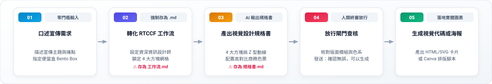
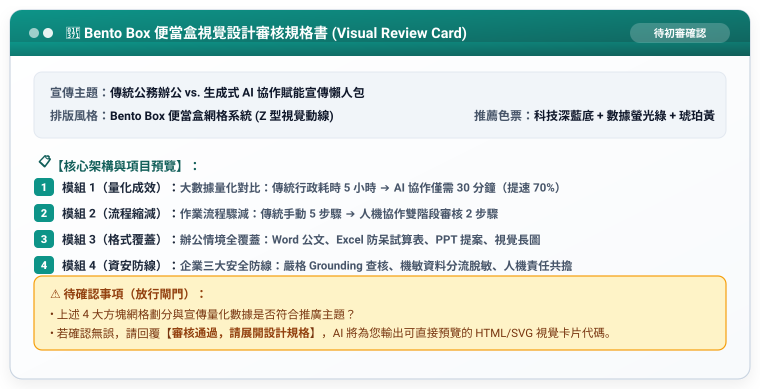

# 實戰範例 01：便當盒排版法：AI 協作賦能宣傳圖表（Infographic）

> 🟢 **適用範圍**：通用於各主流 AI Agent（Web 對話介面與 Coding Agent）  
> 🛠️ **核心工作流**：**雙階段 Markdown 審核閉環**（口語發想 ➔ 存為 `工作流.md` 初審 ➔ 產出 `規格書.md` 終審 ➔ 正式生成 HTML/SVG 視覺卡片或 Canva 腳本）

---

## 📥 學員實戰素材與交付成品

- **核心交付成品**：
  - [**`便當盒視覺卡片_已完成.html`**](./便當盒視覺卡片_已完成.html) *(由 AI 規劃之 Bento Box 網格系統高質感資訊圖表，支援瀏覽器即時預覽、向量縮放與社群截圖分享)*

---

## 🏆 案例情境與業務痛點

想製作一張「傳統辦公 vs. 生成式 AI 協作賦能」的宣傳懶人包發在公司社群或公佈欄：
1. **沒有專業美編支援**：非技術同仁不會使用 Illustrator 或 Photoshop，排版容易雜亂。
2. **文字過多無人閱讀**：讀者停留時間僅 15~30 秒，純文字根本沒有人想看。
3. **資訊缺乏模組化**：沒有掌握 Bento Box 便當盒網格，版面零散沒有焦點。

---

## ⚡ 人機協商工作流程（Human-in-the-Loop）



---

## 🛠️ 實戰演練：自然語言 ➔ RTCCF 交辦事項 ➔ 規格書 ➔ 實體視覺圖表

學員不必在多個檔案間切換，以下完整展示從白話日常口語到生成最終便當盒圖表的完整流程：

### 步驟 1：日常自然語言輸入（零門檻口述需求）

學員只要在對話框中輸入日常白話：

```text
我想做一張「傳統行政辦公 vs. 生成式 AI 協作賦能」的宣傳資訊圖表，要發在公司內部群組與公告欄，希望排版有現代科技感，像蘋果或微軟官網那種「便當盒方塊感 (Bento Box)」，讓同仁 30 秒內看懂。
請先幫我把這段需求改寫成標準的 RTCCF 交辦事項（工作流），讓我儲存為 Markdown (.md) 檔案；並且先產出「視覺設計審核規格書」給我確認，不要直接輸出全部程式碼。待我確認 Markdown 內容與架構後，請再依照該檔為我正式生成 HTML/SVG 視覺卡片代碼。
```

---

### 步驟 2：AI Agent 轉化為 RTCCF 交辦事項（⚠️ 強制儲存為 `工作流.md`）

AI Agent 接收口語後，自動結構化出標準交辦事項。**請學員第一時間將此內容儲存為 `便當盒宣傳圖表_工作流.md` 檔案**：

```markdown
## Role
資深資訊設計師兼數位行銷視覺總監。

## Task
以「傳統行政公務 vs. 生成式 AI 協作」為主題，規劃一張採用 Bento Box 便當盒排版法的單頁資訊圖表視覺規格。

## Context
張貼於企業內部公告欄與通訊群組，讀者多為非技術同仁，強調「省時、易學、零資安疑慮」。

## Constraint
1. 嚴格採用 4 大矩形模組網格，配置 Z 型視覺掃描動線。
2. 配置高對比商務色票（深藍底、螢光綠數據亮點、琥珀黃警示）。
3. 執行限制：【第一步必須先產出審核規格書】，待使用者核准後再輸出全文。
4. 語言：繁體中文，強烈對比且易懂。

## Format
階層標題（Markdown #、##、###）、模組網格色票配置。
```

> 👤 **人類初審**：使用者在本地或專案中檢視 `工作流.md`，確認 4 大模組內容後傳給 AI 執行。

---

### 步驟 3：傳遞工作流 ➔ AI Agent 輸出「視覺設計審核規格書」（⚠️ 亦存為 `規格書.md`）

AI Agent 接獲交辦事項後，先輸出視覺設計審核規格書供人類查核：



---

### 步驟 4：人類終審放行 ➔ 正式生成 HTML/SVG 視覺卡片或 Canva 腳本

使用者人眼核對 4 大方塊模組與色票完全符合預期後，發送放行指令：

```text
審核通過，請展開設計規格。
```

AI Agent 立即依循規格書輸出完整視覺規範與 HTML/SVG 代碼：
- 📄 **完整示範成果**：可直接開啟 [**`便當盒視覺卡片_已完成.html`**](./便當盒視覺卡片_已完成.html) 預覽互動卡片！

---

[← 返回資訊圖表生成模組](../README.md)
