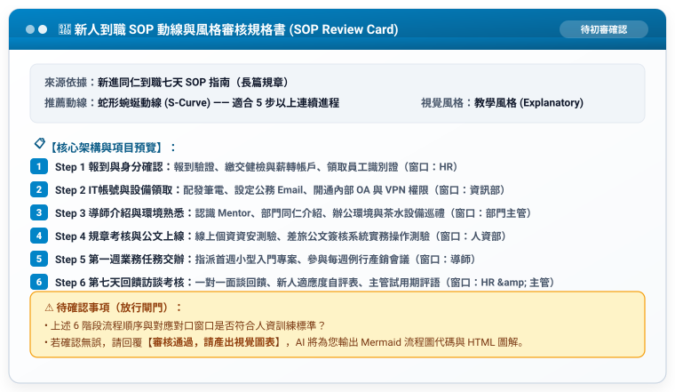
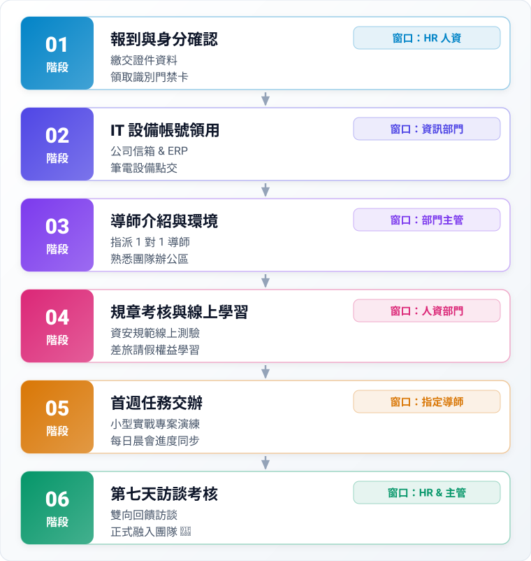

📍 [常見的 AI 應用](../../../README.md) › [AI 圖像與資訊圖表](../../README.md) › [全自動資訊圖表](../README.md) › [範例 02：新人到職 SOP 蛇形流程圖](README.md) › **步驟 2-3 審核放行與生成**

# 步驟 3：動線審核卡片與 Mermaid 流程代碼生成提示詞

## 🛡️ 人機協商閘門：AI 產出的「新人 SOP 資訊圖表審核卡片」

在展開詳細視覺規劃前，AI 呈現規格書供人類核准：



---

## 💬 人類核准指令

```text
審核通過，請產出視覺圖表。
```

---

## 📥 落地產出視覺流程圖（SVG 圖解）



完成成果請參閱：[**`新人到職SOP_視覺流程圖解_已完成.html`**](./新人到職SOP_視覺流程圖解_已完成.html)。

---

🧭 [⬅ 上一頁：步驟 2-2 RTCCF 規格書](2-2_AI產出之RTCCF新人SOP流程圖表提示詞.md) ｜ [⬆ 回到：範例 02：新人到職 SOP 蛇形流程圖](README.md)
