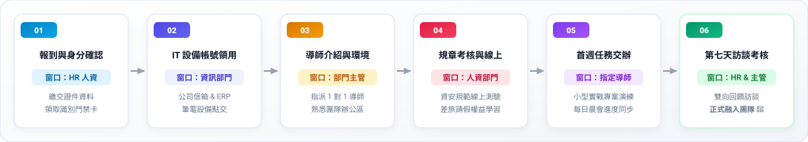

# 步驟 3：動線審核卡片與 Mermaid 流程代碼生成提示詞

## 🛡️ 人機協商閘門：AI 產出的「新人 SOP 資訊圖表審核卡片」

在展開詳細視覺規劃前，AI 呈現規格書供人類核准：


---

## 💬 人類核准指令

```text
審核通過，請產出視覺圖表。
```

---

## 📥 落地產出視覺流程圖（SVG 圖解）



完成成果請參閱：[**`新人到職SOP_視覺流程圖解_已完成.html`**](./新人到職SOP_視覺流程圖解_已完成.html)。

---

[← 返回步驟 2](./2-2_AI產出之RTCCF新人SOP流程圖表提示詞.md) ｜ [返回範例導覽](./README.md)
