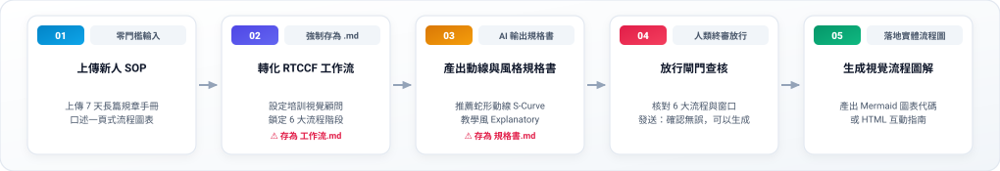

# 實戰範例 02：新人到職 SOP 指南轉蛇形流程圖解（Infographic）

> 🟢 **適用範圍**：通用於各主流 AI Agent（Web 對話介面與 Coding Agent）  
> 🛠️ **核心工作流**：**雙階段 Markdown 審核閉環**（上傳規章附件 ➔ 存為 `工作流.md` 初審 ➔ 產出 `規格書.md` 終審 ➔ 正式生成蛇形流程圖解）

---

## 📥 學員實戰素材與交付成品

- **必載輸入素材**：
  - [**`素材_新進同仁到職七天SOP指南.md`**](./素材_新進同仁到職七天SOP指南.md) *(長篇規章，亦可使用 [純文字檔](./素材_新進同仁到職七天SOP指南.txt))*
- **核心交付成品**：
  - [**`新人到職SOP_視覺流程圖解_已完成.html`**](./新人到職SOP_視覺流程圖解_已完成.html) *(由 AI 規劃之教學風 Explanatory 6 階段垂直/蛇形流程圖解，支援瀏覽器即時預覽與 Mermaid 代碼)*

---

## 🏆 案例情境與業務痛點

新人第一天報到，面對厚厚一本數千字的 SOP 手冊：
1. **記不住步驟順序**：不知道 IT 設備要去哪裡領、帳號找誰開、第幾天要做資安測驗。
2. **缺乏視覺指引**：純文字條列令人昏昏欲睡，無法留下深刻印象。
3. **沒有選對動線與風格**：超過 5 個步驟若用一般表格很難看清遞進關係，最適合採用「蛇形流程 (S-Curve)」或「垂直線性 (Vertical)」。

---

## ⚡ 人機協商工作流程（Human-in-the-Loop）



---

## 🛠️ 實戰演練：自然語言 ➔ RTCCF 交辦事項 ➔ 規格書 ➔ 實體流程圖

學員不必在多個檔案間切換，以下完整展示從白話日常口語到生成最終流程圖解的完整流程：

### 步驟 1：日常自然語言輸入（零門檻口述需求）

在對話介面上傳 [`素材_新進同仁到職七天SOP指南.md`](./素材_新進同仁到職七天SOP指南.md)，並輸入日常白話：

```text
請根據我剛才上傳的新人 SOP 指南，幫我整理成一張給新同仁看的單頁視覺流程圖。步驟大約有 6 個，希望排版採用一目了然的流程圖解，風格要親切清晰。
請先幫我把這段需求改寫成標準的 RTCCF 交辦事項（工作流），讓我儲存為 Markdown (.md) 檔案；並且先產出「動線與風格審核規格書」給我確認，不要直接輸出圖表。待我確認 Markdown 內容與架構後，請再依照該檔為我正式生成 Mermaid 流程代碼與 HTML 圖解。
```

---

### 步驟 2：AI Agent 轉化為 RTCCF 交辦事項（⚠️ 強制儲存為 `工作流.md`）

AI Agent 接收口語與附件後，自動結構化出標準交辦事項。**請學員第一時間將此內容儲存為 `新人SOP流程圖_工作流.md` 檔案**：

```markdown
## Role
企業培訓視覺顧問兼流程架構師。

## Task
以已上傳之《新進同仁到職七天 SOP 指南》為依據，將複雜規章萃取為 6 階段清晰易讀的一頁式視覺流程圖解。

## Context
供新進同仁報到首週隨身查閱，避免遺漏 IT 設備領取、帳號開通與資安測驗。

## Constraint
1. 嚴選 6 大核心進程，每階段清楚標註責任對口窗口。
2. 推薦採用蛇形流程動線（S-Curve）與教學風格（Explanatory）。
3. 執行限制：【第一步必須先產出審核規格書】，待使用者核准後再輸出全文。
4. 語言：繁體中文，親切清晰。

## Format
階段序號、時間軸、負責窗口、關鍵任務。
```

> 👤 **人類初審**：使用者在本地或專案中檢視 `工作流.md`，確認 6 大階段與窗口無誤後傳給 AI 執行。

---

### 步驟 3：傳遞工作流 ➔ AI Agent 輸出「動線與風格審核規格書」（⚠️ 亦存為 `規格書.md`）

AI Agent 接獲交辦事項後，先輸出動線與風格規格書供人類查核：


---

### 步驟 4：人類終審放行 ➔ 正式生成 Mermaid 流程代碼與 HTML 圖解

使用者人眼核對 6 大進程與負責窗口完全符合規章後，發送放行指令：

```text
審核通過，請產出視覺圖表。
```

AI Agent 立即依循規格書輸出標準 Mermaid 流程圖代碼與完整 HTML 視覺圖解：
- 📄 **完整示範成果**：可直接開啟 [**`新人到職SOP_視覺流程圖解_已完成.html`**](./新人到職SOP_視覺流程圖解_已完成.html) 瀏覽！

---

[← 返回資訊圖表生成模組](../README.md)
