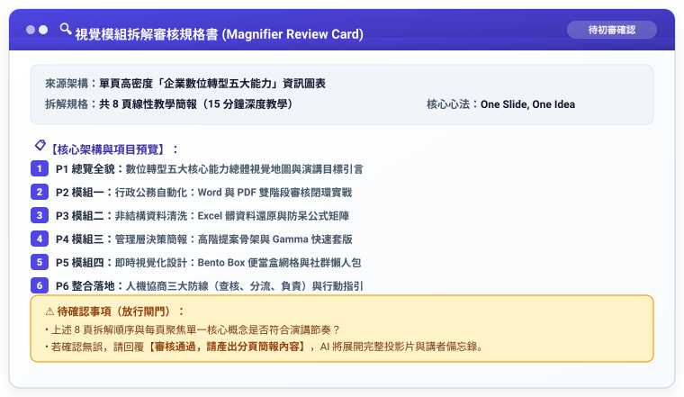

# 實戰範例 01：資訊圖表拆解為簡報（放大鏡原則）

> 🟢 **適用範圍**：通用於各主流 AI Agent（Web 對話介面與 Coding Agent）  
> 🛠️ **核心工作流**：**雙階段 Markdown 審核閉環**（口語發想 ➔ 存為 `工作流.md` 初審 ➔ 產出 `規格書.md` 終審 ➔ 正式生成簡報大綱與講稿）

---

## 📥 學員實戰素材與交付成品

- **核心交付成品**：
  - [**`企業數位轉型五大能力_拆解簡報大綱與講者備忘錄.md`**](./企業數位轉型五大能力_拆解簡報大綱與講者備忘錄.md) *(由 AI 完整產出之 8 頁線性教學簡報，含大字體重點與 30 秒口語導引，可一鍵轉為 PowerPoint (.pptx))*

---

## 🏆 案例情境與業務痛點

企業講師或業務主管拿到現成的業務架構或流程資訊圖表（如長圖或海報）時：
1. **直接貼圖看不清**：密密麻麻的小字直接塞進 PPT，台下觀眾完全無法辨識。
2. **缺乏講者敘事動線**：圖表本質是非線性探索，若無拆解引導，觀眾注意力發散。
3. **沒有保存結構化工作流**：未將模組化原則儲存為 `工作流.md`，無法重複套用到其他複雜圖表。

---

## ⚡ 人機協商工作流程（Human-in-the-Loop）


---

## 🛠️ 實戰演練：自然語言 ➔ RTCCF 交辦事項 ➔ 規格書 ➔ 實體簡報

學員不必在多個檔案間切換，以下完整展示從白話日常口語到生成最終簡報內容的完整流程：

### 步驟 1：日常自然語言輸入（零門檻口述需求）

學員只要在對話框中輸入日常白話：

```text
我有一張高密度的「企業數位轉型五大能力」資訊圖表長圖文案，裡面字很多，如果直接貼到 PPT 會完全看不清楚。
請幫我依照「放大鏡原則」，把這張圖表拆解成 8 頁的教學簡報大綱，每一頁只放大一個核心模組，並附上講者的解說引言。
請先幫我把這段需求改寫成標準的 RTCCF 交辦事項（工作流），讓我儲存為 Markdown (.md) 檔案；並且先產出「模組拆解審核規格書」給我確認，不要直接輸出全部投影片。待我確認 Markdown 內容與架構後，請再依照該檔為我正式生成完整簡報。
```

---

### 步驟 2：AI Agent 轉化為 RTCCF 交辦事項（⚠️ 強制儲存為 `工作流.md`）

AI Agent 接收口語後，自動結構化出標準交辦事項。**請學員第一時間將此內容儲存為 `圖表拆解簡報_工作流.md` 檔案**：

```markdown
## Role
資深資訊解構師兼高階簡報教練。

## Task
應用「放大鏡原則（Magnifying Glass Principle）」，將提供之單頁高密度資訊圖表架構，解構轉化為適合 15 分鐘深度教學的 8 頁線性商務簡報。

## Context
避免聽眾在遠處無法辨識圖表微小細節，透過分頁遞進展示，引導視線焦點。

## Constraint
1. 每一頁只呈現圖表中的單一視覺模組（One Slide, One Idea）。
2. 為每一頁投影片撰寫【講者 30 秒口語導引】與【過渡銜接問句】。
3. 執行限制：【第一步必須先產出審核規格書】，待使用者核准後再輸出全文。
4. 語言：繁體中文，專業教學口吻。

## Format
階層標題（Markdown #、##、###）、講者備忘錄 Callout。
```

> 👤 **人類初審**：使用者在本地或專案中檢視 `工作流.md`，可隨時微調分頁目標或演講時間，確認無誤後傳給 AI 執行。

---

### 步驟 3：傳遞工作流 ➔ AI Agent 輸出「模組拆解審核規格書」（⚠️ 亦存為 `規格書.md`）

AI Agent 接獲交辦事項後，先輸出視覺模組拆解規格書供人類查核：



---

### 步驟 4：人類終審放行 ➔ 正式生成簡報內容與講者備忘錄

使用者人眼核對 8 頁架構節奏符合演講順序後，發送放行指令：

```text
審核通過，請產出分頁簡報內容。
```

AI Agent 立即依循規格書輸出完整 8 頁簡報大綱、重點提示與講者逐字備忘錄：
- 📄 **完整示範成果**：可直接貼入簡報模板或 Gamma 自動生成實體 `.pptx` 投影片！

---

[← 返回簡報與圖表差異總覽](../README.md)
