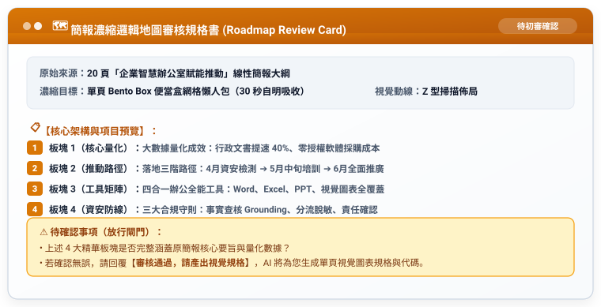

# 實戰範例 02：簡報組合成資訊圖表（導覽圖原則）

> 🟢 **適用範圍**：通用於各主流 AI Agent（Web 對話介面與 Coding Agent）  
> 🛠️ **核心工作流**：**雙階段 Markdown 審核閉環**（口語發想 ➔ 存為 `工作流.md` 初審 ➔ 產出 `規格書.md` 終審 ➔ 正式生成單頁資訊圖表）

---

## 📥 學員實戰素材與交付成品

- **核心交付成品**：
  - [**`企業AI賦能_單頁資訊地圖視覺規格書.md`**](./企業AI賦能_單頁資訊地圖視覺規格書.md) *(由 AI 完整產出之 Bento Box 單頁導覽圖視覺規格與 HTML/SVG 代碼)*

---

## 🏆 案例情境與業務痛點

演講或主管會議結束後，聽眾往往面臨三大吸收難題：
1. **投影片太多無人翻閱**：會後觀眾很少會再逐頁翻閱 20~30 頁 PPT。
2. **缺乏單頁全局視野**：線性簡報難以一眼綜觀核心數據與四合一解決方案。
3. **沒有保存結構化工作流**：未將濃縮邏輯儲存為 `工作流.md`，無法標準化複製到其他專案。

---

## ⚡ 人機協商工作流程（Human-in-the-Loop）


---

## 🛠️ 實戰演練：自然語言 ➔ RTCCF 交辦事項 ➔ 規格書 ➔ 實體圖表

學員不必在多個檔案間切換，以下完整展示從白話日常口語到生成最終資訊圖表的完整流程：

### 步驟 1：日常自然語言輸入（零門檻口述需求）

學員只要在對話框中輸入日常白話：

```text
我有 20 頁關於「企業智慧辦公室賦能」的簡報文字，想把它濃縮成一張給主管與全體同仁看的單頁資訊地圖（導覽圖海報），讓大家 30 秒就能看懂四大精華重點。
請先幫我把這段需求改寫成標準的 RTCCF 交辦事項（工作流），讓我儲存為 Markdown (.md) 檔案；並且先產出「邏輯地圖審核規格書」給我確認，不要直接輸出全部視覺代碼。待我確認 Markdown 內容與架構後，請再依照該檔為我正式生成一頁式視覺圖表規格。
```

---

### 步驟 2：AI Agent 轉化為 RTCCF 交辦事項（⚠️ 強制儲存為 `工作流.md`）

AI Agent 接收口語後，自動結構化出標準交辦事項。**請學員第一時間將此內容儲存為 `簡報濃縮圖表_工作流.md` 檔案**：

```markdown
## Role
資深視覺地圖架構師兼資訊設計師。

## Task
應用「導覽圖原則（Roadmap Principle）」，將 20 頁線性商務簡報內容去蕪存菁，提煉為一張具備自明性的單頁 Bento Box 視覺資訊圖表規格。

## Context
課後複習與宣傳分享，讀者平均停留時間僅 30 秒，需具備高度視覺層級與流暢動線。

## Constraint
1. 嚴選 4 大核心板塊，每板塊配備一組量化數據或結論金句。
2. 配置 Z 型視覺掃描動線與科技高對比色票。
3. 執行限制：【第一步必須先產出審核規格書】，待使用者核准後再輸出全文。
4. 語言：繁體中文，親切俐落。

## Format
階層標題（Markdown #、##、###）、板塊網格定義。
```

> 👤 **人類初審**：使用者在本地或專案中檢視 `工作流.md`，確認板塊劃分符合業務主軸後傳給 AI 執行。

---

### 步驟 3：傳遞工作流 ➔ AI Agent 輸出「邏輯地圖審核規格書」（⚠️ 亦存為 `規格書.md`）

AI Agent 接獲交辦事項後，先輸出邏輯地圖規格書供人類查核：



---

### 步驟 4：人類終審放行 ➔ 正式生成單頁視覺圖表規格與代碼

使用者人眼核對 4 大精華板塊完全符合預期後，發送放行指令：

```text
審核通過，請產出視覺規格。
```

AI Agent 立即依循規格書輸出具備色票與排版規格的 Markdown 規範書，亦可產出 HTML/SVG 代碼或貼入 Canva 製作精美單頁宣傳海報！

---

[← 返回簡報與圖表差異總覽](../README.md)
