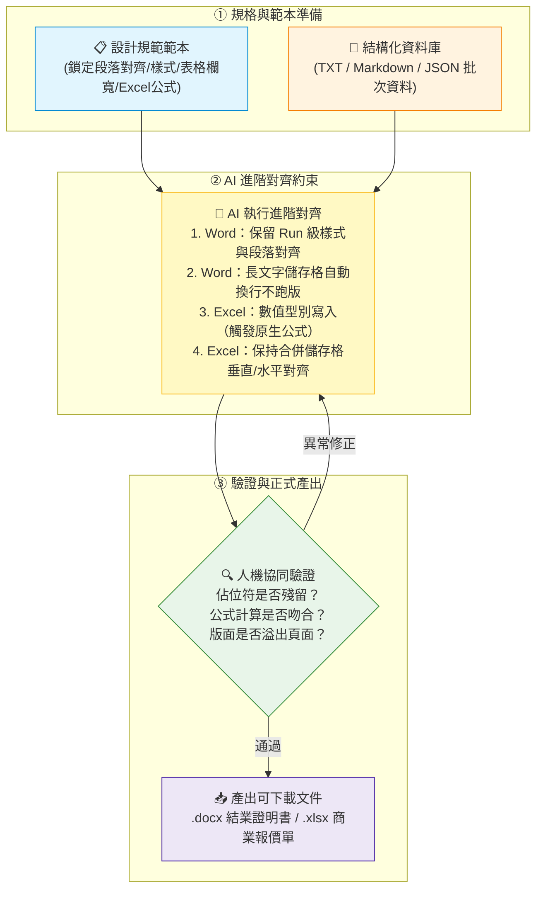
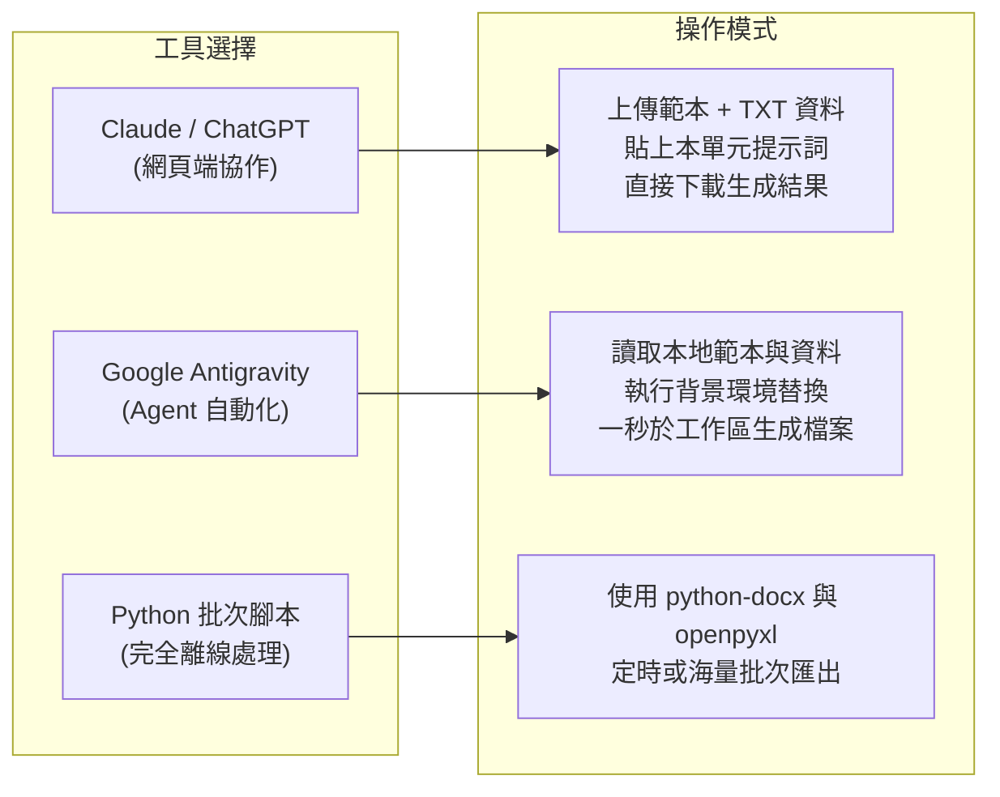

# 🎯 Office 辦公室應用：進階對齊與範本套印指南
## 🚀 從「版面錯位與公式被覆蓋」到「AI 像素級精準對齊與批次產出」

> **模組核心理念**：  
> 在職場中，製作正式的 **Word (.docx)** 證書公文或 **Excel (.xlsx)** 商業報價單時，最讓人頭痛的往往不是內容本身，而是**「對齊與格式跑版」**：
> - **Word 的噩夢**：名字長度不同導致底線縮放、文字換行把印章欄位推到下一頁、手動貼上文字覆蓋了原本設定好的段落對齊（置中/靠左/靠右）與字型。
> - **Excel 的地雷**：AI 生成或手動填入時把數字寫成純文字，導致 `SUM` 公式失效變 0；或者直接把計算結果打成死值，破壞了原本的動態計算公式與合併儲存格換行設定。
> 
> **本模組聚焦於「進階對齊（Precision Alignment & Template Grounding）」技術**：  
> 透過預先設計的「佔位符範本（Template Placeholders）」＋「結構化資料（TXT/Markdown）」＋「嚴謹 AI 提示詞約束」，讓 AI 精確執行**版面對齊、儲存格折行對齊、資料型別與公式連動對齊**，一鍵批次產出高水準的正式商務文件！

---

## 🧭 人機協同進階對齊標準工作流



---

## 📥 實戰資源與範例檔案下載專區

本專案提供完整無缺的**原始範本**、**測試資料**以及**已對齊完成的示範成品**，點擊即可直接於專案中查看或下載：

### 1. Word (.docx) 結業證明書對齊實戰
| 檔案類型 | 檔案名稱 | 核心對齊測試點 | 檔案下載 / 檢視連結 |
| :--- | :--- | :--- | :--- |
| **DOCX 範本檔** | `繁體中文_結業證明書_佔位符範本.docx` | 預設標題置中、表格固定欄寬、左側靠左發證、右側靠右日期 | [📥 下載範本](./繁體中文_結業證明書_佔位符範本.docx) |
| **文字資料檔** | `student_data.txt` | 3 位學員資料（含一般長度、極長課名與評語測試） | [📄 查看資料](./student_data.txt) |
| **完成品 1** | `結業證明書_示範成果_學員1_林佳穎.docx` | 標準長度：文字完全置中與表格欄位水平對齊 | [📥 下載示範成果](./結業證明書_示範成果_學員1_林佳穎.docx) |
| **完成品 2** | `結業證明書_示範成果_學員2_王志豪(長文字折行測試).docx` | 極長文字：驗證儲存格自動折行對齊，版面完全不爆破 | [📥 下載示範成果](./結業證明書_示範成果_學員2_王志豪(長文字折行測試).docx) |
| **完成品 3** | `結業證明書_示範成果_學員3_張雅婷.docx` | 短期時數：驗證日期區間與格式保持一致 | [📥 下載示範成果](./結業證明書_示範成果_學員3_張雅婷.docx) |

### 2. Excel (.xlsx) 商業報價單對齊實戰
| 檔案類型 | 檔案名稱 | 核心對齊測試點 | 檔案下載 / 檢視連結 |
| :--- | :--- | :--- | :--- |
| **XLSX 範本檔** | `quotation_template.xlsx` | 內建 `=IF(AND(ISNUMBER()))`、`SUM`、稅額公式、合併儲存格 | [📥 下載範本](./quotation_template.xlsx) |
| **文字資料檔** | `quotation_data.txt` | 3 家客戶資料（新創建置、AI 培訓、電商分析）與預期未稅/含稅金額 | [📄 查看資料](./quotation_data.txt) |
| **完成品 1** | `報價單_示範成果_客戶1_星河創意.xlsx` | 標準 3 項服務：數值自動計算 95,550 元含稅總計 | [📥 下載示範成果](./報價單_示範成果_客戶1_星河創意.xlsx) |
| **完成品 2** | `報價單_示範成果_客戶2_遠景智慧製造(長備註測試).xlsx` | 長備註：合併儲存格自動換行與靠左垂直置中對齊 | [📥 下載示範成果](./報價單_示範成果_客戶2_遠景智慧製造(長備註測試).xlsx) |
| **完成品 3** | `報價單_示範成果_客戶3_好日子生活選物.xlsx` | 混合數量單位（場/批/頁）：公式計算 67,200 元 | [📥 下載示範成果](./報價單_示範成果_客戶3_好日子生活選物.xlsx) |

---

## 📄 單元一：Word (.docx) 進階對齊實戰解析

### 🎯 核心對齊概念與技術關鍵
在進行 Word 範本套印時，AI 容易犯下「直接重構整份文檔」的錯誤，導致字型遺失或版面錯亂。進階對齊必須落實以下四大原則：

1. **段落對齊（Paragraph Alignment）語意分離**：
   - 主標題與證明聲明文字強制維持 `CENTER`（水平置中）。
   - 下方發證機構資訊維持 `LEFT`（靠左對齊），日期維持 `RIGHT`（靠右對齊）。
2. **表格儲存格對齊（Table Cell Alignment）與穩定性**：
   - 採用雙欄表格排版：左欄為「固定寬度標籤（如：課程名稱、訓練時數、上課期間）」，右欄為「動態內容佔位符」。
   - 無論填入的字元多寡，左欄寬度永遠鎖定，避免版面產生水平偏移。
3. **長文字儲存格自動折行（Auto-Wrap）容錯**：
   - 如學員 2 的課程名稱長達 32 字（`生成式人工智慧應用、Python 資料分析與跨平台自動化整合實務工作坊`），文字應在右側儲存格內自然折行，列高自動延展，整體版面絕不能溢出至第二頁。
4. **底层 XML Run 級別精準替換**：
   - 保留範本定義的標題字階（18pt / 14pt）、中英文字型（微軟正黑體 / Calibri）與邊距。

### 📋 Word 課堂操作提示詞（可直接複製使用）
```markdown
請讀取我上傳的 DOCX 範本（繁體中文_結業證明書_佔位符範本.docx）與 Markdown 學員資料（student_data.txt），依據每位學員資料各產生一份獨立的 DOCX 結業證明書。

【嚴格對齊要求】：
1. 替換佔位符：將範本中所有 `{{欄位名稱}}` 精準替換為對應學員內容，共同資料套用至所有學員。
2. 保留版面設定：嚴格保留原始範本的頁面邊距、段落靠左/置中/靠右對齊設定與字型大小。
3. 表格穩定性：表格欄位寬度不可變形；遇長文字（如學員 2 的長課程名稱與長評語）請於儲存格內自動換行，維持單頁排版。
4. 交付檢核：產出前確認文檔內無任何殘留之 {{...}} 標籤，並提供 3 份可供下載的 DOCX 檔案。
```

---

## 📊 單元二：Excel (.xlsx) 進階對齊實戰解析

### 🎯 核心對齊概念與技術關鍵
Excel 的進階對齊不僅是「視覺上的文字對齊」，更重要的是**「資料結構、儲存格型別與計算公式的精準對齊」**：

1. **商業報表對齊慣例（Alignment Conventions）**：
   - **文字類欄位**（客戶名稱、專案名稱、項目說明）：靠左對齊（Left Align）。
   - **代碼與度量單位**（項次、單號、單位）：水平置中（Center Align）。
   - **金額與數值欄位**（數量、單價、小計、稅額）：靠右對齊（Right Align），並套用千分位格式（`#,##0`）。
2. **型別對齊（Data Type Alignment）**：
   - ⚠️ **高頻雷區**：AI 若將數量 `1` 或單價 `28000` 當作字串（`"1"`、`"28000"`）寫入，儲存格公式中的 `ISNUMBER()` 判斷將返回 `FALSE`，導致小計顯示「待填資料」！
   - **關鍵規則**：數量與單價必須嚴格以數值型別（Integer / Float）填入，與公式結構對齊。
3. **公式保護與動態連動（Dynamic Formulas）**：
   - 嚴禁直接填入固定計算結果（打死值）！
   - 保留小計公式 `=IF(AND(ISNUMBER(D13),ISNUMBER(F13)),D13*F13,"待填資料")`。
   - 保留統計公式 `=SUM(G13:G15)`、`=G18*5%` 與 `=G18+G19`，讓客戶後續修改單價時仍能即時連動。
4. **合併儲存格（Merged Cells）與自動折行對齊**：
   - 報價單底部的「專案備註與付款條件」為跨欄合併儲存格（Row 24: B24~G24）。
   - 必須啟用 `wrap_text=True`，並確保垂直對齊為靠上（Top）或置中，確保多行合約備註排版美觀易讀。

### 📋 Excel 課堂操作提示詞（可直接複製使用）
```markdown
請以我提供的 quotation_template.xlsx 為唯一結構範本，根據 quotation_data.txt 內的客戶資料，分別產出對應的 .xlsx 商業報價單。

【嚴格對齊要求】：
1. 數值型別對齊：{{項目N數量}} 與 {{項目N單價}} 必須填寫為「純數值型別（Number）」，絕不可寫入字串型別，以確保公式正常運作。
2. 公式完整性：保留原範本中所有公式（G13~G15 小計、G18 未稅合計、G19 營業稅、G20 含稅總計），嚴禁將計算結果覆蓋為固定數值。
3. 版面與對齊保留：嚴格保留原有之儲存格合併範圍、字型、背景色、框線、數值千分位格式與文字/數值之對齊方式。
4. 合併儲存格折行：備註欄位請啟用自動換行，文字長度超長時自動垂直延伸。
5. 驗算對齊：產出結果計算出的含稅總計，必須與 TXT 內的預期金額精確相符，並提供可下載的 .xlsx 檔案。
```

---

## 🛠️ 主流 AI 工具實作操作指引



1. **ChatGPT (Plus / Team / Enterprise)**：
   - 上傳 `.docx` / `.xlsx` 範本與 `.txt` 資料檔案。
   - 複製上方專屬提示詞，啟用進階資料分析（Advanced Data Analysis / Python Code Interpreter）模式，模型會於後台精確讀取並輸出可下載的壓縮檔或個別檔案。
2. **Claude (Claude 3.5 Sonnet / Opus)**：
   - 將範本與資料附加至對話中，貼上提示詞。
   - 透過 Artifacts 檢核替換前後的資料對照表，並下載產出的正式檔案。
3. **Google Antigravity (Local Agent)**：
   - 直接在對話中告知 Agent 執行本地檔案替換，Agent 會使用本地環境套件（如 `openpyxl`、`python-docx`）直接在資料夾內生成實體檔案。
4. **企業自動化腳本**：
   - 若需每日大量批次產生（例如每日數千份證書或報價單），可將本單元的替換邏輯封裝為 Python 輕量排程工具，兼具 100% 準確性與零額外 Token 成本。

---

## 📌 課堂檢查清單（Checklist）

完成產出後，請依序檢查以下重點：
- [ ] **DOCX**：標題是否置中？發證機構是否靠左？發證日期是否靠右？
- [ ] **DOCX**：長文字學員的課程名稱是否有於表格內自動換行？版面是否維持單頁？
- [ ] **DOCX**：是否已無任何殘留的 `{{...}}` 佔位符？
- [ ] **XLSX**：數量與單價是否為「數值」而非文字（左上方無綠色三角錯誤警示）？
- [ ] **XLSX**：點選小計與總計儲存格，上方編輯列是否仍顯示 `=SUM(...)` 等動態公式？
- [ ] **XLSX**：備註欄的長文字是否有於合併儲存格內正常折行顯示？
- [ ] **XLSX**：未稅合計、營業稅 5% 與含稅總計是否與資料檔之預期金額完全一致？

---

[← 返回職場 AI 應用分類導覽](../README.md)
