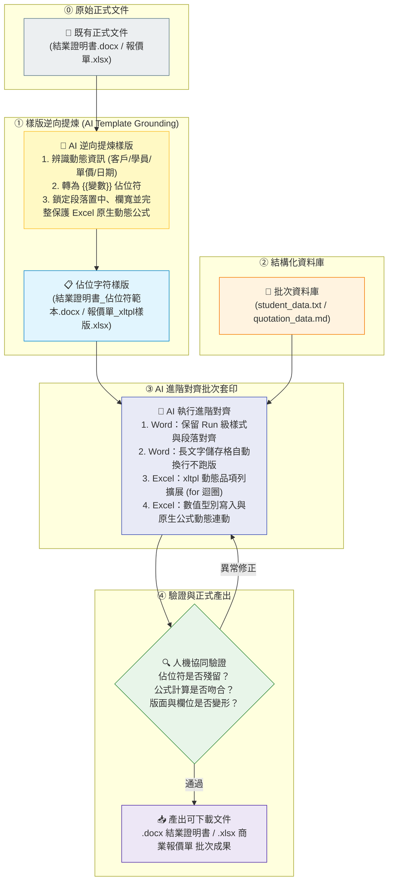
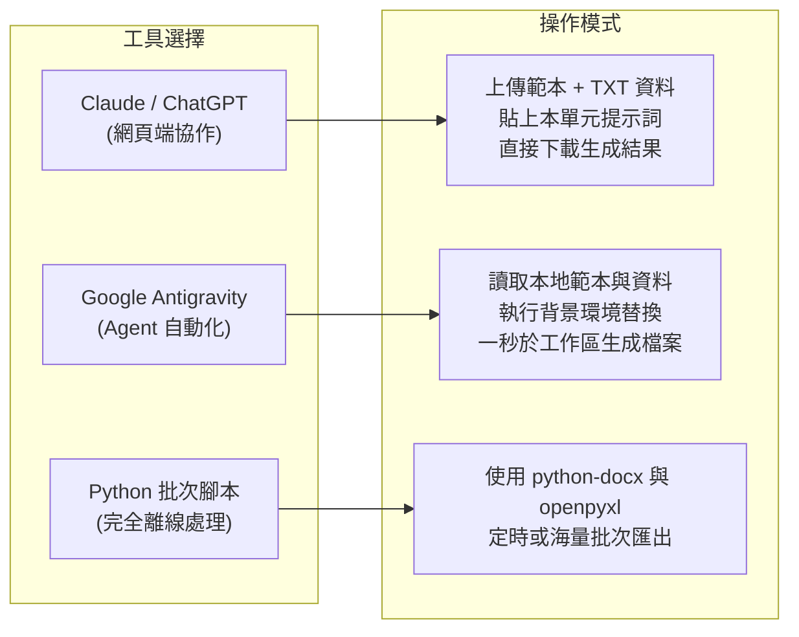

# 🎯 Office 辦公室應用：進階對齊與範本套印指南
## 🚀 從「版面錯位與公式被覆蓋」到「AI 像素級精準對齊與批次產出」

> **模組核心理念**：  
> 在職場中，製作正式的 **Word (.docx)** 證書公文或 **Excel (.xlsx)** 商業報價單時，最讓人頭痛的往往不是內容本身，而是**「對齊與格式跑版」**：
> - **Word 的噩夢**：名字長度不同導致底線縮放、文字換行把印章欄位推到下一頁、手動貼上文字覆蓋了原本設定好的段落對齊（置中/靠左/靠右）與字型。
> - **Excel 的地雷**：AI 生成或手動填入時把數字寫成純文字，導致 `SUM` 公式失效變 0；或者直接把計算結果打成死值，破壞了原本的動態計算公式與合併儲存格換行設定。
> 
> **本模組聚焦於「進階對齊（Precision Alignment & Template Grounding）」技術**：  
> 透過預先設計的「佔位符範本（Template Placeholders）」＋「結構化資料（TXT/Markdown）」＋「嚴謹 AI 提示詞約束」，讓 AI 精確執行**版面對齊、儲存格折行對齊、資料型別與公式連動對齊**，一鍵批次產出高水準的正式商務文件！

---

## 🧭 人機協同進階對齊標準工作流



---

## 📥 實戰資源與範例檔案下載專區

本專案提供完整無缺的**原始業務檔案**、**AI 提煉之佔位字符樣版**、**測試資料**以及**已對齊完成的示範成品**，點擊即可直接於專案中查看或下載：

### 1. Word (.docx) 結業證明書：從原始檔到樣版與套印實戰
| 檔案類型 | 檔案名稱 | 核心功能 / 對齊測試點 | 檔案下載 / 檢視連結 |
| :--- | :--- | :--- | :--- |
| **DOCX 原始檔** | `結業證明書.docx` | **未轉樣版前之真實證書檔案**（含學員張雅婷完整資料，作為 AI 逆向提煉樣版之起點） | [📥 下載原始檔](./結業證明書.docx) |
| **DOCX 樣版檔** | `結業證明書_佔位符範本.docx` | **AI 產出之佔位字符樣版**（已將變數轉為 `{{學員姓名}}` 等佔位符，保留原字型/置中/表格欄寬） | [📥 下載佔位符樣版](./結業證明書_佔位符範本.docx) |
| **文字資料檔** | `student_data.txt` | 3 位學員資料（含一般長度、極長課名與評語測試） | [📄 查看資料](./student_data.txt) |
| **完成品 1** | `結業證明書_示範成果_學員1_林佳穎.docx` | 標準長度：文字完全置中與表格欄位水平對齊 | [📥 下載示範成果](./結業證明書_示範成果_學員1_林佳穎.docx) |
| **完成品 2** | `結業證明書_示範成果_學員2_王志豪(長文字折行測試).docx` | 極長文字：驗證儲存格自動折行對齊，版面完全不爆破 | [📥 下載示範成果](./結業證明書_示範成果_學員2_王志豪(長文字折行測試).docx) |
| **完成品 3** | `結業證明書_示範成果_學員3_張雅婷.docx` | 短期時數：驗證日期區間與格式保持一致 | [📥 下載示範成果](./結業證明書_示範成果_學員3_張雅婷.docx) |

### 2. Excel (.xlsx) 商業報價單：xltpl 動態範本套印實戰
| 檔案類型 | 檔案名稱 | 核心功能 / 對齊測試點 | 檔案下載 / 檢視連結 |
| :--- | :--- | :--- | :--- |
| **XLSX 原始檔** | `報價單.xlsx` | **未轉樣版前之真實商業報價單**（含星河創意有限公司完整服務項目、單價與動態公式，作為提煉起點） | [📥 下載原始檔](./報價單.xlsx) |
| **XLSX xltpl 樣版** | `報價單_xltpl樣版.xlsx` | **符合 Python xltpl / Jinja2 規範之動態樣版**（支援 `` 動態品項增減、自動下推備註、保留公式） | [📥 下載 xltpl 樣版](./報價單_xltpl樣版.xlsx) |
| **資料檔案 (Markdown)** | `quotation_data.md` | 3 家客戶資料（新創建置、AI 培訓長備註、電商分析）與完整 xltpl Payload 資料結構 | [📄 查看資料](./quotation_data.md) |
| **完成品 1** | `報價單_示範成果_客戶1_星河創意.xlsx` | 標準 3 項服務：數值自動計算 95,550 元含稅總計 | [📥 下載示範成果](./報價單_示範成果_客戶1_星河創意.xlsx) |
| **完成品 2** | `報價單_示範成果_客戶2_遠景智慧製造(長備註測試).xlsx` | 擴充為 5 項服務＋長備註：自動延伸 5 列，計算 210,000 元含稅總計 | [📥 下載示範成果](./報價單_示範成果_客戶2_遠景智慧製造(長備註測試).xlsx) |
| **完成品 3** | `報價單_示範成果_客戶3_好日子生活選物.xlsx` | 擴充為 4 項服務（混合場/批/頁/式）：公式計算 84,000 元含稅總計 | [📥 下載示範成果](./報價單_示範成果_客戶3_好日子生活選物.xlsx) |

---

## 📄 單元一：Word (.docx) 進階對齊實戰解析

在辦公室實務中，我們很少從零開始手動敲程式碼寫 Word 樣版。最常見的情境是：**「手邊已經有一份製作精美、發給特定對象的正式文件（例如結業證明書、聘書、公文），現在需要將它改成通用範本，以便日後大量自動化套印。」**

本單元分為兩大關鍵階段：
1. **階段 0**：將既有原始文件（`結業證明書.docx`）交給 AI，逆向工程提煉為**「佔位字符樣版」**。
2. **階段 1**：搭配學員資料庫（`student_data.txt`），指示 AI 進行**「進階對齊批次套印」**。

---

### 🔄 階段 0：將原始檔案轉換為「佔位字符樣版」

#### 1. 原始檔案下載
- [📥 點此下載原始證書檔案：結業證明書.docx](./結業證明書.docx)  
  *（這是一份已填妥特定學員資料的真實 Word 文件，包含置中標題、固定寬度雙欄表格、靠右對齊之發證日期等完整排版）*

#### 2. AI 樣版產生提示詞（Prompt 0，可直接複製使用）
將原始檔 `結業證明書.docx` 上傳給 ChatGPT / Claude / Antigravity，並送出以下提示詞：

```markdown
請讀取我上傳的原始正式文件《結業證明書.docx》，將其轉換為可重複套印的「標準佔位字符樣版（Template Placeholder）」。

【任務目標】：
1. 自動識別變動欄位：
   請分析文檔內容，找出所有屬於個人化、動態變更的資料欄位，並將其實體文字替換為雙大括號佔位符：
   - 學員姓名：`張雅婷` ➔ `{{學員姓名}}`
   - 學員編號：`S2026003` ➔ `{{學員編號}}`
   - 課程名稱：`Word 文件自動化與 AI 辦公應用` ➔ `{{課程名稱}}`
   - 訓練時數：`12 小時` ➔ `{{訓練時數}} 小時`
   - 上課期間：`2026年10月3日 ～ 2026年10月18日` ➔ `{{開始日期}} ～ {{結束日期}}`
   - 結業成績：`89 分` ➔ `{{結業成績}}`
   - 授課講師：`陳怡君老師` ➔ `{{授課講師}}`
   - 學習評語：`已掌握文件樣式、表格排版與佔位符替換的基本技巧。` ➔ `{{學習評語}}`
   - 發證單位：`臺灣數位技能培訓中心` ➔ `{{發證單位}}`
   - 證書編號：`CERT-2026-003` ➔ `{{證書編號}}`
   - 發證日期：`2026年10月21日` ➔ `{{發證日期}}`

2. 【嚴格排版與對齊鎖定（重要）】：
   - 禁止重新排版或更動原始設計！必須 100% 保留原始文檔的 XML 結構、字型（微軟正黑體）、字體大小與頁面邊距。
   - 段落對齊維持不變：標題與聲明文字保持「水平置中（Center）」、發證單位保持「靠左（Left）」、發證日期保持「靠右（Right）」。
   - 表格結構鎖定：雙欄表格的左欄寬度不可改變，僅替換右欄內容為佔位符，確保日後套入長文字時能自動換行而不跑版。

3. 交付要求：
   請產出轉換後的 Word 樣版檔，命名為《結業證明書_佔位符範本.docx》，並提供直接下載連結。
```

#### 3. AI 產出成果下載
- [📥 點此下載 AI 產出之佔位符樣版：結業證明書_佔位符範本.docx](./結業證明書_佔位符範本.docx)

---

### 🎯 階段 1：Word 進階對齊核心概念與批次套印

完成樣版提煉後，進入批次套印時，AI 容易犯下「直接重構整份文檔」的錯誤，導致字型遺失或版面錯亂。進階對齊必須落實以下四大原則：

1. **段落對齊（Paragraph Alignment）語意分離**：
   - 主標題與證明聲明文字強制維持 `CENTER`（水平置中）。
   - 下方發證機構資訊維持 `LEFT`（靠左對齊），日期維持 `RIGHT`（靠右對齊）。
2. **表格儲存格對齊（Table Cell Alignment）與穩定性**：
   - 採用雙欄表格排版：左欄為「固定寬度標籤（如：課程名稱、訓練時數、上課期間）」，右欄為「動態內容佔位符」。
   - 無論填入的字元多寡，左欄寬度永遠鎖定，避免版面產生水平偏移。
3. **長文字儲存格自動折行（Auto-Wrap）容錯**：
   - 如學員 2 的課程名稱長達 32 字（`生成式人工智慧應用、Python 資料分析與跨平台自動化整合實務工作坊`），文字應在右側儲存格內自然折行，列高自動延展，整體版面絕不能溢出至第二頁。
4. **底層 XML Run 級別精準替換**：
   - 保留範本定義的標題字階（18pt / 14pt）、中英文字型（微軟正黑體 / Calibri）與邊距。

### 📋 批次套印課堂操作提示詞（Prompt 1，可直接複製使用）
```markdown
請讀取我上傳的 DOCX 範本（結業證明書_佔位符範本.docx）與 Markdown 學員資料（student_data.txt），依據每位學員資料各產生一份獨立的 DOCX 結業證明書。

【嚴格對齊要求】：
1. 替換佔位符：將範本中所有 `{{欄位名稱}}` 精準替換為對應學員內容，共同資料套用至所有學員。
2. 保留版面設定：嚴格保留原始範本的頁面邊距、段落靠左/置中/靠右對齊設定與字型大小。
3. 表格穩定性：表格欄位寬度不可變形；遇長文字（如學員 2 的長課程名稱與長評語）請於儲存格內自動換行，維持單頁排版。
4. 交付檢核：產出前確認文檔內無任何殘留之 {{...}} 標籤，並提供 3 份可供下載的 DOCX 檔案。
```

---

## 📊 單元二：Excel (.xlsx) 進階對齊實戰：xltpl 動態範本引擎解析

在商務報價、採購單與財務發票中，企業最常遇到的自動化難題是：**「報價項目的數量不固定（有時 1 項、有時 3 項、有時 10 項），如何讓試算表自動增減列數，同時下方的合計公式、備註欄與合併儲存格完全不跑版？」**

傳統使用 `openpyxl` 透過程式碼逐格硬寫時，開發者必須自己算列號、手動插入列、手動複製字型與邊框，稍微不慎就會破壞 `=SUM()` 公式或讓跨欄合併儲存格破裂。  
為此，本單元正式引入現代 Python 生態系中最優雅的解決方案：**`xltpl` 動態樣版引擎**！

---

### 💡 認識 xltpl 套件：為什麼它是 Excel 自動化的最佳解？

**`xltpl`（Excel Template Library）** 是一套基於 **openpyxl / xlwt** 與 **Jinja2** 模板語法所構建的高階 Excel 樣版渲染套件。

#### 🌟 核心優勢與關鍵機制：
1. **Jinja2 標籤原生支援（Jinja2 in Excel）**：
   可以直接在 Excel 儲存格中輸入熟悉的 `{{ 變數名稱 }}` 以及 `` ... `` 迴圈指令。
2. **動態品項列無痛擴展（Dynamic Row Expansion）**：
   在樣版中只需定義一行品項示範列。當傳入 3 筆或 10 筆資料時，`xltpl` 會自動向下展開新列，並自動把下方的「未稅合計」、「營業稅 5%」、「含稅總計」與「專案備註」整體向下順延推移，排版毫髮無傷！
3. **像素級樣式繼承（Pixel-Perfect Style Retention）**：
   展開出來的所有新列，會 100% 自動繼承樣版列的字型（微軟正黑體）、字階、文字靠左/置中/靠右對齊、單價千分位格式（`#,##0`）與儲存格邊框色彩，不再需要手動編寫繁瑣的樣式程式碼。
4. **原生動態計算公式自動修復（Formula Auto-Adjustment）**：
   在樣版中設定的小計公式 `=IF(AND(ISNUMBER(D13),ISNUMBER(F13)),D13*F13,"待填資料")` 與下方合計 `=SUM(...)`，在展開多列後會由引擎動態調整相對列號，確保公式持續動態計算，客戶事後仍可隨意改動單價！
5. **合併儲存格與長文字折行完美相容**：
   底部的跨欄合併備註儲存格（Row 20: B20~G20）在推移後依然維持合併狀態，且具備 `wrap_text=True` 自動折行垂直置中。

---

### 🔄 階段 0：從原始報價單轉換為「xltpl 動態樣版」

#### 1. 原始檔案下載
- [📥 點此下載原始報價單檔案：報價單.xlsx](./報價單.xlsx)  
  *（這是一份已填妥星河創意有限公司完整項目的正式 Excel 報價單，具備標準標題、3 項服務、小計公式、稅額公式與千分位格式）*

#### 2. xltpl 樣版標籤配置規則
在 [報價單_xltpl樣版.xlsx](./報價單_xltpl樣版.xlsx) 中，欄位標籤與資料結構對照如下：
- **客戶與專案標頭**：
  - `{{客戶名稱}}`、`{{聯絡窗口}}`、`{{報價單號}}`、`{{報價日期}}`、`{{專案名稱}}`
- **品項迴圈區塊（列 13~14）**：
  - 列 13 第 1 欄：``
  - 列 13 內容欄：`{{ it.no }}`（項次）｜ `{{ it.name }}`（服務項目）｜ `{{ it.qty }}`（數量）｜ `{{ it.unit }}`（單位）｜ `{{ it.price }}`（單價）
  - 列 13 公式欄：`=IF(AND(ISNUMBER(D13),ISNUMBER(F13)),D13*F13,"待填資料")`
  - 列 14 第 1 欄：``
- **彙總與備註**：
  - 列 15~17：保留動態合計公式 `=SUM(G13:G14)`、`=G15*5%`、`=G15+G16`
  - 列 20~21：`{{付款條件與備註}}`、`{{報價有效期限}}`

#### 3. AI 樣版提煉提示詞（Prompt 0，可直接複製使用）
將原始檔 `報價單.xlsx` 上傳給 ChatGPT / Claude / Antigravity，送出以下提示詞：

```markdown
請讀取我上傳的原始商業試算表《報價單.xlsx》，將其轉換為符合 Python xltpl / Jinja2 語法規範的「動態擴展佔位符樣版」。

【任務目標】：
1. 表頭變數標籤化：
   - 客戶名稱 ➔ `{{客戶名稱}}`
   - 聯絡窗口 ➔ `{{聯絡窗口}}`
   - 報價單號 ➔ `{{報價單號}}`
   - 報價日期 ➔ `{{報價日期}}`
   - 專案名稱 ➔ `{{專案名稱}}`

2. 動態品項區塊導入 xltpl 迴圈：
   - 在品項明細起始列上方加入 `` 指令。
   - 將固定品項列改為變數佔位符：
     - 項次：`{{ it.no }}`
     - 服務項目：`{{ it.name }}`
     - 數量：`{{ it.qty }}`
     - 單位：`{{ it.unit }}`
     - 單價：`{{ it.price }}`
   - 保留該列之原生小計公式 `=IF(AND(ISNUMBER(D13),ISNUMBER(F13)),D13*F13,"待填資料")`。
   - 在品項列下方加入結束標籤 ``。

3. 彙總公式與備註保留：
   - 嚴禁覆蓋公式：保留未稅合計 `=SUM(...)`、營業稅 5% 與含稅總計動態公式。
   - 備註欄合併儲存格替換為 `{{付款條件與備註}}`，有效期限替換為 `{{報價有效期限}}`。
   - 100% 保持千分位數值格式（`#,##0`）、儲存格框線、底色與自動換行。

4. 交付要求：
   產出符合 xltpl 規範的 Excel 樣版檔，命名為《報價單_xltpl樣版.xlsx》，並提供直接下載連結。
```

#### 4. xltpl 樣版成果下載
- [📥 點此下載 AI 產出之 xltpl 動態樣版：報價單_xltpl樣版.xlsx](./報價單_xltpl樣版.xlsx)

---

### 🎯 階段 1：使用 xltpl 執行批次套印與進階對齊

#### 📋 批次套印課堂操作提示詞（Prompt 1，可直接複製使用）
```markdown
請以我提供的《報價單_xltpl樣版.xlsx》為結構範本，並讀取 quotation_data.md 內的客戶資料，為每位客戶各產生一份 .xlsx 商業報價單。

【嚴格對齊要求】：
1. xltpl 迴圈展開：品項區塊以 `` 展開，無論品項數量多寡，必須自動延展新列並向下推移合計與備註欄。
2. 數值型別對齊：{{ it.qty }} 與 {{ it.price }} 必須寫入為「數值型別（Number）」，絕不可寫入文字字串，確保觸發原版 `=IF(AND(ISNUMBER()))` 動態小計公式。
3. 公式與樣式保留：嚴禁覆蓋任何計算公式為死值；保留千分位格式（`#,##0`）與合約備註欄位的跨欄合併與自動折行。
4. 交付檢核：產出 3 份可供下載的 .xlsx 檔案，且含稅總計需與 quotation_data.md 內的預期金額精確相符。
```

#### 💻 Python xltpl 本地快速執行腳本（10 行極致簡潔）
若在本地或 CI/CD 排程中執行，只需透過 `xltpl` 即可達到零失誤產出：

```python
# 安裝指令：pip install xltpl (或使用 uv run --with xltpl python script.py)
from xltpl.writerx import BookWriter

# 準備符合 xltpl 樣版的結構化資料
payload = {
    "客戶名稱": "星河創意有限公司",
    "聯絡窗口": "林怡君",
    "報價單號": "Q20261021-001",
    "報價日期": "2026/10/21",
    "專案名稱": "企業形象網站建置專案",
    "items": [
        {"no": 1, "name": "網站視覺設計", "qty": 1, "unit": "式", "price": 28000},
        {"no": 2, "name": "響應式網站開發", "qty": 1, "unit": "式", "price": 48000},
        {"no": 3, "name": "網站維護服務", "qty": 6, "unit": "月", "price": 2500},
    ],
    "付款條件與備註": "簽約後支付總價 50%，網站驗收後支付尾款 50%；包含一次操作教學。",
    "報價有效期限": "2026/11/20",
}

# 載入樣版 ➔ 渲染資料 ➔ 另存新檔（排版、公式、欄寬與合併儲存格 100% 完美保留）
writer = BookWriter("報價單_xltpl樣版.xlsx")
writer.render_sheet(payload)
writer.save("報價單_示範成果_客戶1_星河創意.xlsx")
print("✅ 報價單生成完成！")
```

---

## 🛠️ 主流 AI 工具實作操作指引



1. **ChatGPT (Plus / Team / Enterprise)**：
   - 上傳 `.docx` / `.xlsx` 範本與 `.txt` 資料檔案。
   - 複製上方專屬提示詞，啟用進階資料分析（Advanced Data Analysis / Python Code Interpreter）模式，模型會於後台精確讀取並輸出可下載的壓縮檔或個別檔案。
2. **Claude (Claude 3.5 Sonnet / Opus)**：
   - 將範本與資料附加至對話中，貼上提示詞。
   - 透過 Artifacts 檢核替換前後的資料對照表，並下載產出的正式檔案。
3. **Google Antigravity (Local Agent)**：
   - 直接在對話中告知 Agent 執行本地檔案替換，Agent 會使用本地環境套件（如 `openpyxl`、`python-docx`）直接在資料夾內生成實體檔案。
4. **企業自動化腳本**：
   - 若需每日大量批次產生（例如每日數千份證書或報價單），可將本單元的替換邏輯封裝為 Python 輕量排程工具，兼具 100% 準確性與零額外 Token 成本。

---

## 📌 課堂檢查清單（Checklist）

完成產出後，請依序檢查以下重點：
- [ ] **DOCX**：標題是否置中？發證機構是否靠左？發證日期是否靠右？
- [ ] **DOCX**：長文字學員的課程名稱是否有於表格內自動換行？版面是否維持單頁？
- [ ] **DOCX**：是否已無任何殘留的 `{{...}}` 佔位符？
- [ ] **XLSX**：數量與單價是否為「數值」而非文字（左上方無綠色三角錯誤警示）？
- [ ] **XLSX**：點選小計與總計儲存格，上方編輯列是否仍顯示 `=SUM(...)` 等動態公式？
- [ ] **XLSX**：備註欄的長文字是否有於合併儲存格內正常折行顯示？
- [ ] **XLSX**：未稅合計、營業稅 5% 與含稅總計是否與資料檔之預期金額完全一致？

---

[← 返回職場 AI 應用分類導覽](../README.md)
