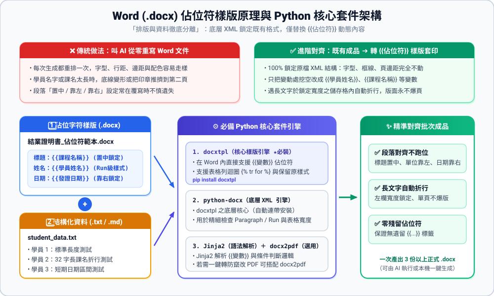

# 📖 Word (.docx) 佔位符樣版原理與 Python 核心套件介紹

> 💡 **講師講解導讀**：本頁用一張架構圖帶您秒懂「為什麼用佔位符樣版就不會跑版」，以及背後必備的 Python 核心套件生態系。

---

## 🖼️ 一張圖看懂：佔位符樣版與 Python 套印原理



---

## 🧩 一、什麼是「佔位字符樣版（Template Placeholder）」？

在 Word 自動化中，最穩健的做法不是叫 AI「從零畫一份 Word」，而是把**「排版外殼」跟「變動資料」徹底分開**：

1. **先保留原檔的完美排版**：拿手邊已經做好的正式文件（如 [`結業證明書.docx`](./結業證明書.docx)），保留原本的頁邊距、LOGO、印章位置、表格欄寬與段落對齊設定。
2. **把會變動的地方挖空改成 `{{變數名稱}}`**：
   - 例如把「張雅婷」改成 `{{學員姓名}}`、把「2026年10月21日」改成 `{{發證日期}}`。
   - 這份只留骨架、不綁死特定人名的檔案，就是**佔位字符樣版**（如 [`結業證明書_佔位符範本.docx`](./結業證明書_佔位符範本.docx)）。
3. **為什麼這樣就能達到像素級對齊？**
   - **段落對齊鎖定**：主標題的「置中」、發證單位的「靠左」、日期的「靠右」全都鎖在 `.docx` 底層 XML 裡，套印時只換字不改排版。
   - **表格欄寬鎖定 ＋ 長文字自動折行**：就算遇到 32 字的超長課名，文字只會在右欄儲存格內自然換行，不會撐壞表格寬度或把印章擠到下一頁。
   - **Run 級樣式保留**：微軟正黑體／Calibri 字型、字級大小與粗體色彩 100% 繼承原樣版。

---

## ⚙️ 二、必需會用到的 Python 核心套件

無論是請 AI 在雲端沙盒（ChatGPT / Claude）執行，還是在本機透過 Antigravity／Python 批次產出，背後必備的套件如下：

| 套件名稱 | 角色定位 | 核心功能與為什麼需要它？ | 安裝指令 |
| :--- | :--- | :--- | :--- |
| **`docxtpl`** | 🏆 **主樣版引擎（★必裝）** | 專為 Word 設計的佔位符套印套件！可直接讀取含 `{{變數}}` 的 `.docx` 樣版並保留原有字型與對齊，也支援表格列動態迴圈 `` 與條件判斷 ``。 | `pip install docxtpl` |
| **`python-docx`** | 🔧 **底層 XML 讀寫引擎** | `docxtpl` 的底層基礎（安裝 `docxtpl` 時會自動安裝）。用來檢查段落對齊（`alignment`）、文字區塊（`Run`）、鎖定表格欄寬與設定自動折行。 | *(隨 `docxtpl` 自動安裝)* |
| **`Jinja2`** | 🧠 **模板語法解析器** | 負責解析 `{{ 學員姓名 }}`、`` 等模板語法（與 Excel 的 `xltpl` 語法完全相通，學會一套通用雙格式！）。 | *(隨 `docxtpl` 自動安裝)* |
| **`docx2pdf`** *(選用)* | 📄 **PDF 轉檔工具** | 若批次產出 `.docx` 後需要直接轉成不可隨意編輯的 `.pdf` 寄給客戶或學員，可搭配此套件（或本機 LibreOffice）一鍵批次轉檔。 | `pip install docx2pdf` |

---

### 💻 10 行 Python `docxtpl` 極簡套印示範

```python
# 安裝：pip install docxtpl（或 uv run --with docxtpl python run.py）
from docxtpl import DocxTemplate

doc = DocxTemplate("結業證明書_佔位符範本.docx")

context = {
    "學員姓名": "林佳穎",
    "學員編號": "S2026001",
    "課程名稱": "生成式 AI 職場效率實戰班",
    "訓練時數": "18",
    "開始日期": "2026年10月1日",
    "結束日期": "2026年10月15日",
    "發證日期": "2026年10月21日",
}

doc.render(context)  # 100% 保留原版排版、字型與置中/靠左/靠右對齊
doc.save("結業證明書_示範成果_學員1_林佳穎.docx")
```

---

[← 返回 Word (.docx) 進階對齊實戰專區](./README.md)
