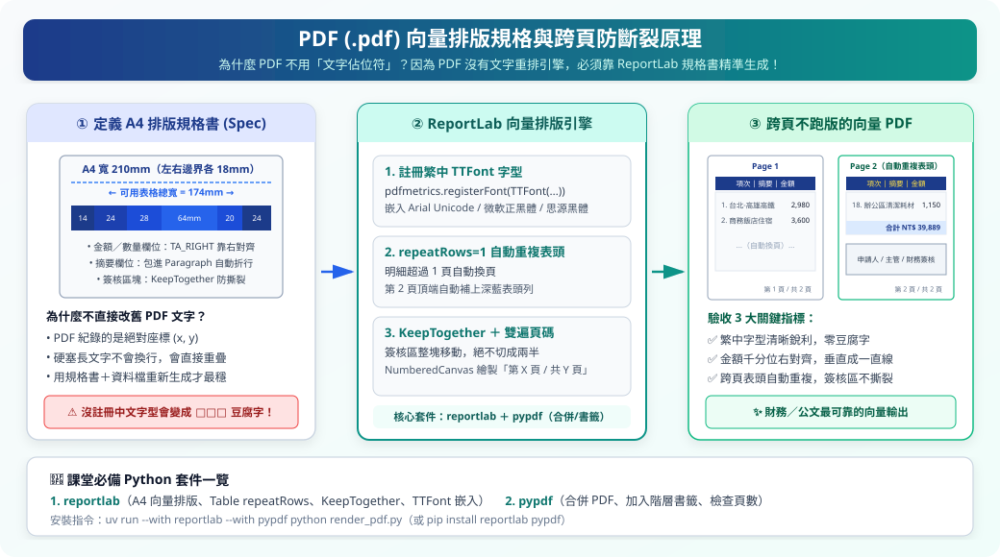

📍 [常見的 AI 應用](../../README.md) › [Office 進階對齊](../README.md) › [PDF (.pdf) 進階對齊](README.md) › **課前導讀：樣版原理與核心套件**

# 📄 PDF (`.pdf`) 向量排版規格與核心 Python 套件介紹

> 💡 **為什麼 PDF 不能像 Word / PPTX 那樣直接替換 `{{佔位符}}`？**  
> 因為 PDF 本質上是一張「畫在固定 `(x, y)` 座標上的向量圖紙」，內部並沒有自動文字重排引擎。如果你強行把短字換成長字，文字會直接重疊或衝出紙張！  
> 因此，PDF 自動化的標準做法是：**「先整理出一份排版規格書（Spec）→ 再用 `reportlab` 根據資料動態生成跨頁不跑版的向量 PDF」**。

---

## 🖼️ 一張圖看懂：向量排版規格與跨頁防斷裂原理



---

## 🧩 一、什麼是「PDF 向量排版規格書」？設計時要注意什麼？

把版面規則（紙張大小、邊界寬度、表格每一欄的固定寬度 `colWidths`、對齊方式與中文字型）寫進 `pdf_layout_spec.md`，讓 AI 每次寫 Python 腳本時都有明確的座標基準。

### ⚠️ 新手做 PDF 最常踩的 4 個地雷
1. **中文字全部變成 `□□□`（豆腐字）**：  
   `reportlab` 預設字型 `Helvetica` 不支援中文。必須用 `pdfmetrics.registerFont(TTFont(...))` 明確註冊系統內的繁體中文字型（如 macOS 的 `Arial Unicode.ttf` 或 Windows 的 `msjh.ttc`）。
2. **表格內容長一點就擠成一團、甚至不換行**：  
   若直接把純字串塞進 `Table`，`reportlab` 不會自動折行！必須把文字包進 `Paragraph(text, style)` 再放入儲存格，才會依照 `colWidths` 自動折行並撐高列高。
3. **明細超過 1 頁，第 2 頁沒有表頭**：  
   長清單換頁後如果沒有表頭，會計根本看不懂哪一欄是什麼。只要在 `Table(..., repeatRows=1)` 加上參數，第 2 頁起就會自動重複深藍色表頭！
4. **底部簽核欄被切成兩半**：  
   「申請人 / 主管 / 財務」的標題留在第 1 頁底端，簽名線卻掉到第 2 頁？把簽核表格包進 `KeepTogether([sign_tbl])`，就會自動整塊移到下一頁。

---

## 🧰 二、課堂必備 Python 套件一覽

| 套件名稱 | 角色定位 | 為什麼一定要用它？ | 安裝指令 |
| :--- | :--- | :--- | :--- |
| **`reportlab`** | **向量 PDF 生成核心** | 精準控制 `A4` 邊界、`colWidths`、數字右對齊、`repeatRows=1` 跨頁表頭與雙遍頁碼 `第 X 頁 / 共 Y 頁`。 | `uv add reportlab` 或 `pip install reportlab` |
| **`pypdf`** | **PDF 後製與驗證** | 負責多份 PDF 合併、加入階層書籤（Outline）以及自動驗證頁數與文字抽取。 | `uv add pypdf` 或 `pip install pypdf` |
| **`weasyprint`** *(選配)* | **HTML/CSS 轉 PDF** | 若你的團隊更習慣用 HTML/CSS Flexbox 排版，也可用它轉出 PDF（需系統安裝 Pango/Cairo）。 | `uv add weasyprint` |

> 🚀 **免安裝環境快速執行（推薦使用 `uv`）**：  
> ```bash
> uv run --with reportlab --with pypdf python render_pdf.py
> ```

---

## 🔗 下一步：回到實戰步驟
👉 [返回 PDF (.pdf) 進階對齊實戰指南](./README.md)

---

🧭 [⬆ 回到：PDF (.pdf) 進階對齊](README.md)
