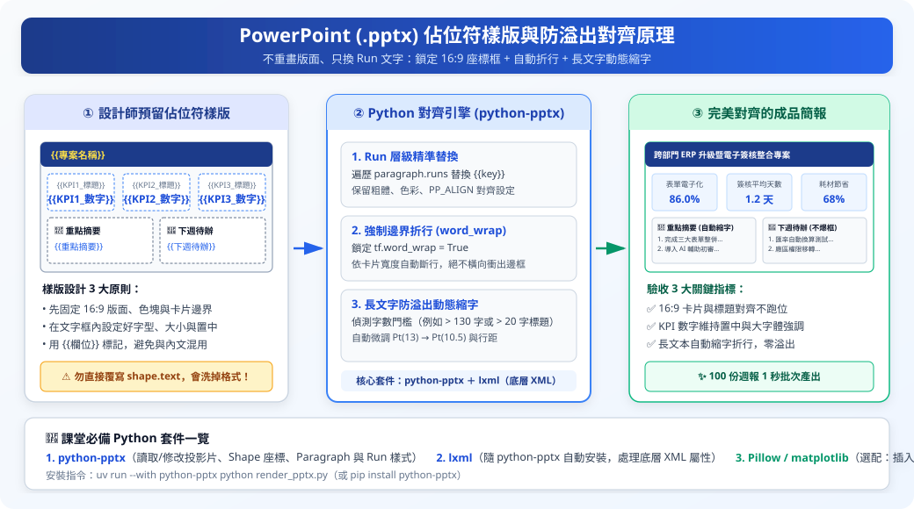

📍 [常見的 AI 應用](../../README.md) › [Office 進階對齊](../README.md) › [PowerPoint (.pptx) 進階對齊](README.md) › **課前導讀：樣版原理與核心套件**

# 📊 PowerPoint (`.pptx`) 佔位符樣版與核心 Python 套件介紹

> 💡 **為什麼要學這個？**  
> 許多人請 AI 寫 Python「從零開始畫投影片」，結果座標常常算錯、字體跑掉、卡片對不齊。  
> 真正高效的企業級做法是：**「人類在 PowerPoint 設計好 16:9 母片與色塊樣版 → Python 只負責把資料精準注入 `{{佔位符}}`」**，同時加上防溢出保護，讓長文字也不會衝出卡片框外！

---

## 🖼️ 一張圖看懂：佔位符樣版與防溢出對齊原理



---

## 🧩 一、什麼是 PowerPoint「佔位符樣版」？有哪兩種模式？

在企業級自動化簡報中，「佔位符樣版」依使用情境分為兩種做法：
1. **模式 A（主軸一｜固定版型 `{{佔位符}}`）**：適合每月／每週格式固定的報表。先用 PowerPoint 排版好背景色塊、Logo、KPI 卡片與文字框座標，再把會變動的文字改成 **`{{欄位名稱}}`**（例如 `{{專案名稱}}`、`{{KPI1_數字}}`、`{{重點摘要}}`）。
2. **模式 B（主軸二｜公司母片原生 `Placeholder`）**：適合每次主題與頁數不同的簡報。直接使用公司 `.pptx` **投影片母片（Slide Master）** 中設定好的各種 **版面配置（Slide Layouts）** 與原生佔位符（`placeholder.idx`），讓 AI 依大綱動態挑選版型並新增投影片（👉 詳見 [母片大綱動態生成模組](./母片大綱動態生成/README.md)）。

### ⚠️ 新手最常踩的 3 個地雷
1. **直接覆寫 `shape.text` 導致格式全部被洗掉**：  
   在 `python-pptx` 中，直接寫 `shape.text = "新文字"` 會把原本設定好的粗體、顏色、字體大小與 `PP_ALIGN.CENTER` 全部清除！正確做法是**遍歷 `paragraph.runs` 在 Run 層級替換文字**。
2. **佔位符被 PowerPoint 拆成多個 Run**：  
   有時你在 PowerPoint 裡只改了 `{{專案名稱}}` 的某幾個字，底層 XML 會把它拆成 `{{專案` 和 `名稱}}` 兩個 Run，導致單純的 `run.text.replace()` 找不到！解法是先合併判斷段落全文，再安全替換並保留第一個 Run 的樣式。
3. **長文字溢出卡片邊框**：  
   投影片空間有限，當 `{{重點摘要}}` 或標題突然變長時，必須強制鎖定 `tf.word_wrap = True`，並根據字數門檻**動態微調字體大小**（例如從 `13pt` 降至 `10.5pt`）。

---

## 🧰 二、課堂必備 Python 套件一覽

| 套件名稱 | 角色定位 | 為什麼一定要用它？ | 安裝指令 |
| :--- | :--- | :--- | :--- |
| **`python-pptx`** | **核心簡報引擎** | 可讀取現有 `.pptx` 樣版、精準定位每個 `Shape` 與 `Table`，並在保留原字型與對齊的前提下替換文字。 | `uv add python-pptx` 或 `pip install python-pptx` |
| **`lxml`** | **底層 XML 支援** | `python-pptx` 的底層依賴（安裝時會自動裝好），處理投影片 XML 節點與段落屬性。 | 隨 `python-pptx` 自動安裝 |
| **`Pillow` / `matplotlib`** *(選配)* | **圖表與圖片處理** | 若簡報需要動態插入統計圖表或裁切人員大頭照，可搭配使用。 | `uv add pillow matplotlib` |

> 🚀 **免安裝環境快速執行（推薦使用 `uv`）**：  
> ```bash
> uv run --with python-pptx python render_pptx.py
> ```

---

## 🔗 下一步：回到實戰步驟
👉 [返回 PowerPoint (.pptx) 進階對齊實戰指南](./README.md)

---

🧭 [⬆ 回到：PowerPoint (.pptx) 進階對齊](README.md)
