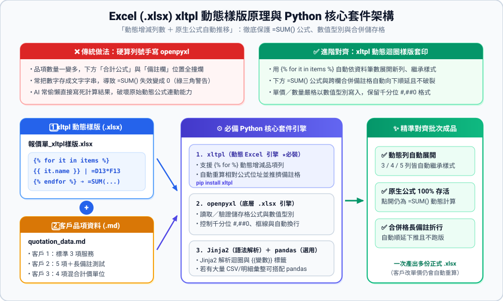

# 📖 Excel (.xlsx) xltpl 動態樣版原理與 Python 核心套件介紹

> 💡 **講師講解導讀**：本頁用一張架構圖帶您秒懂「為什麼品項列數一直變，下方合計公式與合併儲存格卻不會跑版」，以及背後必備的 Python 核心套件。

---

## 🖼️ 一張圖看懂：xltpl 動態樣版與公式保護原理

---

## 🧩 一、什麼是「xltpl 動態佔位符樣版」？

在 Excel 報價單或請款單自動化中，最大痛點是**「表格中間的明細列數每次都不一樣」**。若只是把文字替換掉，遇到 5 筆或 10 筆品項時，就會覆蓋到下方的「未稅合計」、「營業稅 5%」與「備註合併儲存格」。

**`xltpl` 動態樣版**的解決邏輯如下：
1. **在原檔中只留 1 行品項示範列**：保留原本的字型、千分位格式 `#,##0`、邊框色彩與小計公式（如 `=IF(AND(ISNUMBER(D13),ISNUMBER(F13)),D13*F13,"待填資料")`）。
2. **用 `` ... `` 包住該示範列**：
   - 當輸入 3 筆品項時，自動展開為 3 列；輸入 5 筆時，自動展開為 5 列！
   - 下方的 `=SUM(...)` 公式位址與合併儲存格備註欄會**自動往下順延並重算範圍**。
3. **數值型別（Number）嚴格對齊**：
   - 數量與單價必須傳入數字（`int` / `float`）而非文字字串，否則 Excel 公式會失效且左上角出現綠色錯誤三角警示。

---

## ⚙️ 二、必需會用到的 Python 核心套件

| 套件名稱 | 角色定位 | 核心功能與為什麼需要它？ | 安裝指令 |
| :--- | :--- | :--- | :--- |
| **`xltpl`** | 🏆 **主動態樣版引擎（★必裝）** | 專為 `.xlsx` 設計的 Jinja2 樣版渲染套件！可動態展開 `` 明細列、繼承原樣式並自動調整下方 `=SUM()` 公式列號。 | `pip install xltpl` |
| **`openpyxl`** | 🔧 **底層 `.xlsx` 讀寫引擎** | `xltpl` 的底層基礎，用來驗證寫入後的儲存格是否仍為動態公式、檢查數值型別與千分位格式 `#,##0`。 | *(隨 `xltpl` 自動安裝)* |
| **`Jinja2`** | 🧠 **模板語法解析器** | 負責解析 Excel 儲存格內的 `{{ 客戶名稱 }}` 與 `` 迴圈語法。 | *(隨 `xltpl` 自動安裝)* |
| **`pandas`** *(選用)* | 📊 **前置資料整理工具** | 若原始資料來自大型 CSV 或多工作表流水帳，可先用 `pandas` 清洗彙整後，再轉成字典餵給 `xltpl`。 | `pip install pandas` |

---

[← 返回 Excel (.xlsx) 進階對齊實戰專區](./README.md)
