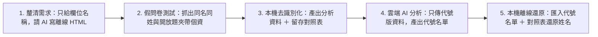

📍 [常見的 AI 應用](../README.md) › **去識別化（個資替換與還原）**

# 🔐 去識別化實戰：打造離線個資替換與還原小工具

公司規定含有個資的資料不能直接交給 AI，但手上的員工問卷、客戶意見又多到看不完，到底還能不能用 AI 幫忙分析？

其實可以請 AI 寫一個**不需要連網的單一 HTML 小工具**，在自己的電腦裡先把個資換成代號，檢查沒問題後再交給 AI 分析；需要聯繫特定對象時，還能在自己電腦裡把代號還原成姓名。

---

## 🧭 核心架構與安全邊界（零外洩閉環）



| 操作階段 | 執行環境 | 送出的資料內容 | 資安關鍵 |
| :--- | :--- | :--- | :--- |
| **開發與測試工具**（Step 1～2） | 雲端 AI ＋ 本機瀏覽器 | 僅提供**欄位名稱**與 AI 生成的**假問卷** | 絕不貼入任何真實個資 |
| **替換個資**（Step 3 前半） | **本機離線 HTML** | 正式問卷檔案 | 完全斷網可用，資料不離開電腦 |
| **分析需求**（Step 3 後半） | 雲端 AI | **僅含代號的分析資料** | 上傳前人工確認無漏網個資；**對照表留在本機** |
| **還原名單**（Step 4） | **本機離線 HTML** | AI 回覆的代號名單 ＋ 本機對照表 | 還原姓名全程在本機完成 |

---

## 🛠️ 四步驟實戰教學（以「員工回饋問卷」為例）

### STEP 1️⃣ 先別寫程式，請 AI 陪你釐清需求

開一段新對話，告訴 AI 問卷有哪些欄位（**只提供欄位名稱，不要上傳真實問卷**），請它逐一提問，確認姓名、員編、Email 要換成代號還是直接刪除，對照表又該怎麼保管。

先透過對話把模糊的「幫我遮個資」，整理成包含安全限制與例外處理的開發需求，再請 AI 寫出程式碼。

#### 📋 Prompt 範例（需求訪談）

```text
我想開發用於員工問卷分析的「個資替換與還原工具」。問卷欄位有：（貼上欄位名稱）。

先不要寫程式，請逐一提問，幫我確認需求，並主動檢視安全風險與例外狀況。

工具必須是單一HTML檔案，完全離線運作，不連網、不傳送資料。需求確認後，再整理成開發提示詞。
```

> 💡 **小提醒**：等 AI 逐題問完、整理出完整的開發規格後，再開新對話（或接續對話）請它依據該開發提示詞產出單一 `.html` 檔案，下載後直接用瀏覽器（Chrome / Edge / Safari）雙擊開啟即可。

---

### STEP 2️⃣ 用假問卷測試，抓出漏網之魚

工具寫好後，先別急著匯入正式問卷！請 AI 產生一份**容易出錯的假問卷**（例如：員工同名同姓、有人把 Email 或手機號碼寫在開放式回答裡），再用瀏覽器開啟 HTML 工具實際跑一次。

#### 📋 Prompt 範例（產生壓力測試假資料）

```text
請幫我生成一份 10 筆的「員工回饋問卷」測試用假資料（CSV 格式），刻意加入以下容易出錯的情境：
1. 兩位員工同名同姓，但部門或員編不同。
2. 有人在「其他建議」的開放式欄位中，自己寫入了 Email、分機或手機號碼。
3. 欄位中有空白值或換行符號。
```

如果測試發現有個資沒被遮蔽、或代號對應錯亂，**把「測試情境 ＋ 預期結果 ＋ 實際結果」一起告訴 AI**，修正會更精準：

```text
我在測試 HTML 工具時發現問題，請幫我修正：
- 測試情境：開放式建議欄出現「請寄信到 abc@company.com 聯繫我」
- 預期結果：Email 應一併被遮蔽或替換成代號
- 實際結果：Email 原封不動保留在匯出的分析檔中
```

---

### STEP 3️⃣ 處理正式問卷，兩份檔案分開放

測試通過後，在自己的電腦用瀏覽器打開 HTML 工具並匯入正式問卷，工具會產出兩份完全分開的檔案：

| 產出檔案 | 用途說明 | 存放與上傳規範 |
| :--- | :--- | :--- |
| **1. 替換個資後的分析資料** | 姓名、員編、Email 等已轉為代號（如 `EMP-001`）或遮蔽 | ✅ 人工抽檢確認無可辨識身分內容、符合公司規範後，**可交給 AI 分析** |
| **2. 代號還原對照表** | 記錄「代號 ↔ 真實姓名 / Email」的對應關係 | ⛔ **嚴格留在自己的電腦**，絕對不跟著上傳到 AI |

#### 📋 Prompt 範例（請 AI 分析去識別化後的資料）

```text
請分析各部門的學習需求、提出改善建議，並以代號列出需要後續協助的學員。
```

---

### STEP 4️⃣ 需要聯繫時，再離線還原姓名

當 AI 分析完成、列出需要追蹤或寄送學習資源的「代號名單」後，只要回到自己電腦的 HTML 小工具，把 **AI 整理的代號名單** 和 **本機保留的對照表** 一起匯入，就能離線還原成真實姓名與聯絡方式。

> ♻️ **一次開發、重複使用**：這份單一 HTML 小工具存放在電腦裡，下次辦完教育訓練或新的滿意度調查時，只要欄位結構相同就能直接沿用。

---

## ✅ 上傳 AI 前的資安檢核清單

在把處理完的檔案上傳到任何雲端 AI 之前，請務必花 30 秒快速確認：

- [ ] **對照表已隔離**：確認上傳附件中**沒有**包含「代號還原對照表」。
- [ ] **開放式回答已掃描**：抽查開放式文字欄，確認沒有員工自己填入的姓名、手機、Email、分機或專案機密代號。
- [ ] **間接識別風險檢查**：若某部門只有 1 位員工（例如「法務室＋資深經理」），單獨出現仍可能被猜出身分，必要時可先將過度細分的職稱合併或移除。
- [ ] **工具離線驗證**：確認該 HTML 工具沒有載入外部 CDN 函式庫或任何網路傳輸請求（斷網狀態下仍可正常執行替換與還原）。

---

🧭 [⬅ 上一頁：模組 00 AI 前置資料清洗與規格化](../AI前置資料清洗與規格化/README.md) ｜ [⬆ 回到：常見的 AI 應用](../README.md) ｜ [下一頁：辦公室全能應用 ➡](../辦公室全能應用/README.md)
