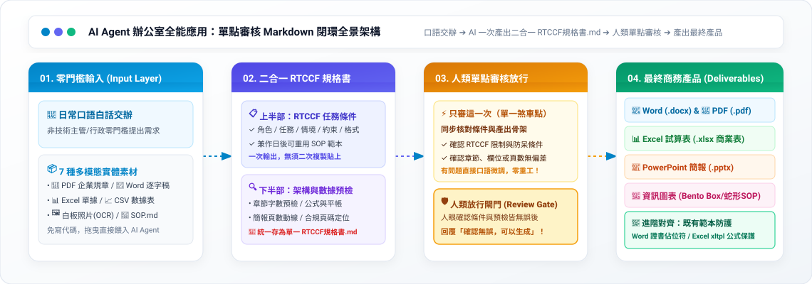

📍 [常見的 AI 應用](../../README.md) › [辦公室全能應用](../README.md) › **共通工作流**

# 🧭 共通工作流：6 個口語重點 ＋ `RTCCF.md` 一問一答

> 後面所有範例都照這一頁的方法走。**先讀完這頁，再進入 Word、Excel、簡報。**

---

## 🧭 三步工作流

每個範例都照同樣三步走：

1. **口語條列輸入**：對照下方 6 個重點，用自己平時講話的方式簡短條列需求（可附上 PDF、Word、Excel、CSV、白板照片等素材）。
2. **AI 儲存 `RTCCF.md` ＋ 一問一答**：AI 先用專業經驗填好小細節並存成 `RTCCF.md`，再針對大方向一次問 1 題（附建議選項，最多 5~6 題）；每確認一題就更新 `RTCCF.md`。
3. **人類確認放行 ➔ 交付檔案**：打開定稿的 `RTCCF.md` 檢查無誤後放行。三種格式的交付方式不同：

| 格式 | 交付路徑 |
| :--- | :--- |
| 📄 **Word / PDF** | `RTCCF.md` ➔ **先審完整內文 `.md`** ➔ 定稿後轉 `.docx` / `.pdf` |
| 📊 **Excel** | `RTCCF.md`（欄位、公式、防呆）➔ **直接交付 `.xlsx`** |
| 📑 **PowerPoint** | `RTCCF.md`（含每頁大綱）➔ **直接交付 `.pptx`** |

### 📝 6 個口語重點（每個範例都會用到）

> 💡 **不用複製貼上！** 看懂這 6 個重點，再用自己的話寫出來，才真正學得會。各範例頁都有對應的口語示範。

1. **交代主題與對象**：要做什麼文件、給誰看或誰使用。
2. **列出基本條件**：必含項目、字數、語氣，或表格欄位與規則。
3. **要求先存 `RTCCF.md`**：先不要直接產出成品，先整理成 `RTCCF.md` 規格書存檔。
4. **小細節請 AI 先填**：格式、字型、公式語法等專業細節請 AI 用經驗補齊。
5. **大方向一問一答（約 5~6 題）**：一次問 1 題、附建議選項、不要問太細。
6. **邊問邊更新存檔**：每確認完一題，就同步更新儲存 `RTCCF.md`。

---

## 📌 為什麼規格書要存成 `RTCCF.md`？

唯有存成實體 `.md` 檔（而不只是對話框裡的文字），你才能打開檢視、透過問答修改，真正做到人類把關（Human-in-the-Loop）：

| 評估面向 | 儲存為 Markdown (`.md`) | 存為一般記事本 (`.txt`) | 存為 Word (`.docx`) |
| :--- | :--- | :--- | :--- |
| **語意結構保真度** | 🟢 **100% 原生解析**：保留 `#` 標題、`\| 表格 \|`、代碼區塊與縮排層級，AI Agent 精準理解任務角色、欄位邊界與約束條件。 | 🟡 **結構模糊**：僅有平鋪文字，複雜的交辦步驟、參數對齊容易錯位，AI Agent 容易漏看約束。 | 🔴 **格式污染**：夾帶大量二進位與 XML 富文本標籤，複製到對話介面時引發格式錯亂與雜訊。 |
| **AI Agent 相容性** | 🟢 **完美通用**：主流 AI Agent 原生皆以 Markdown 渲染與解析，直接讀取 `.md` 規格書能做到**零幻覺精準執行**。 | 🟡 段落切分較生硬，跨段落檢索容易斷層。 | 🟡 檔案體積大，上傳與解析耗時較久，部分平台解析表格易變形。 |
| **人機協作與版本控管** | 🟢 **最佳數位資產**：支援 Git、VS Code、Obsidian，一份檔案同時保存 RTCCF 提示詞與預檢標準，團隊可多人修訂並作為下次一鍵套用的 SOP 資產庫。 | 🔴 缺乏結構化，難以建立可追蹤、可擴充的規格資產庫。 | 🔴 難以進行純文字 diff 版本比較與自動化管道調用。 |

---

## 🔤 跨平台（Mac / Windows）統一字型防跑版

轉出的檔案常出現「英文換字型了，中文卻退回新細明體」，甚至「『申、請、補、準』的筆畫像簡體字」，主要有三個原因：
1. **Mac（蘋方體 `PingFang TC`）與 Windows（微軟正黑體 `Microsoft JhengHei`）預設字庫互斥**。
2. **AI 產檔時常漏設 Office 底層的「東亞中文字型標籤（`eastAsia` / `a:ea`）」與繁體中文語系（`zh-TW`）**。
3. **雲端 Linux 轉 PDF 容易誤映射到簡體／日文字庫**：未宣告 `lang="zh-TW"` 時，`Noto Sans TC` 會被映射成簡體 `Noto Sans CJK SC` 或日文 `Noto Sans CJK JP`。

全格式首選台灣版思源黑體 **`Noto Sans CJK TC` / `Noto Sans TC`**；若免安裝字體且雙平台皆有 Microsoft Office，可統一使用 **`Microsoft JhengHei`（微軟正黑體）＋ 英數 `Arial`**。各格式的鎖定時機如下：

| 格式 | 何時鎖定字型 | 要求 AI 做到的事（台灣繁體 `zh-TW`） |
| :--- | :--- | :--- |
| **Excel (`.xlsx`)** | 寫進 `RTCCF.md` 格式規範 | 全活頁簿（標題、表頭、資料列、總計列與圖表）所有儲存格皆顯式指定 `Microsoft JhengHei`（或 `Noto Sans TC`），禁止留空退回預設字型。 |
| **PowerPoint (`.pptx`)** | 寫進 `RTCCF.md` 格式規範 | 中文 `Microsoft JhengHei`（或 `Noto Sans TC`）、英數 `Arial`，底層 XML 同時寫入**東亞字型 `<a:ea>`**、**拉丁字型 `<a:latin>`** 與 `lang="zh-TW"`。 |
| **Word (`.docx`)** | `.md` 定稿後的轉檔 Prompt | 所有樣式同時綁定**西文字型 `w:ascii` / `w:hAnsi`**（`Arial`）與**東亞字型 `w:eastAsia`**（`Microsoft JhengHei` 或 `Noto Sans TC`），語系 `zh-TW`。 |
| **PDF (`.pdf`)** | `.md` 定稿後的轉檔 Prompt | HTML 宣告 `lang="zh-TW"`，字型堆疊 `"Noto Sans CJK TC", "Noto Sans TC", "PingFang TC", "Microsoft JhengHei", sans-serif` 並內嵌，嚴禁映射到 `SC` / `JP` 字庫；內文 `11pt`、行高 `1.6` 倍。 |

> 💡 Word / PDF 可直接複製的轉檔 Prompt，以及「先轉 `.docx` 再用本機另存 PDF」確保 100% 台灣字形的做法，都在 [**Word 與 PDF 模組**](../Word與PDF文件的生成/README.md)。

---

🧭 [⬆ 回到：辦公室全能應用](../README.md) ｜ [下一頁：Word 與 PDF ➡](../Word與PDF文件的生成/README.md)
