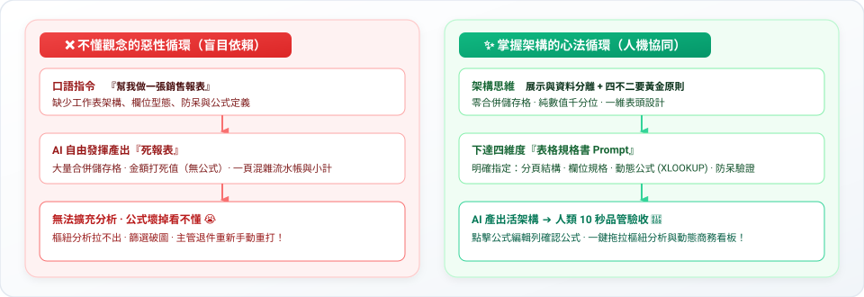
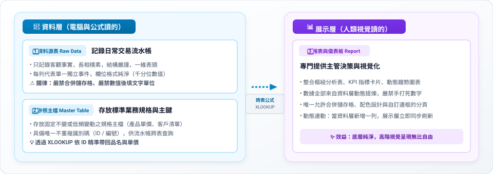

# 🧠 前導核心：AI 時代的 Excel 資料架構與審核心法
## 🎯 從「學操作軟體」到「資料架構師」：懂底層邏輯，才能精準 Prompt 與審核驗收

> **核心學習定位**：  
> 當 AI 已經能在一秒內寫出 Python 腳本並生成實體 `.xlsx` 檔案時，學習 Excel 的核心價值發生了根本性的典範轉移——**從「怎麼在軟體上點擊操作（How to click）」轉移到「如何設計資料架構與下達精準規格（How to architect & prompt）」**。  
> 
> 如果完全不懂底層邏輯，學生對 AI 下達的指令往往只有一句：「幫我做一張銷售報表」。結果 AI 吐出一張包含大量合併儲存格、排版花俏但全是死數字、後續完全無法排序、篩選或樞紐分析的「死報表」；一旦公式算錯，學生更完全沒有能力抓漏除錯。  
> **唯有掌握 Excel 的底層架構思維，你才能當 AI 的「總架構師」與「品管總監（QA）」！**

---

## 🧭 為什麼 AI 時代更需要懂底層資料觀念？



---

## 🗺️ 駕馭 AI 的五大核心架構模組


---

### 🏛️ 模組一：Excel 的「展示層」與「資料層」分離觀念（最核心的思維）

初學者最常犯的直覺錯誤，就是**把「用來儲存資料的流水帳」跟「印出來給主管看的漂亮報表」混在同一個工作表裡**。

在要求 AI 生成 Excel 檔案前，必須先建立**「工作表三層分工」**的觀念：



| 工作表角色 | 核心用途 | 誰在讀這張表？ | 設計規範與限制 |
| :--- | :--- | :--- | :--- |
| **1. 資料源表<br>(Raw Data)** | 記錄每一筆日常交易、報銷、工時或進出貨流水帳。 | **電腦、公式、樞紐分析** | 嚴禁合併儲存格、欄位名稱單純一維化、每列代表獨立事件。 |
| **2. 參照主檔<br>(Master Table)** | 存放基本不常變動的標準字典（如：產品編號對應單價、客戶統編）。 | **公式檢索 (XLOOKUP)** | 每一筆記錄必須有唯一的識別碼（ID），不可有重複列。 |
| **3. 報表與儀表板<br>(Report / Dashboard)** | 將冰冷數據轉化為決策資訊，含 KPI 卡片、圓餅圖、趨勢圖。 | **主管、客戶、決策者** | 允許適度合併儲存格美化、標色警示、專注於商業指標結論。 |

> 💡 **對 AI Prompt 的直接影響**：  
> 懂這個觀念後，你就不會只叫 AI「把所有東西塞在同一頁」，而是能明確下達規格：  
> *「請幫我建立一個包含『訂單明細（流水帳）』、『產品主檔（單價參照）』與『月度銷售分析（匯總儀表板）』三個工作表的 .xlsx 檔案。」*

---

### 🧹 模組二：認識「乾淨資料」的黃金法則（無痛版資料庫正規化）

不必死背生澀的資料庫正規化理論（1NF ~ 3NF），我們將它包裝成「AI 聽得懂、公式算得準」的**「四不二要」**法則：

#### 🚫 四不原則（保證每一格都是最小原子單元）

1. **不合併儲存格**：資料源表只要有合併儲存格，Excel 的「自動篩選」、「排序」與「樞紐分析」就會全面破圖失效。
2. **不留空白列 / 空白欄**：連續資料中斷會導致 `Ctrl + Shift + 方向鍵` 快捷鍵失靈，也會使 AI 與公式誤判資料範圍邊界。
3. **一格不塞多件事**：一格絕對不寫 `王小明 (0912-345678)`，必須拆成「聯絡人姓名」與「電話」兩欄，後續才能各自比對排序。
4. **不把時間或類別當欄位名稱（拒絕二維交叉表）**：
   - ❌ **錯誤二維表**：欄位放「產品名、1月、2月、3月」（後續無法新增月份，難以統計）。
   - ✅ **正確一維表**：欄位放「產品名、月份、銷售金額」（無限往下新增，樞紐分析一秒完成）。

#### ✅ 二要原則（建立關聯與避免冗餘）

1. **要有唯一識別碼（Primary Key）**：每個客戶要有客戶編號、產品要有 SKU 編號、訂單要有訂單號。避免同名同姓或品名微調造成公式找不到資料。
2. **要拆分重複資訊（建立獨立主檔）**：訂單明細裡只需要填「產品編號」，不要每次手打產品名稱、規格、供應商電話與成本；需要時由公式自動跨表帶出。

---

### ⚙️ 模組三：看懂 Excel 的結構與「活檔案 vs. 死檔案」

當 AI 生成 `.xlsx` 檔案時，背後有兩種截然不同的路徑：
- 🔴 **死檔案（純數值硬編碼）**：AI 在後台用 Python 算好數字，直接把 `15000` 填入儲存格。日後你只要修改單價或數量，總金額**完全不會自動重算**！
- 🟢 **活檔案（動態公式架構）**：AI 在儲存格寫入 `=C2*D2` 與 `=SUM(E2:E20)`。未來修改任何資料，報表**動態連動重算**。

為了指揮 AI 產出「活檔案」，學生必須具備以下四大基礎概念：

| 必學基礎概念 | 為什麼在 AI 時代一定要懂？ | 檢查與 Prompt 重點 |
| :--- | :--- | :--- |
| **資料型態<br>（文字 vs. 數值 vs. 日期）** | AI 生成常把「數字存成文字」（導致 `SUM` 出來是 0），或把「日期存成純字串」（無法依月份群組）。 | 檢查儲存格靠左（通常是文字）或靠右（數值與日期），注意綠色三角警告標籤。 |
| **相對參照 vs. 絕對參照<br>(`A1` vs. `$A$1`)** | 當 AI 幫你寫跨表抓取或百分比公式時，必須看懂為什麼有些地方加了 `$` 符號；否則自行拖拉公式時參照範圍會整排位移跑掉。 | 鎖欄鎖列的語法，下指令要求 AI 在抓取固定主檔時使用絕對參照。 |
| **Excel 結構化表格<br>(`Ctrl + T`)** | 傳統普通範圍在新增資料列時，公式與樞紐不會自動擴充；結構化表格具備動態延展性。 | 指示 AI：「請將資料源清單設定為 Excel Table（結構化表格），命名為 `Table_Orders`」。 |
| **四大核心函數家族** | 不必硬背每個函數的參數位置，但**必須知道在什麼商業情境下，要叫 AI 使用哪個函數家族**！ | 詳見下方核心函數定位說明。 |

```
【四大核心函數家族速查】
1. 跨表檢索家族：XLOOKUP（現代首選，取代易破圖的 VLOOKUP）
2. 條件統計家族：SUMIFS（多條件加總）、COUNTIFS（多條件計數）、AVERAGEIFS
3. 邏輯判斷家族：IF、IFS（多重條件分流）、SWITCH
4. 容錯防呆家族：IFERROR（當找不到資料時顯示「查無此人」，避免滿畫面 #N/A）
```

---

### 📝 模組四：如何對 AI 下達「表格規格書（Prompt）」

有了前面三大觀念，你就能把日常口語轉化為具備「工程嚴密性」的結構化 Prompt。  
請記住向 AI 開立規格書的**「黃金四大維度」**：


#### 📋 實戰提示詞範本（可直接複製修改）

```markdown
你是一位具備 10 年經驗的資深財務與資料庫分析架構師，請為我建立一份標準的 Excel (.xlsx) 檔案，規格如下：

1. 【工作表架構】請建立三個分頁：
   - Sheet 1「產品主檔」：存放產品基本規格（參照層）。
   - Sheet 2「銷貨明細」：記錄每日流水帳，設為結構化表格（資料層）。
   - Sheet 3「月度統計看板」：供主管閱讀的樞紐匯總（展示層）。

2. 【欄位與型態規範】
   - 「產品主檔」欄位：[產品編號(文字,主鍵)]、[品名(文字)]、[標準售價(純整數,千分位)]。
   - 「銷貨明細」欄位：[訂單編號]、[銷售日期(YYYY-MM-DD)]、[產品編號]、[銷售數量(純整數)]、[單價]、[小計金額]。

3. 【公式邏輯（嚴禁寫死純數值）】
   - 「銷貨明細」的 [單價] 欄位：請寫入 =XLOOKUP 公式，依 [產品編號] 自動至「產品主檔」帶出售價，查無資料請用 IFERROR 容錯顯示 0。
   - [小計金額] 欄位：請寫入動態公式 =[銷售數量]*[單價]。
   - 底端總計列請使用 =SUM() 函數。

4. 【防呆與格式化】
   - 在「銷貨明細」的 [產品編號] 欄位配置資料驗證（Data Validation），限制只能從「產品主檔」的編號清單中下拉選擇。
   - 所有金額欄位設定格式為 #,##0。
   - 請預先填入 10 筆測試資料以供驗收。
```

---

### 🔍 模組五：驗收、除錯與樞紐分析（Human-in-the-loop）

拿到 AI 生成的 `.xlsx` 檔案，工作才完成一半！你必須擔任合格的品管員（QA），依照以下三步驟進行驗收：

#### 1. 點開儲存格看「資料編輯列（Formula Bar）」
- **合格**：點到小計或總計格，上方編輯列顯示 `=C2*D2` 或 `=SUM(E2:E20)`。
- **不合格（退件）**：編輯列直接顯示靜態數字 `15000`。請立即叫 AI 重寫：「請將靜態數字改為動態 Excel 公式」。

#### 2. 常見錯誤代碼速查與修復對策

| 錯誤代碼 | 代表意義 | 常見原因 | 如何叫 AI 修正或自我排查？ |
| :--- | :--- | :--- | :--- |
| **`#N/A`** | 找不到資料 (Not Available) | `XLOOKUP` 查無比對值；或者編號前後夾雜了多餘的隱形空白鍵。 | 叫 AI：「請在查詢比對時加入 `TRIM()` 函數去空白，並用 `IFERROR` 包裹查無比對的狀況。」 |
| **`#REF!`** | 無效參照 (Reference Error) | 公式參照的工作表、欄或列被刪除了，或是公式向下拉時超出了範圍。 | 檢查被參照的儲存格是否被覆蓋或改名，請 AI 重新檢查參照座標。 |
| **`#VALUE!`** | 數值型態錯誤 | 把「文字」拿去參與加減乘除（例如儲存格填了 `3,500元`）。 | 檢查欄位是否被存成文字，請 AI 剝除文字單位改用自訂儲存格格式。 |
| **`#####`** | 欄寬不足 / 日期負數 | 不是壞掉！純粹是儲存格寬度不夠容納長數字，或日期運算出現負值。 | 將滑鼠移到欄位分隔線雙擊自動最適欄寬；或請 AI 調整欄寬屬性。 |
| **`#DIV/0!`** | 除以零錯誤 | 分母為 0 或參照到了空白儲存格。 | 叫 AI 加入條件防呆：「請使用 `=IF(分母=0, 0, 分子/分母)` 避免除以零錯誤。」 |

#### 3. 一鍵檢驗成果：拉出樞紐分析表（Pivot Table）
如果你的資料源表完全符合「四不二要」的乾淨標準，你只要選取資料範圍，按下 `插入` ➔ `樞紐分析表`，用滑鼠拖拉「產品類別」到列、「銷售金額」到值，**10 秒鐘就能產出多維度交叉報表**！
> 🚀 **驗收的極致體會**：  
> 當底層資料架構對了，後續的樞紐分析、篩選器與動態圖表就會無比順暢；反之，若底層充斥合併儲存格與髒資料，再厲害的 AI 也救不回混亂的報表。

---

## 🎓 建議的「從 0 到完成」實戰教學專案設計（課堂四步落地法）

若要帶領學員親自體驗「觀念顛覆」與「AI 協作賦能」，建議以**「小型企業進銷存／專案訂單管理系統」**為主題，分成以下四個階段推進：


1. **【第一階段：反面教材震撼體驗】**  
   先讓學員用直覺在對話框輸入：「幫我做一張客戶訂單統計表」。  
   讓大家親眼見證 AI 隨便生出來的表格問題重重：合併儲存格讓資料無法排序、數字寫死無公式、客戶資訊每次重複手打。
2. **【第二階段：紙上／白板架構設計】**  
   先不碰電腦！帶領學員拿出紙筆或筆記軟體，畫出三個分頁架構：  
   `[產品主檔]`、`[客戶主檔]`、`[訂單流水帳]`，並列出每個分頁的欄位名稱、資料型態與主鍵 ID。
3. **【第三階段：撰寫結構規格 Prompt 並生成檔案】**  
   帶著學員將第二步的紙上架構，套入模組四的「規格書四大維度」，要求 AI 寫入 `XLOOKUP` 公式、加入下拉選單防呆，並請 AI 自動填入 20 筆測試資料生成 `.xlsx`。
4. **【第四階段：打開 Excel 驗收與拖拉樞紐分析】**  
   學員下載檔案打開 Excel，檢查資料編輯列的動態公式、測試在下拉選單新增一筆訂單看是否自動計算總價，最後用滑鼠 10 秒拉出「各業務員銷售排行」樞紐分析表，完美收官！

---

## 🗺️ 銜接後續實戰階梯

掌握了本章節的核心架構思維後，你已經具備向 AI 清楚下達規格與品管驗收的能力！接下來請依序進入實戰五大階梯，逐一解鎖具體場景：

- 🟢 **[階梯一：基礎建表與運算](../01_階梯一_基礎建表與運算_告別排版地雷與公式語法/README.md)** —— 告別排版地雷，實作標準資料庫結構與費用報銷
- 🟡 **[階梯二：資料防呆與自動警示](../02_階梯二_資料防呆與自動警示_告別手動檢查與眼花抓漏/README.md)** —— 實作下拉選單與條件式格式化
- 🟠 **[階梯三：髒資料清洗與轉化](../03_階梯三_髒資料清洗與轉化_告別無止境複製貼上/README.md)** —— 處理非結構文字、LINE留言與雜訊剝除
- 🔵 **[階梯四：跨表關聯與多維統計](../04_階梯四_跨表關聯與多維統計_告別VLOOKUP破圖與公式恐懼/README.md)** —— 深入 XLOOKUP 與多條件統計矩陣
- 🟣 **[階梯五：商業儀表板與視覺化](../05_階梯五_商業儀表板與視覺化_直上主管級商務看板/README.md)** —— 直上主管級 C-Level 商業看板與決策洞察

---

[← 返回 Excel 全能實戰課程總導覽](../README.md)
