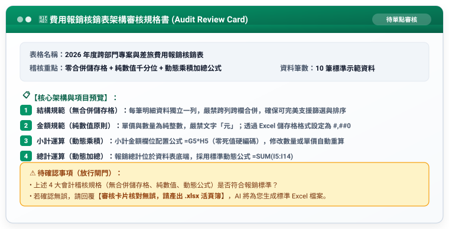

# 📑 步驟 1-2：AI 一次產出之二合一 RTCCF 規格與預檢卡片

> **核心機制（單點審核）**：  
> AI 在同一回合將初學者的口語需求，直接轉化為「上半部：RTCCF 試算表工程規格」＋「下半部：表格架構與公式預檢卡片」。  
> 💡 **單點審核優勢**：學員只需審核這一次即可直接放行生成，不必在兩次對話間來回貼上；亦可將整份規格儲存為單一 `報銷表_RTCCF規格書.md` 範本供日後直接套用！

---

## 📋 上半部：RTCCF 試算表工程規格（可供日後重用）

```markdown
# Role (角色定位)
你是一位精通財務報銷制度、資料庫正規化設計與 Microsoft Excel 商務應用的資深資料分析師。

# Task (核心任務)
請根據以下規格，為「2026 年度部門差旅與專案費用報銷核銷表」建立一份標準化試算表。包含：
1. 嚴謹的欄位結構（嚴禁合併資料儲存格）。
2. 符合會計稽核標準的格式設定（純數值、千分位標記）。
3. 動態小計與總計運算公式（零死值硬編碼）。
4. 先與本規格書同步輸出【架構預檢審核卡片】，待單次核准後產出標準活頁簿。

# Context (業務背景)
- 表格名稱：2026 年度跨部門專案與差旅費用報銷核銷表
- 工作表名稱 (Sheet Name)：費用報銷明細表
- 適用對象：全體專案成員與行政人員填報，財務主管審批。

# Constraints (極嚴格防呆與規格限制)
1. 【嚴禁合併儲存格】：資料明細列（Data Rows）每筆記錄獨立一行，嚴禁跨列或跨欄合併，確保可進行 Excel「資料篩選（Filter）」與「多重排序（Sort）」。
2. 【純數值與千分位原則】：
   - 單價（Unit Price）、數量（Quantity）、小計金額（Subtotal）必須為純整數數值。
   - 嚴格禁止直接在單元格內輸入「NT$」、「$」、「元」、「台」、「包」等文字。
   - 貨幣視覺呈現必須透過 Excel 儲存格格式設定為 `#,##0`。
3. 【公式動態連動】：
   - 小計金額：必須為公式 `=單價*數量`（例如第 5 列為 `=G5*H5`）。
   - 報銷總計金額：必須位於資料表底部，採用公式 `=SUM(I5:I14)`。
4. 【日期標準格式】：統一為 ISO-8601（`YYYY-MM-DD`），文字置中。

# Column Definitions (欄位定義)
- A 欄：報銷序號（例如 EXP-2026-001，文字置中）
- B 欄：報銷日期（YYYY-MM-DD，文字置中）
- C 欄：申請部門（文字置中）
- D 欄：申請人（文字置中）
- E 欄：費用類別（文字置中）
- F 欄：支出項目說明（文字置左，自動換行）
- G 欄：單價 (NTD)（數值，格式 `#,##0`，置右）
- H 欄：數量（數值，格式 `#,##0`，置右）
- I 欄：小計金額 (NTD)（公式 `=G*H`，格式 `#,##0`，置右）
- J 欄：憑證發票號碼（文字置中）
- K 欄：審核備註（文字置左）

# Format (輸出階段)
- 請先輸出【表格架構與公式預檢卡片】，條列確認欄位清單、公式設置與 10 筆示範數據。
- 待使用者單次確認無誤後，提供可直接匯出 .xlsx 的完整檔案或 Python openpyxl 生成腳本。
```

---

## 🛡️ 下半部：表格架構與公式預檢卡片（單點審核閘門）



---

[← 上一步：步驟 1-1](./1-1_白話自然語言發想提示詞.md) ｜ [返回本階梯索引](./README.md) ｜ [下一步：步驟 1-3（單點審核放行與匯出）➔](./1-3_架構審核卡片與Excel範本生成提示詞.md)
